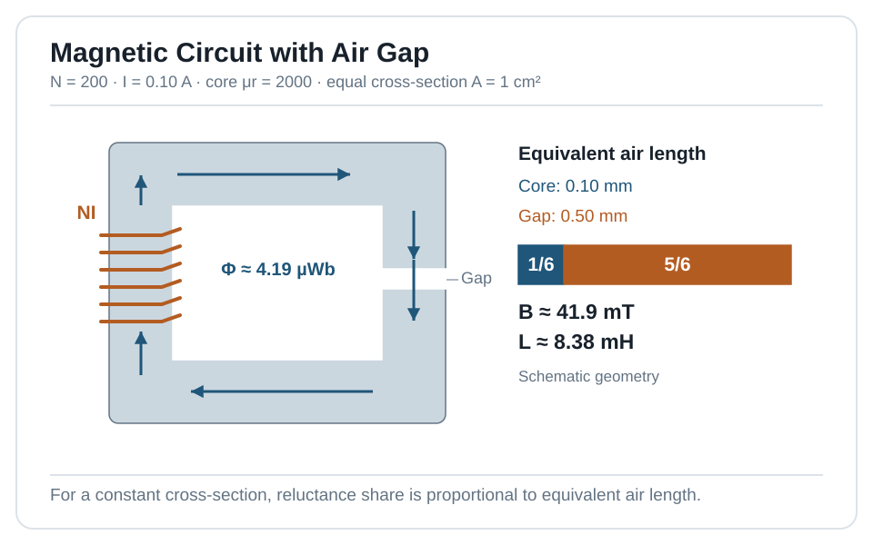

# M4-L3 – Magnetostatics and Magnetic Circuits {#L3}

**Course area:** M4 – Bachelor: Electromagnetic Fields and Waves

**Level:** Bachelor

**Prerequisites:** [Material properties and boundary conditions](M4-L2.md), [Vector calculus and spatial derivatives](M2-L5.md).

**Learning objective:** Distinguish magnetic field strength, flux density and flux, apply Ampère's law and calculate a simple magnetic circuit with an air gap.

## Magnetic field around a conductor {#S1}

A time-independent current produces a magnetic field. For a long, straight wire, the field lines run in circles around the axis of the wire. The right hand indicates their orientation. The thumb points in the direction of conventional current, and the curled fingers indicate the direction of circulation. In the magnetostatic case, if the direction of circulation and the surface normal are defined by the same right-hand rule,

$$
\oint_{\partial S}\mathbf H\cdot\mathrm d\boldsymbol{\ell}
=I_{\mathrm f,S} .
$$

Here $I_{\mathrm f,S}$ is the free current through the oriented surface. $\mathbf H$ is the magnetic field strength in $\mathrm{A/m}$. $\mathbf B$ is the magnetic flux density in tesla, $1\,\mathrm T=1\,\mathrm{Wb/m^2}$. For a linear, isotropic material, $\mathbf B=\mu\mathbf H$ with $\mu=\mu_0\mu_\mathrm r$ and $\mu_0\approx1.257\cdot10^{-6}\,\mathrm{H/m}$. The magnetic flux through an oriented surface is

$$
\Phi=\int_S\mathbf B\cdot\mathrm d\mathbf A .
$$

Only when the normal flux density is uniform does this simplify to $\Phi=B_n A$. The unit of flux is the weber. The total magnetic flux through every closed surface is zero. Consequently, in the simple magnetic circuit every portion of flux leaving the core returns through another section.

## Simple field models {#S2}

For a very long wire in air, cylindrical symmetry gives $H=I/(2\pi r)$ outside the wire. For a long coil with $N$ turns and length $\ell$, far from its ends the internal field is approximately $H=(N/\ell)I$. To obtain this result, choose an elongated closed contour with one side inside the nearly uniform coil field and the other in the weak external field.

Example of an air-core coil: The turn density is $1000\,\mathrm{m^{-1}}$, the current is $0.20\,\mathrm A$ and the cross-sectional area is $2.0\,\mathrm{cm^2}$. This gives $H=200\,\mathrm{A/m}$, $B\approx251\,\mathrm{\mu T}$ and $\Phi\approx50.3\,\mathrm{nWb}$ per turn penetrated normally by the field in the uniform region.

## Equivalent model with a core and an air gap {#S3}

A closed magnetic path with approximately uniform flux density across the cross-sectional area $A$ can be divided into sections. Ampère's law is approximated by $\sum_i H_i\ell_i=NI$. With $H_i=B_i/\mu_i$ and negligible leakage flux,

$$
NI=\Phi\sum_i\frac{\ell_i}{\mu_i A_i}
=\Phi\mathcal R_\mathrm{m}.
$$

The magnetic reluctance $\mathcal R_\mathrm{m}$ has the unit $\mathrm{A/Wb}=\mathrm{H^{-1}}$. $NI$ is the magnetomotive force. The equivalent model uses the same algebraic form as an electrical series circuit. Here $\Phi$ denotes a flux of the magnetic flux density, not an electric current.

A core has a mean path length of $0.20\,\mathrm m$, $\mu_\mathrm r=2000$ and an air gap of $0.50\,\mathrm{mm}$. Both cross-sectional areas are $1.0\,\mathrm{cm^2}$. With $N=200$ and $I=0.10\,\mathrm A$,

$$
B\approx
\frac{\mu_0 NI}{\ell_\mathrm K/\mu_{\mathrm r,K}+\ell_\mathrm g}
=41.9\,\mathrm{mT},
\qquad
\Phi\approx4.19\,\mathrm{\mu Wb}.
$$

The core contributes an equivalent air length of $0.10\,\mathrm{mm}$. The gap therefore accounts for $5/6$ of the total reluctance. If all $N$ turns link the same flux, the inductance in the linear model is $L=N\Phi/I\approx8.38\,\mathrm{mH}$.

{alt="Schematic core with winding and air gap, closed flux path and bars showing reluctance shares of one sixth for the core and five sixths for the gap."}

The illustration is not to scale. Despite the short air gap, most of the magnetic reluctance is concentrated there; leakage flux and fringing are neglected as in the calculation.

## Self-check and further study {#S4}

1. How does the external field of a long wire change when the distance doubles?
2. The air gap in the example is increased to $1.0\,\mathrm{mm}$. Calculate the new flux density and flux.

**Solutions.** 1. $H$ is halved, as is $B$ in the same surroundings. The direction of circulation remains the same if the current is unchanged. 2. The denominator grows from $0.60$ to $1.10\,\mathrm{mm}$. $B$ is about $22.8\,\mathrm{mT}$, and $\Phi$ is about $2.28\,\mathrm{\mu Wb}$.

In real cores, $\mu$ and hence $L$ may vary with excitation. Saturation, hysteresis, leakage flux and fringing in the air gap limit the model. [Induction and electromagnetic energy](M4-L4.md) covers the consequences of a change in $\Phi$.

## Sources {#S5}

- [OpenStax – University Physics Volume 2, § 12.5 Ampère’s Law](https://openstax.org/books/university-physics-volume-2/pages/12-5-amperes-law) · Section 12.5 – Ampère's law and the field around a long conductor. · Last accessed: 2026-11-25
- [MIT OpenCourseWare – Electromagnetic Fields and Energy, Chapter 9 Magnetization](https://ocw.mit.edu/courses/res-6-001-electromagnetic-fields-and-energy-spring-2008/d4860fdc85d667828060e6d72e49a62f_09.pdf) · § 9.7 on the equivalent magnetic circuit. · Last accessed: 2026-11-25
