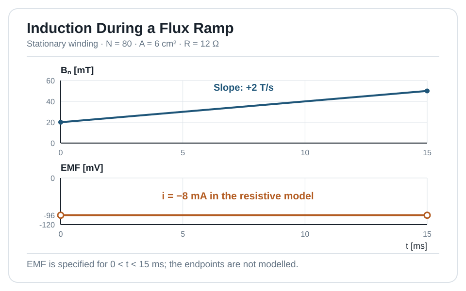

# M4-L4 – Induction and Electromagnetic Energy {#L4}

**Course area:** M4 – Bachelor: Electromagnetic Fields and Waves

**Level:** Bachelor

**Prerequisites:** [Magnetostatics and magnetic circuits](M4-L3.md), [Calculus and differential equations for time-dependent models](M2-L3.md).

**Learning objective:** Determine the induced electromotive force of a stationary coil using a consistent orientation and explain energy transfer in the model.

## A changing flux produces an electromotive force {#S1}

A stationary conducting loop in a constant magnetic field has no electromotive force induced by that field. If the flux density within the loop changes, however, an electric field can arise along the wire. Its circulation is generally non-zero. This distinguishes the case from electrostatics, where all electric field components can be derived from a scalar potential.

Choose the surface normal $\mathbf n$ of a stationary loop. The positive direction of circulation around the boundary $\partial S$ then follows from the right-hand rule. With $\mathrm d\mathbf A=\mathbf n\,\mathrm dA$,

$$
\Phi(t)=\int_S\mathbf B(\mathbf r,t)\cdot\mathrm d\mathbf A,
\qquad
\mathcal E=\oint_{\partial S}\mathbf E\cdot\mathrm d\boldsymbol\ell
=-\frac{\mathrm d\Phi}{\mathrm dt}.
$$

Here $\mathcal E$ denotes the induced electromotive force (EMF) in volts. Despite its name, it is energy per unit charge and does not have units of force. For $N$ equally oriented turns linking the same flux, $\mathcal E=-N\,\mathrm d\Phi/\mathrm dt$ follows.

## Lenz's law as a sign check {#S2}

If a positive flux increases, $\mathcal E<0$. In a closed loop modelled as purely resistive, the current then flows opposite to the positive direction of circulation. Its magnetic field opposes the **increase** in the original flux. If the positive flux decreases, the induced current flows in the opposite direction. It is therefore the change in flux that matters. Even a large but constant field still gives $\mathcal E=0$ in this model.

Reversing the normal also reverses the positive direction of circulation. The flux, EMF and calculated current then change sign. The physical direction of current, determined by the current value **and** its associated reference direction, remains the same.

## Worked example: a flux ramp {#S3}

A stationary winding with $N=80$ and $A=6.0\,\mathrm{cm^2}$ per turn is placed in a spatially uniform field. The normal flux density increases uniformly from $20$ to $50\,\mathrm{mT}$ in $15\,\mathrm{ms}$. The modelled loop resistance is $12\,\Omega$. We consider the interior of the ramp interval and neglect self-inductance. In SI units:

$$
\dot B_n=\frac{0.050-0.020}{0.015}\,\mathrm{T/s}
=2.0\,\mathrm{T/s},
\quad
\mathcal E=-N A\dot B_n=-96\,\mathrm{mV},
\quad
i=\frac{\mathcal E}{R}=-8.0\,\mathrm{mA}.
$$

The heat dissipated per unit time in the resistor is $P=Ri^2=0.768\,\mathrm{mW}$. Approximately $11.5\,\mathrm{\mu J}$ is therefore dissipated during the ramp. An external device maintaining the increasing field must supply energy to this coupled system. The negative sign of $i$ describes its direction and does not produce negative power dissipation.

{alt="Time plots of a flux-density ramp from 20 to 50 millitesla and the constant negative EMF of 96 millivolts within the ramp interval."}

The EMF follows from the slope with respect to time, not the instantaneous magnitude of the flux density. The open circles indicate that the endpoints of the ramp are not treated in the simplified model.

## Self-induction and energy in the field {#S4}

A winding generates its own flux as the current increases. For a linear inductance, the flux linkage is $\Psi=Li$. The induced EMF is $-\mathrm d\Psi/\mathrm dt$. When the same component is written into a circuit using the **passive sign convention**, its terminal voltage is $u_L=L\,\mathrm di/\mathrm dt$. Then $u_L i$ is the power entering the component at its terminals:

$$
W_\mathrm m=\int_0^i L i'\,\mathrm di'=\frac12 L i^2.
$$

A lossless linear magnetic medium locally stores an energy density $w_\mathrm m=\mathbf B\cdot\mathbf H/2$ in $\mathrm{J/m^3}$. In a real winding, field energy storage and material losses must be considered separately.

## Self-check and further study {#S5}

1. In the flux ramp, $B_n$ decreases from $50$ to $20\,\mathrm{mT}$ over the same period. How do the results change?
2. How much energy does a linear coil with $L=8\,\mathrm{mH}$ store at $i=0.10\,\mathrm A$?

**Solutions.** 1. $\mathcal E=+96\,\mathrm{mV}$, $i=+8.0\,\mathrm{mA}$. The quadratic power dissipation and energy remain unchanged. 2. $W_\mathrm m=40\,\mathrm{\mu J}$.

The example assumes a fixed loop geometry and a prescribed external field. With rapid changes or large self-inductance, the winding and its coupling influence the time response. In moving conductors, the magnetic force on moving charge also contributes to the EMF. [Maxwell's equations and wave propagation](M4-L5.md) summarises the mutual coupling of the fields.

## Sources {#S6}

- [OpenStax – University Physics Volume 2, § 13.1 Faraday’s Law](https://openstax.org/books/university-physics-volume-2/pages/13-1-faradays-law) · Section 13.1 – Flux change and induced EMF. · Last accessed: 2026-11-25
- [OpenStax – University Physics Volume 2, § 13.2 Lenz’s Law](https://openstax.org/books/university-physics-volume-2/pages/13-2-lenzs-law) · Section 13.2 – Current direction for increasing or decreasing flux. · Last accessed: 2026-11-25
- [OpenStax – University Physics Volume 2, § 14.3 Energy in a Magnetic Field](https://openstax.org/books/university-physics-volume-2/pages/14-3-energy-in-a-magnetic-field) · Section 14.3 – Inductance energy and field energy density. · Last accessed: 2026-11-25
