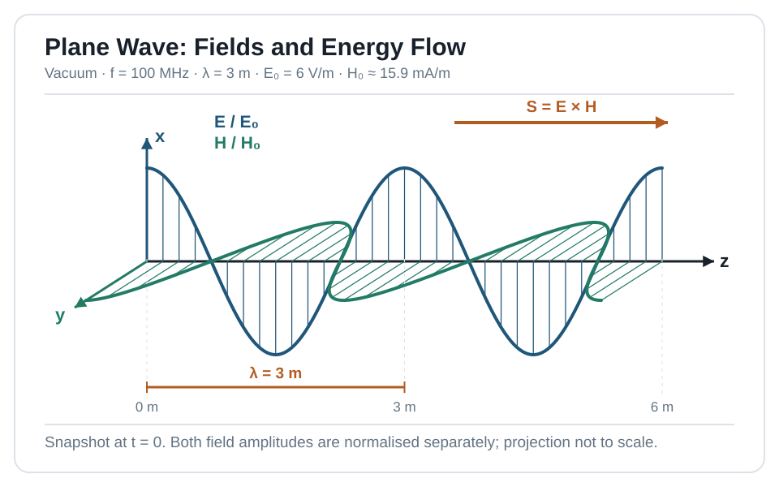

# M4-L5 – Maxwell's Equations and Wave Propagation {#L5}

**Course area:** M4 – Bachelor: Electromagnetic Fields and Waves

**Level:** Bachelor

**Prerequisites:** [Vector calculus and spatial derivatives](M2-L5.md), [Induction and electromagnetic energy](M4-L4.md).

**Learning objective:** Identify the sources and curls of electromagnetic fields and determine the direction, propagation speed and power flow of a plane wave.

## Four equations and the material description {#S1}

The differential form of Maxwell's equations describes fields in space and time. In macroscopic SI notation:

| Equation | Meaning |
| --- | --- |
| $\nabla\cdot\mathbf D=\rho_\mathrm f$ | Free charge density is the source of electric flux density. |
| $\nabla\cdot\mathbf B=0$ | The net magnetic flux through any closed surface is zero. |
| $\nabla\times\mathbf E=-\partial_t\mathbf B$ | A change in magnetic flux density produces a curl of the electric field. |
| $\nabla\times\mathbf H=\mathbf J_\mathrm f+\partial_t\mathbf D$ | Free current and time-varying electric flux density contribute to the curl of the magnetic field. |

$\rho_\mathrm f$ is measured in $\mathrm{C/m^3}$ and $\mathbf J_\mathrm f$ in $\mathrm{A/m^2}$. The derivative $\partial_t\mathbf D$ has the same units as free current density. This term is called the displacement current density. Taking the divergence of the last equation gives zero on the left-hand side. Together with Gauss's law for electricity, this yields $\partial_t\rho_\mathrm f+\nabla\cdot\mathbf J_\mathrm f=0$. The change in free charge with time is thus linked to the free current.

Material relations are also required. In a linear, lossless, isotropic medium with constant $\varepsilon,\mu>0$, we have $\mathbf D=\varepsilon\mathbf E$ and $\mathbf B=\mu\mathbf H$.

## Why a change propagates {#S2}

Consider such a medium without free charge or free current. One model case has fields $\mathbf E=E_x(z,t)\mathbf e_x$ and $\mathbf H=H_y(z,t)\mathbf e_y$. Both are independent of $x$ and $y$. The curl equations yield:

$$
\partial_z E_x=-\mu\partial_t H_y,
\qquad
\partial_z H_y=-\varepsilon\partial_t E_x.
$$

Differentiating the first equation with respect to $z$ and substituting the second gives $\partial_z^2 E_x=\mu\varepsilon\partial_t^2 E_x$. For propagation in the positive $z$ direction, this wave equation has solutions of the form $E_x(z,t)=E_0\cos(\omega t-kz)$ with $k=\omega/v$. The speed is $v=1/\sqrt{\mu\varepsilon}$, and the wavelength is $\lambda=v/f$ with $f=\omega/(2\pi)$. In a vacuum, $v$ equals the speed of light $c$.

For the forward-travelling wave, $H_y=E_x/\eta$, where the wave impedance is $\eta=\sqrt{\mu/\varepsilon}$ in ohms. The field directions $\mathbf E,\mathbf H$ and the propagation direction are mutually perpendicular. If the propagation direction is reversed while the electric polarisation direction remains the same, the sign of $H_y$ relative to $E_x$ changes.

## Power flow and example {#S3}

The Poynting vector $\mathbf S=\mathbf E\times\mathbf H$ has units of $\mathrm{W/m^2}$. In the example it points in the positive $z$ direction. Averaged over one period, $\langle S_z\rangle=E_0^2/(2\eta)$, where $E_0$ is the **peak value**. The $2$ in the denominator comes from the time average of $\cos^2$.

For $f=100\,\mathrm{MHz}$ and $E_0=6.0\,\mathrm{V/m}$ in a vacuum, using $c\approx3.00\cdot10^8\,\mathrm{m/s}$ and $\eta_0\approx377\,\Omega$, the results are:

| Quantity | Result |
| --- | --- |
| Wavelength $\lambda$ | $3.00\,\mathrm m$ |
| Peak magnetic field strength $H_0$ | $15.9\,\mathrm{mA/m}$ |
| Peak magnetic flux density $B_0$ | $20.0\,\mathrm{nT}$ |
| Mean power flux density | $47.7\,\mathrm{mW/m^2}$ |

{alt="Spatial projection of a plane wave: electric field strength in the x direction and magnetic field strength in the y direction, both sinusoidal and in phase, with propagation and energy flow in the positive z direction."}

Both sinusoidal curves show the field components at the same instant, each normalised to its own peak value. They are not particle trajectories. The axes are oriented so that the cross product of the electric and magnetic fields points in the positive z direction.

## Self-check and further study {#S4}

1. Calculate $v$, $\lambda$ and $\eta$ at the same frequency in an ideal medium with $\varepsilon_\mathrm r=4$ and $\mu_\mathrm r=1$.
2. A forward-travelling wave has $\mathbf E$ in the direction $\mathbf e_y$ and $\mathbf H$ in the direction $-\mathbf e_x$. In which direction does the energy flow?

**Solutions.** 1. $v=c/2$, $\lambda\approx1.50\,\mathrm m$ and $\eta=\eta_0/2\approx188.5\,\Omega$. 2. $\mathbf e_y\times(-\mathbf e_x)=\mathbf e_z$.

A spatially infinite plane wave is a model. Finite sources can produce curved wavefronts and complex near fields. Losses or frequency-dependent material properties alter attenuation and phase behaviour. [Waves at boundaries and on transmission lines](M4-L6.md) shows how a wave splits at an interface.

## Sources {#S5}

- [OpenStax – University Physics Volume 2, § 16.1 Maxwell’s Equations and Electromagnetic Waves](https://openstax.org/books/university-physics-volume-2/pages/16-1-maxwells-equations-and-electromagnetic-waves) · Section 16.1 – Relationship between the four field equations. · Last accessed: 2026-11-25
- [OpenStax – University Physics Volume 2, § 16.2 Plane Electromagnetic Waves](https://openstax.org/books/university-physics-volume-2/pages/16-2-plane-electromagnetic-waves) · Section 16.2 – Wave equation, field directions and wavelength. · Last accessed: 2026-11-25
- [OpenStax – University Physics Volume 2, § 16.3 Energy Carried by Electromagnetic Waves](https://openstax.org/books/university-physics-volume-2/pages/16-3-energy-carried-by-electromagnetic-waves) · Section 16.3 – Poynting vector and mean power flux density. · Last accessed: 2026-11-25
