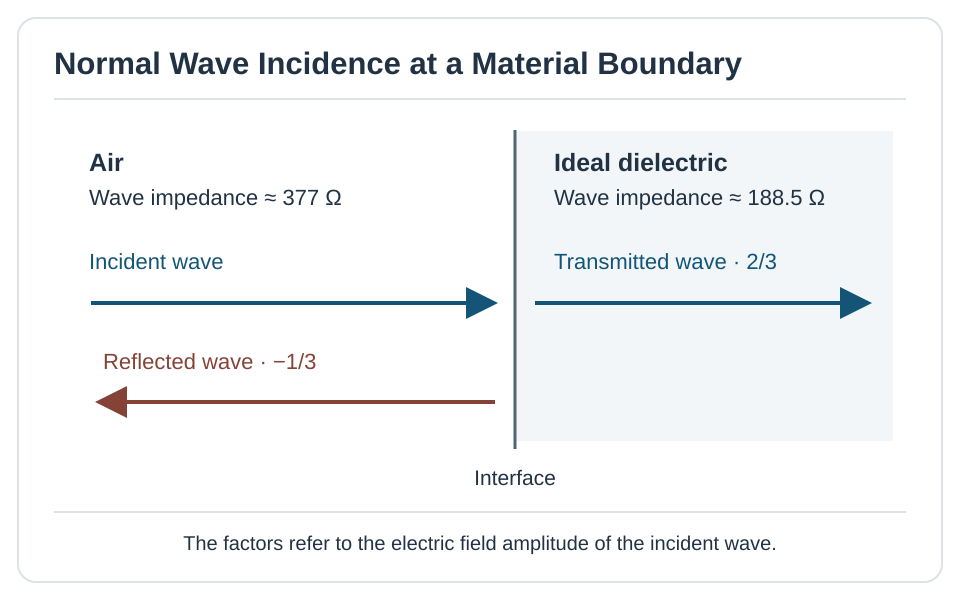

# M4-L6 – Waves at Boundaries and on Transmission Lines {#L6}

**Course area:** M4 – Bachelor: Electromagnetic Fields and Waves

**Level:** Bachelor

**Prerequisites:** [Maxwell's equations and wave propagation](M4-L5.md), [Sinusoidal alternating current and complex impedance](M1-L6.md).

**Learning objective:** Calculate reflection coefficients for normal wave incidence and for an idealised transmission line, distinguish field ratios from power ratios and interpret propagation delays.

## A plane wave arrives at a boundary at normal incidence {#S1}

A wave travels from medium 1 with wave impedance $\eta_1$ towards a planar boundary with medium 2, which has wave impedance $\eta_2$. Both media are assumed to be homogeneous and lossless. The electric polarisation is parallel to the interface. We denote the complex amplitudes at the boundary, referenced to the same electric field direction, by $E_\mathrm i$, $E_\mathrm r$ and $E_\mathrm t$ for the incident, reflected and transmitted waves.

In the absence of an impressed surface current, the tangential fields are continuous across the boundary. For the backward-travelling wave, the magnetic field has the opposite sign relative to the electric field. Hence:

$$
E_\mathrm i+E_\mathrm r=E_\mathrm t,\qquad
\frac{E_\mathrm i-E_\mathrm r}{\eta_1}=\frac{E_\mathrm t}{\eta_2}.
$$

Solving for the electric field amplitude ratios gives

$$
\Gamma_E=\frac{E_\mathrm r}{E_\mathrm i}
=\frac{\eta_2-\eta_1}{\eta_2+\eta_1},
\qquad
\frac{E_\mathrm t}{E_\mathrm i}=1+\Gamma_E .
$$

The mean reflected power per unit area as a fraction of the incident power per unit area is $\mathcal R=|\Gamma_E|^2$. The transmitted power ratio, by contrast, is $\mathcal T=(\eta_1/\eta_2)|1+\Gamma_E|^2$. The impedance factor arises from the relationship between electric field amplitude and power flow in the respective medium.

## Example: air and an idealised dielectric {#S2}

From air with $\eta_1\approx377\,\Omega$, the wave encounters a medium with $\varepsilon_\mathrm r=4$ and $\mu_\mathrm r=1$. Thus $\eta_2\approx188.5\,\Omega$. The amplitude ratios are $\Gamma_E=-1/3$ and $E_\mathrm t/E_\mathrm i=2/3$. At the boundary, the reflected electric component is phase-shifted by $\pi$ relative to the incident component. The power fractions are $\mathcal R=1/9$ and $\mathcal T=8/9$. Their sum is one.

{alt="Normal incidence at a lossless boundary. The reflected electric field has a relative factor of −1/3. The transmitted field has a factor of 2/3."}

## Voltage waves on a transmission line {#S3}

An idealised, lossless two-conductor transmission line also carries forward- and backward-travelling waves. Its real characteristic impedance $Z_0$ is the ratio of voltage amplitude to current amplitude for a **single** forward-travelling wave. At the termination $Z_L$, with the reference direction of current towards the load,

$$
U_L=U^++U^-,
\qquad
I_L=\frac{U^+-U^-}{Z_0},
\qquad
\Gamma_U=\frac{U^-}{U^+}=\frac{Z_L-Z_0}{Z_L+Z_0}.
$$

For $Z_L=Z_0$, reflection at the load end vanishes. An ideal open circuit gives $\Gamma_U=+1$ and $I_L=0$. For an ideal short circuit, $\Gamma_U=-1$ and $U_L=0$. Both reflect all the incident power in the lossless model.

A $50\,\Omega$ line with $Z_L=100\,\Omega$ receives a forward-travelling voltage of $1.0\,\mathrm V$ peak at the termination. Then $\Gamma_U=1/3$, so $U_L=1.333\,\mathrm V$ and $I_L=13.33\,\mathrm{mA}$ are peak values. The mean load power is $U_L^2/(2Z_L)\approx8.89\,\mathrm{mW}$. The forward-travelling wave carries $10\,\mathrm{mW}$ and the backward-travelling wave about $1.11\,\mathrm{mW}$. The difference corresponds to the power in the load.

## Propagation delay, self-check and further study {#S4}

For $\ell=10\,\mathrm m$ and $v=2.0\cdot10^8\,\mathrm{m/s}$, a change takes $50\,\mathrm{ns}$ to reach the load end. A reflection generated there reaches the source after a further $50\,\mathrm{ns}$. Steady-state phasors describe the settled sinusoidal response, but do not themselves describe the initial switching wavefront. With fast edges, a line can be electrically long even at a low repetition frequency. For a rough approximation as a lumped connection, its propagation delay must be much shorter than the characteristic signal transition times.

1. What results at the end of the same $50\,\Omega$ line for $Z_L=25\,\Omega$ with the forward-travelling amplitude unchanged?
2. What is the round-trip propagation delay if the line length is halved?

**Solutions.** 1. $\Gamma_U=-1/3$, $U_L\approx0.667\,\mathrm V$, $I_L\approx26.7\,\mathrm{mA}$. The load absorbs about $8.89\,\mathrm{mW}$ because the reflected power fraction remains $1/9$. 2. The total round-trip propagation delay is $50\,\mathrm{ns}$.

For oblique incidence, polarisation is relevant to reflection. Real transmission lines may exhibit attenuation, dispersion and additional modes. [Back to the study pathway](pages/study-path.md).

## Sources {#S5}

- [Steven W. Ellingson – Electromagnetics, Volume 2 (2020, VT Publishing, PDF)](https://vtechworks.lib.vt.edu/bitstream/handle/10919/93253/Electromagnetics_Vol2_screen-reader-friendly.pdf) · § 5.1, pp. 56–59: normal incidence, boundary conditions and reflection. · Last accessed: 2026-11-25
- [Steven W. Ellingson – Electromagnetics, Volume 1 (2018, VT Publishing, PDF)](https://vtechworks.lib.vt.edu/bitstream/handle/10919/84164/Electromagnetics_Vol1_screen-reader-friendly.pdf) · § 3.12, pp. 47–48, Eq. 3.86: voltage reflection coefficient and line termination. · Last accessed: 2026-11-25
