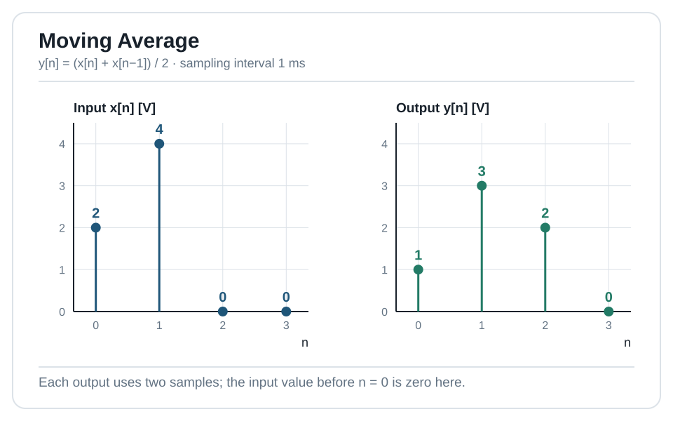

# M5-L1 – Signals, Systems and Linearity {#L1}

**Course area:** M5 – Bachelor: Signals and Systems

**Level:** Bachelor

**Prerequisites:** Sine functions, exponential functions and complex phasors from [M2-L4](M2-L4.md). The step response from [M1-L5](M1-L5.md) serves as a first example of a system.

**Learning objective:** Distinguish continuous-time and discrete-time signals and test a signal model for linearity, time invariance, causality and boundedness.

## A measured voltage and its samples {#S1}

A vibration sensor supplies a voltage $x(t)$ at every instant $t$. With a sampling interval $T_\mathrm s$, the computer receives only the sequence $x[n]=x(nT_\mathrm s)$, where $n$ is an integer. Consecutive elements of the sequence are separated by an interval of $T_\mathrm s$. For $T_\mathrm s=1\,\mathrm{ms}$, $x[4]$ corresponds to the time $4\,\mathrm{ms}$. Hereafter, parentheses denote continuous time and square brackets denote discrete time.

Time discretisation determines when a quantity is acquired. Quantisation determines which values the digital representation can take. A real-valued sequence in a model can therefore already be discrete in time before an analogue-to-digital converter maps it to numbers with finite resolution.

A system $T$ maps an input $x$ to an output $y=T\{x\}$. The initial state is also part of this mapping. When characterising a circuit as a system for input signals, we first set its dynamic state to zero. A precharged capacitor would produce an additional free response.

## Four distinct properties {#S2}

**Linearity.** For input signals $x_1,x_2$ and constant factors $a,b$, the following must hold:

$$
T\{a x_1+b x_2\}=aT\{x_1\}+bT\{x_2\}.
$$

This incorporates scaling and addition. The equation implies $T\{0\}=0$. A constant measurement offset makes the mapping $T\{x\}=x+c$ affine for $c\ne0$. A converter with a quadratic characteristic $T\{x\}=x^2$ violates scaling because doubling the input quadruples the output.

**Time invariance.** If the input arrives $n_0$ samples later, the output must likewise be shifted by exactly $n_0$ samples. Formally, for the shift operator $D_{n_0}x[n]=x[n-n_0]$, the equality $T\{D_{n_0}x\}=D_{n_0}T\{x\}$ holds. Time-dependent gain violates this property despite being linear. For $T\{x\}[n]=n x[n]$, the results $n x[n-n_0]$ and $(n-n_0)x[n-n_0]$ are generally different.

**Causality.** If two inputs are identical up to and including $n$, the output up to $n$ must not depend on how the two inputs continue afterwards. Thus $y[n]=x[n+1]$ is non-causal. Offline processing of recorded data can use such look-ahead values.

**BIBO stability.** An input that is bounded at all times must produce a bounded output. This test concerns finite output values and by itself says nothing about the internal state stability of an arbitrary realisation.

## Example: Moving average in a sensor channel {#S3}

A measurement computer displays $y[n]=(x[n]+x[n-1])/2$. The output uses the current and previous values. For the first input samples $x[0]=2\,\mathrm V$, $x[1]=4\,\mathrm V$ and $x[2]=0\,\mathrm V$ with $x[-1]=0\,\mathrm V$, the result is:

| Index $n$ | Input sample | Displayed average |
| ---: | ---: | ---: |
| 0 | $2\,\mathrm V$ | $1\,\mathrm V$ |
| 1 | $4\,\mathrm V$ | $3\,\mathrm V$ |
| 2 | $0\,\mathrm V$ | $2\,\mathrm V$ |
| 3 | $0\,\mathrm V$ | $0\,\mathrm V$ |

The expression adds delayed input values with constant weights. It is therefore linear and time invariant. It is causal. If every magnitude satisfies $|x[n]|\le M$, the triangle inequality also gives $|y[n]|\le M$. The assumption about the value before measurement explains the initial value here. In an actual recalculation, the first value could be weighted twice or processing could begin only once two measured values are available. This boundary handling is part of the definition of the processing operation.

{alt="Two discrete stem plots: input samples of 2, 4, 0 and 0 volts, output samples of 1, 3, 2 and 0 volts."}

The individual points are samples, not continuous curves. The output at index two remains at two volts even though the input has fallen to zero, because the previous sample contributes to the average.

## Self-assessment {#S4}

1. Which input times are required by $y[n]=(x[n-1]+x[n+1])/2$? Is the system linear, time invariant and causal?
2. Is an integrator $y(t)=\int_0^t x(\tau)\,\mathrm d\tau$ BIBO stable for $t\ge0$? Use a bounded constant input.

### Solutions

1. The average uses the previous and next values. The weights are constant, so the mapping is linear and time invariant. The next value makes it non-causal.
2. For $x(t)=1$, $y(t)=t$. Although the input remains bounded, the output grows without bound. This input disproves BIBO stability.

## Scope and further study {#S5}

In real sensors, linearity and time invariance often hold only within an operating range. Saturation, drift and changing processing are separate effects. In [M5-L2](M5-L2.md), we use linearity and time invariance to derive the response to an arbitrary signal from a short test signal.

## Sources {#S6}

- [MIT OpenCourseWare, 6.003 Signals and Systems, Lecture 1: Signals and Systems](https://ocw.mit.edu/courses/6-003-signals-and-systems-fall-2011/resources/mit6_003f11_lec01/) · signal and system properties · Last accessed: 2026-11-25
