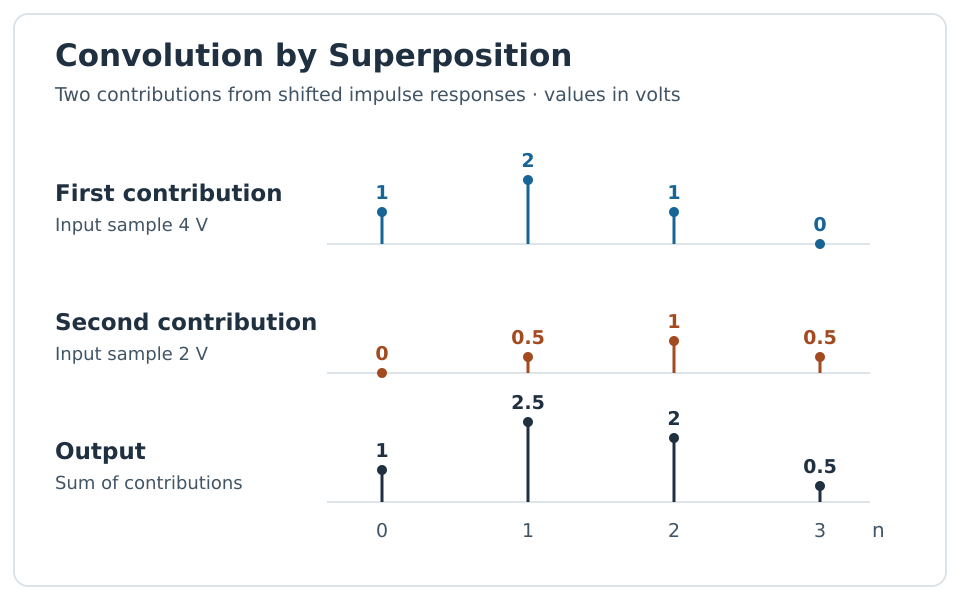

# M5-L2 – Impulse Response and Convolution {#L2}

**Course area:** M5 – Bachelor: Signals and Systems

**Level:** Bachelor

**Prerequisites:** Discrete-time sequences, linearity, time invariance and causality from [M5-L1](M5-L1.md).

**Learning objective:** Calculate a discrete convolution by hand, understand its continuous counterpart, and draw conclusions about delay, causality and stability from an impulse response.

## A system test with a single input value {#S1}

The unit impulse $\delta[n]$ equals one at $n=0$ and is zero at all other indices. The **impulse response** of a linear time-invariant system is $h[n]=T\{\delta\}[n]$. Every finite-length sequence is a sum of weighted, shifted impulses. The response to $x[k]\delta[n-k]$ is therefore $x[k]h[n-k]$. The sum of the individual responses is called **convolution**:

$$
x[n]=\sum_{k=-\infty}^{\infty}x[k]\delta[n-k],
\qquad
y[n]=(x*h)[n]=\sum_{k=-\infty}^{\infty}x[k]h[n-k].
$$

For infinite sequences, the sum must exist for the input under consideration. The formula does not specify a separate initial state. Any output component arising from an initial state is accounted for separately in a particular differential or difference equation where necessary.

{alt="An input consisting of two impulses produces two time-shifted copies of the same impulse response with different heights. Superposition yields four output values."}

## From reading the plot to calculation {#S2}

A filter distributes an input sample over three consecutive output values. Its dimensionless impulse response is $h[0]=1/4$, $h[1]=1/2$, $h[2]=1/4$, with all other values zero. Let the input be $x[0]=4\,\mathrm V$, $x[1]=2\,\mathrm V$ and zero elsewhere. Write two rows of weighted copies of $h$ and add them column by column:

| Index $n$ | $0$ | $1$ | $2$ | $3$ |
| --- | ---: | ---: | ---: | ---: |
| $4h[n]$ in volts | 1 | 2 | 1 | 0 |
| $2h[n-1]$ in volts | 0 | 0.5 | 1 | 0.5 |
| $y[n]$ in volts | 1 | 2.5 | 2 | 0.5 |

At index $n=2$, the convolution formula gives, for example, $4\,\mathrm V\cdot h[2]+2\,\mathrm V\cdot h[1]=2\,\mathrm V$. Beyond $n=3$, no product is non-zero. For finite sequences of lengths $M$ and $N$ that begin and end with non-zero entries, the linear convolution has length $M+N-1$. The check $\sum_n y[n]=(\sum_n x[n])(\sum_n h[n])$ gives $6\,\mathrm V$ here and helps reveal a forgotten boundary value, for example. The resulting four values are instantaneous values at four sampling times.

## Continuous time, causality and stability {#S3}

The continuous-time impulse $\delta(t)$ is a distribution. It is characterised by its sifting property $\int x(\tau)\delta(t-\tau)\,\mathrm d\tau=x(t)$. The continuous counterpart is therefore

$$
(x*h)(t)=\int_{-\infty}^{\infty}x(\tau)h(t-\tau)\,\mathrm d\tau.
$$

For an ordinary continuous-time impulse response of an LTI system, causality means $h(t)=0$ for $t<0$. In discrete time, the condition is $h[n]=0$ for $n<0$. A causal impulse response accesses only present and past input values in the convolution.

For BIBO stability, the discrete convolution test requires $\sum_n |h[n]|<\infty$. Multiplying this sum by the input bound $M$ yields an upper bound for $|y[n]|$. In the continuous case with an ordinary impulse response, the corresponding condition is $\int |h(t)|\,\mathrm dt<\infty$. A system with direct feedthrough can additionally contain a weighted Dirac impulse. Its contribution is a scaled input signal.

## Self-assessment {#S4}

1. Shift the entire input of the table example three samples to the right. At which indices do the four output values occur?
2. Let the causal response be $h[n]=2^{-n}$ for $n\ge0$. Calculate the upper bound of $|y[n]|$ for $|x[n]|\le3\,\mathrm V$.

### Solutions

1. Time invariance shifts the output sequence by three samples. The values are output for $n=3,4,5,6$ in the same order.
2. The series $\sum_{n=0}^\infty 2^{-n}$ equals two. The bound on the output magnitude is therefore $6\,\mathrm V$. A constant positive input reaches this bound if it is also present for all negative indices in the model.

## Scope and further study {#S5}

A single impulse response describes a system completely when the LTI assumptions hold and the input is the only excitation. In a recording of finite duration, missing boundary values can affect the processing. [M5-L3](M5-L3.md) shows how convolution can be replaced by multiplication in the frequency domain.

## Sources {#S6}

- [MIT OpenCourseWare, 6.003 Signals and Systems, Lecture 8: Convolution](https://ocw.mit.edu/courses/6-003-signals-and-systems-fall-2011/resources/mit6_003f11_lec08/) · impulse decomposition, convolution and examples · Last accessed: 2026-11-25
