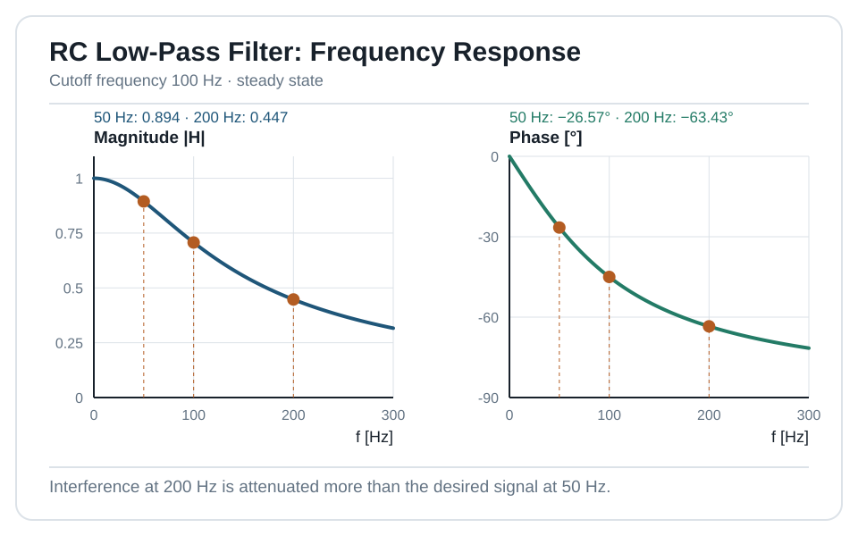

# M5-L3 – Fourier Analysis, Spectra and Frequency Response {#L3}

**Course area:** M5 – Bachelor: Signals and Systems

**Level:** Bachelor

**Prerequisites:** Complex exponential functions from [M2-L4](M2-L4.md) and impulse responses from [M5-L2](M5-L2.md).

**Learning objective:** Distinguish the Fourier series, Fourier transform and DFT by their respective applications, and calculate the amplitude and phase of a sensor signal after a low-pass filter.

## Time history and frequency representation {#S1}

A periodic oscillation with fundamental frequency $f_0$ can, under suitable conditions, be decomposed into components at frequencies $k f_0$. This is the purpose of the Fourier series. For an aperiodic signal with a finite integral of its absolute value, one can, for example, use this convention for the continuous Fourier transform:

$$
X(f)=\int_{-\infty}^{\infty}x(t)\,\mathrm e^{-\mathrm j2\pi ft}\,\mathrm dt,
\qquad
x(t)=\int_{-\infty}^{\infty}X(f)\,\mathrm e^{+\mathrm j2\pi ft}\,\mathrm df
$$

The inverse formula applies where the necessary conditions are satisfied. Here $f$ denotes frequency in hertz, $t$ denotes time in seconds and $\mathrm j^2=-1$. In the phasor representation of [M1-L6](M1-L6.md), $\omega=2\pi f$ denotes angular frequency. In complex representation, a real cosine consists of two exponential functions with conjugate coefficients at $+f_0$ and $-f_0$. The initial phase determines their angles. A sinusoidal oscillation of unlimited duration does not have a finite integral of its absolute value. Its continuous spectrum is represented in the generalised sense as a pair of spectral lines.

## Measurement record and DFT {#S2}

A measurement of $N$ samples at $f_\mathrm s$ has a discrete Fourier transform with $N$ output values. Choose

$$
X[k]=\sum_{n=0}^{N-1}x[n]\,\mathrm e^{-\mathrm j2\pi kn/N},
\qquad
x[n]=\frac1N\sum_{k=0}^{N-1}X[k]\,\mathrm e^{+\mathrm j2\pi kn/N}.
$$

The frequency spacing is $\Delta f=f_\mathrm s/N$. In the upper part of the index range, the frequencies can be read as $(k-N)\Delta f$. Consider $x[n]=2\,\mathrm V\cos(2\pi n/8)$ with $N=8$ and $f_\mathrm s=800\,\mathrm{Hz}$. The window contains exactly one period. The only non-zero DFT values are $X[1]=X[7]=8\,\mathrm V$. They correspond to $+100$ and $-100\,\mathrm{Hz}$. The peak value of the original cosine is $2|X[1]|/8=2\,\mathrm V$. The doubling applies to such a pair of spectral lines other than the DC component and the Nyquist frequency. If the data do not align with the period boundaries, energy of the observed tone spreads across several DFT indices with a rectangular window. This is called **spectral leakage**.

## Frequency response and a sensor example {#S3}

From the convolution $y=x*h$, it follows for the LTI system that $Y(f)=H(f)X(f)$. For a single sinusoidal component in steady state, $|H(f)|$ scales the amplitude and $\arg H(f)$ is added to the phase. Consider a normalised RC low-pass filter with cutoff frequency $f_c=100\,\mathrm{Hz}$:

$$
H(f)=\frac1{1+\mathrm j f/f_c},\qquad
|H(f)|=\frac1{\sqrt{1+(f/f_c)^2}},\qquad
\arg H(f)=-\arctan(f/f_c).
$$

The calculated peak amplitudes apply once the free response has decayed:

| Component | Input amplitude | Gain | Output amplitude | Additional phase |
| --- | ---: | ---: | ---: | ---: |
| Desired oscillation at $50\,\mathrm{Hz}$ | $2\,\mathrm V$ | $0.8944$ | $1.7889\,\mathrm V$ | $-26.57^\circ$ |
| Interference at $200\,\mathrm{Hz}$ | $1\,\mathrm V$ | $0.4472$ | $0.4472\,\mathrm V$ | $-63.43^\circ$ |

At the input, the amplitude ratio of the desired signal to the interference is two. At the output, it is four. The filter also shifts the phases and reduces the desired signal amplitude. The appropriate cutoff frequency therefore depends on the tolerable deviations.

{alt="Magnitude and phase frequency responses of an RC low-pass filter with a cutoff frequency of 100 hertz and points at 50, 100 and 200 hertz."}

The orange points mark the desired signal frequency, cutoff frequency and interference frequency. The gain is a ratio, not an output voltage; it must be multiplied by the corresponding input amplitude.

## Self-assessment {#S4}

1. How fine is the DFT frequency grid for a recording with 1000 samples at $8\,\mathrm{kHz}$?
2. Calculate the magnitude and phase of the RC low-pass filter at $f=f_c$.

### Solutions

1. $\Delta f=8000/1000\,\mathrm{Hz}=8\,\mathrm{Hz}$. A finer grid alone does not demonstrate better separability of closely spaced components. Observation duration and window shape affect it.
2. The magnitude is $1/\sqrt2\approx0.7071$, and the phase is $-45^\circ$. In steady state, a sinusoid with a peak of $1\,\mathrm V$ appears at the output with a peak of approximately $0.7071\,\mathrm V$.

## Scope and further study {#S5}

Such a frequency response describes the chosen model within the linear operating range. Changes to the time basis of the data and to scaling must be documented for spectra. In [M5-L4](M5-L4.md), we extend the frequency axis with a complex variable through which free response components and stability can be investigated.

## Sources {#S6}

- [MIT OpenCourseWare, 6.003 Signals and Systems, Lecture 16: Fourier Transform](https://ocw.mit.edu/courses/6-003-signals-and-systems-fall-2011/resources/mit6_003f11_lec16/) · transform and frequency representation · Last accessed: 2026-11-25
- [MIT OpenCourseWare, 6.003 Signals and Systems, Lecture Notes](https://ocw.mit.edu/courses/6-003-signals-and-systems-fall-2011/pages/lecture-notes/) · units 9 and 17–19 on frequency response and discrete frequency representations · Last accessed: 2026-11-25
