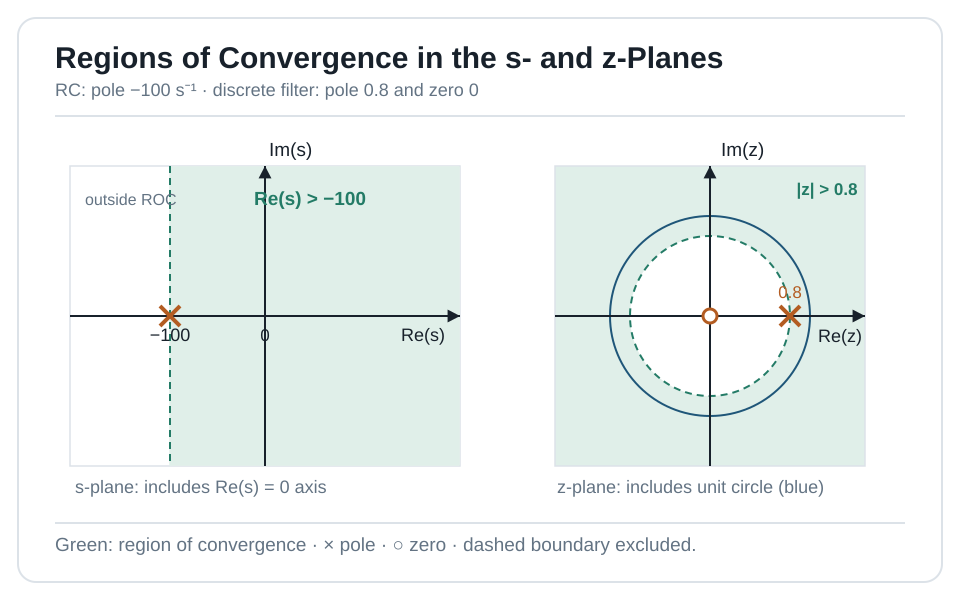

# M5-L4 – Laplace and Z Transforms as System Tools {#L4}

**Course area:** M5 – Bachelor: Signals and Systems

**Level:** Bachelor

**Prerequisites:** Linear differential equations from [M2-L3](M2-L3.md), convolution from [M5-L2](M5-L2.md) and frequency response from [M5-L3](M5-L3.md).

**Learning objective:** Determine poles, zeros and regions of convergence for simple continuous-time and discrete-time systems, and distinguish causal realisation from input-output stability.

## Two transforms for exponential components {#S1}

In continuous-time calculations, the complex variable $s=\sigma+\mathrm j\omega$ replaces the purely oscillatory axis $\mathrm j\omega$. In discrete time, $z=r\mathrm e^{\mathrm j\Omega}$ with $r>0$ and angle $\Omega$ in radians per sample serves this purpose. The bilateral transforms are

$$
H(s)=\int_{-\infty}^{\infty}h(t)\,\mathrm e^{-st}\,\mathrm dt,
\qquad
H(z)=\sum_{n=-\infty}^{\infty}h[n]z^{-n}.
$$

Here $H$ serves as the transfer function corresponding to the respective impulse response. The **region of convergence** specifies the values of $s$ or $z$ for which the integral or sum converges absolutely. It is part of the transform result. The Fourier response is obtained on $\sigma=0$ or $r=1$, provided that this line or circle belongs to the region of convergence. Poles are points where the reduced rational expression becomes unbounded. Zeros are points where it becomes zero. A fully reduced input-output transfer function may conceal internal state modes.

## Continuous-time example {#S2}

The RC low-pass filter in the model $\tau\,\mathrm dy/\mathrm dt+y=x$, with zero initial value and $\tau=0.01\,\mathrm s$, has the causal impulse response $h(t)=100\,\mathrm e^{-100t}u(t)$, where the factor 100 has units of $\mathrm s^{-1}$. Here $u(t)$ denotes the unit step function. Substitution into the integral gives

$$
H(s)=\frac{100}{s+100},
\qquad
\operatorname{Re}(s)>-100\,\mathrm s^{-1}.
$$

The only pole is at $s=-100\,\mathrm s^{-1}$. There is no finite zero. The region of convergence follows from $h(t)\mathrm e^{-st}=100\,\mathrm e^{-(s+100)t}$ for $t\ge0$. The imaginary axis lies in the region, so the filter is BIBO stable. The transfer function describes the forced response with zero initial value. For a non-zero initial capacitor voltage $y(0)$, the free response $y(0)\mathrm e^{-100t}$ is added in the linear model.

The same rational expression, with $\operatorname{Re}(s)<-100\,\mathrm s^{-1}$, corresponds to $-100\,\mathrm e^{-100t}u(-t)$, apart from a single boundary point. This expression grows as $t\to-\infty$. This impulse response is anticausal and BIBO unstable. The pole value alone does not determine it.

## Discrete-time example {#S3}

Consider $y[n]=0.8y[n-1]+0.2x[n]$ without a free initial response. The causal impulse response is $h[n]=0.2(0.8)^n u[n]$. Sum the geometric series:

$$
H(z)=\frac{0.2}{1-0.8z^{-1}}
     =\frac{0.2z}{z-0.8},
\qquad |z|>0.8.
$$

The pole is at $0.8$, and the zero is at $0$. The unit circle lies in the region of convergence. The step response for $x[n]=u[n]$ is $y[n]=1-(0.8)^{n+1}$ for $n\ge0$. It starts with $0.2$ and $0.36$ and approaches one. The limiting value agrees with $H(1)=1$.

For a causal rational input-output system, BIBO stability requires the poles to lie in the open left half-plane or strictly inside the unit circle, respectively. When causality is unknown, examine the region of convergence rather than just the poles.

{alt="Two complex planes: the green region of convergence lies to the right of the pole minus 100 in the s-plane and outside radius 0.8 in the z-plane; the imaginary axis and unit circle, respectively, lie within them."}

The shading shows the respective causal region of convergence within the displayed coordinate range. The blue unit circle is not the pole boundary of the discrete example. For BIBO stability, the decisive point in both cases is that the respective Fourier contour lies entirely in the region of convergence.

## Self-check {#S4}

1. Determine the pole, zero and stability of $H(z)=(1-z^{-1})/(1-0.5z^{-1})$ for a causal response.
2. A bilateral Laplace transform has the region $-4<\operatorname{Re}(s)<-1$, with the boundaries in $\mathrm s^{-1}$. Can the corresponding system be BIBO stable?

### Solutions

1. Multiplying by $z$ gives $(z-1)/(z-0.5)$. The pole is at $0.5$, and the zero is at $1$. The causal region $|z|>0.5$ contains the unit circle. The system is BIBO stable. The zero at $z=1$ suppresses a steady DC component.
2. No. The imaginary axis has real part zero and lies outside the specified region. The ordinary LTI model therefore lacks an absolutely integrable impulse response.

## Scope and further study {#S5}

These examples apply to the stated LTI models and regions of convergence. In [M5-L5](M5-L5.md) we consider the choice of sampling interval before a discrete filter can be applied at all.

## Sources {#S6}

- [MIT OpenCourseWare, 6.003 Signals and Systems, Lecture 6: Laplace Transform](https://ocw.mit.edu/courses/6-003-signals-and-systems-fall-2011/resources/mit6_003f11_lec06/) · Laplace transform, poles and regions of convergence · Last accessed: 2026-11-25
- [MIT OpenCourseWare, 6.003 Signals and Systems, Lecture 5: Z Transform](https://ocw.mit.edu/courses/6-003-signals-and-systems-fall-2011/resources/mit6_003f11_lec05/) · Z transform and discrete systems · Last accessed: 2026-11-25
