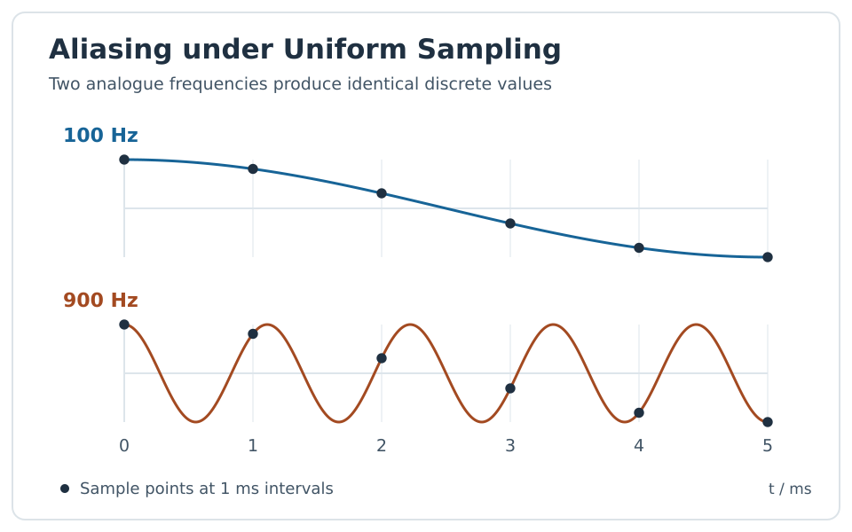

# M5-L5 – Sampling, Aliasing and Digital Filters {#L5}

**Course area:** M5 – Bachelor: Signals and Systems

**Level:** Bachelor

**Prerequisites:** Sample sequences from [M5-L1](M5-L1.md), DFT from [M5-L3](M5-L3.md) and the z-variable from [M5-L4](M5-L4.md).

**Learning objective:** Justify an appropriate sampling rate for a band-limited sensor signal, calculate the alias frequency of two sinusoidal tones and assess a simple digital filter.

## From sensor signal to numerical sequence {#S1}

Uniform sampling produces the samples $x[n]=x(n/f_\mathrm s)$ from $x(t)$. A continuous-time signal with no spectral components outside $[-B,B]$ is uniquely determined by its ideal samples and can be reconstructed ideally if $f_\mathrm s>2B$. This statement assumes an exactly band-limited model, uniform sampling without timing errors and appropriate reconstruction. The frequency $f_\mathrm s/2$ is called the Nyquist frequency. At the limiting case, for example, a sinusoid with a suitable phase shift may be sampled exclusively at its zero crossings.

For a complex oscillation, the analogue frequency $f$ corresponds to the discrete angular frequency $\Omega=2\pi f/f_\mathrm s$. Since $\mathrm e^{\mathrm j2\pi kn}=1$ for integer $k,n$, frequencies $f+k f_\mathrm s$ are indistinguishable after sampling. For real cosine signals, there is also reflection symmetry between positive and negative frequencies at zero phase.

## Computational experiment: Two tones, the same samples {#S2}

At $f_\mathrm s=1000\,\mathrm{Hz}$, a cosine at $100\,\mathrm{Hz}$ and another at $900\,\mathrm{Hz}$ produce the same sequence. Their waveforms differ between the samples. With $900\,\mathrm{Hz}=1000\,\mathrm{Hz}-100\,\mathrm{Hz}$, the angle of the second cosine is $2\pi n-2\pi n/10$. Its cosine equals $\cos(2\pi n/10)$.

{alt="A 100-hertz cosine and a 900-hertz cosine follow different paths between the markers. With uniform sampling at 1000 hertz, both pass through the same markers."}

```python
from math import cos, isclose, pi

sample_rate = 1000
for n in range(6):
    t = n / sample_rate
    slow = cos(2 * pi * 100 * t)
    fast = cos(2 * pi * 900 * t)
    assert isclose(slow, fast, abs_tol=1e-12)
    print(f"{n}: {slow:+.6f}  {fast:+.6f}")
```

The sequence begins with $1$, $0.809017$, $0.309017$, $-0.309017$, $-0.809017$ and $-1$. If the sensor channel contains both tones with the same phase at the time origin, they add after sampling at the apparent frequency of $100\,\mathrm{Hz}$. Subsequent filtering to separate the two individual components is impossible from this sequence alone.

## Analogue prefilter and digital postfilter {#S3}

The analogue **anti-aliasing filter** attenuates frequencies above the intended signal band before sampling. A real filter roll-off requires separation between the end of the signal band and the frequencies to be suppressed. A digital filter can attenuate possible interference within the represented frequency range using the values already sampled. For example, the moving average $y[n]=(x[n]+x[n-1])/2$ from [M5-L1](M5-L1.md) has the frequency response

$$
H(\mathrm e^{\mathrm j\Omega})=\frac{1+\mathrm e^{-\mathrm j\Omega}}{2}
  =\mathrm e^{-\mathrm j\Omega/2}\cos(\Omega/2).
$$

It leaves the DC component unchanged and cancels the alternating sequence $(-1)^n$ at $\Omega=\pi$. For the shared alias at $100\,\mathrm{Hz}$, the magnitude is $\cos(\pi/10)\approx0.9511$. The filter attenuates the two previously merged contributions equally. A suitable analogue prefilter protects the information about the desired tone.

## Self-check {#S4}

1. What apparent frequency is obtained for a zero-phase $720$ Hz cosine sampled at $1000\,\mathrm{Hz}$?
2. A measurement contains desirable signal components up to $180\,\mathrm{Hz}$ and interference above that frequency. What minimum requirement does the ideal sampling theorem impose on $f_\mathrm s$, and why is the numerical value alone insufficient in practice?

### Solutions

1. $720-1000=-280\,\mathrm{Hz}$. For the real zero-phase cosine, a one-sided representation shows $280\,\mathrm{Hz}$.
2. In the ideal band-limited model, $f_\mathrm s>360\,\mathrm{Hz}$ must hold. In the measurement chain, prefiltering, the desired interference attenuation and the actual transition bandwidth must be considered. A slightly greater value alone does not guarantee these properties.

## Scope and further study {#S5}

The example isolates aliasing under uniform sampling. Finite resolution, timing jitter, and windowing and filtering effects are further model components. In [M5-L6](M5-L6.md) we investigate what averaging achieves in the presence of random interference.

## Sources {#S6}

- [MIT OpenCourseWare, 6.003 Signals and Systems, Lecture 21: Sampling](https://ocw.mit.edu/courses/6-003-signals-and-systems-fall-2011/resources/mit6_003f11_lec21/) · sampling theorem, spectral replicas and reconstruction · Last accessed: 2026-11-25
- [MIT OpenCourseWare, 6.003 Signals and Systems, Lecture Notes](https://ocw.mit.edu/courses/6-003-signals-and-systems-fall-2011/pages/lecture-notes/) · units 18 and 22 on discrete frequency response and quantisation · Last accessed: 2026-11-25
