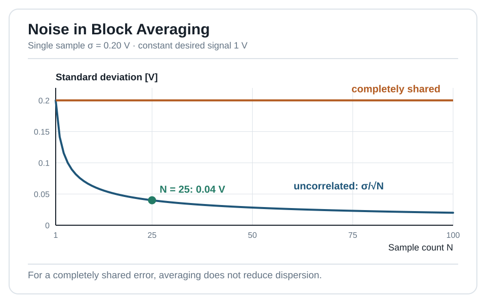

# M5-L6 – Random Signals, Noise and Signal Quality {#L6}

**Course area:** M5 – Bachelor: Signals and Systems

**Level:** Bachelor

**Prerequisites:** Expected value and variance from [M2-L6](M2-L6.md) and frequency response from [M5-L3](M5-L3.md).

**Learning objective:** Describe random interference as a measurement model, calculate the effect of averaging uncorrelated and correlated samples, and specify the signal-to-noise ratio along with its assumptions.

## Measurement sequence as a realisation of a random signal {#S1}

A sensor produces $x[n]=s[n]+w[n]$. Here $s[n]$ denotes the signal quantity of interest and $w[n]$ random interference. In a second recording under the same conditions, the observed history of $w[n]$ changes. The model describes a family of possible sequences. A particular recording is one realisation of this family.

A real wide-sense stationary noise process has a constant expected value over time, finite second moments and an autocovariance that depends only on the lag $k$. With $\mu=\mathbb E[w[n]]$, it is

$$
C_w[k]=\mathbb E\bigl[(w[n]-\mu)(w[n-k]-\mu)\bigr].
$$

For zero-mean white noise, $C_w[0]=\sigma^2$ and $C_w[k]=0$ for $k\ne0$. In this model, different samples are uncorrelated. In general, independence follows only with additional distributional assumptions, such as a joint Gaussian distribution. A constant measurement offset is a different effect. Averaging does not change its contribution to the expected value. A common diagnostic procedure is to compare the mean and dispersion in successive windows of equal length. Strongly varying statistics count against the simple stationary model. Approximately equal window statistics, however, do not guarantee stationarity.

## Example: Averaging and signal-to-noise ratio {#S2}

For a measured value $s=1\,\mathrm V$ that is constant during the observation period, assume that the error has zero mean, is uncorrelated from sample to sample and has standard deviation $\sigma=0.2\,\mathrm V$. In a block of $N=25$ samples, $\bar x$ is estimated:

$$
\bar x=\frac1N\sum_{n=0}^{N-1}x[n],
\qquad
\mathbb E[\bar x]=s,\qquad
\operatorname{Var}(\bar x)=\frac{\sigma^2}{N}.
$$

The variance formula follows because the variance of the sum in this case is $N\sigma^2$ and the factor $1/N$ is squared. The output standard deviation is $0.04\,\mathrm V$. Using the ratio of squared signal value to mean squared noise value, the input yields

$$
\mathrm{SNR}=\frac{s^2}{\sigma^2}=25,\qquad
\mathrm{SNR}_{\mathrm{dB}}=10\log_{10}(25)\approx13.98\,\mathrm{dB}.
$$

At the output, the corresponding values are $s^2/(0.04\,\mathrm V)^2=625$ and $27.96\,\mathrm{dB}$. For voltage quantities, this conversion to a power ratio assumes the same reference conditions for signal and noise. In other applications, the measurement bandwidth, measurement location and definition of power must be documented.

## Correlation and filter selection {#S3}

In general, block averaging has the noise variance

$$
\operatorname{Var}(\bar w)=\frac1{N^2}
\sum_{n=0}^{N-1}\sum_{m=0}^{N-1}C_w[n-m].
$$

For a completely shared random offset, every pair has the same covariance $\sigma^2$. The variance of the mean then remains equal to $\sigma^2$. Positive correlation can substantially reduce the expected improvement. At the same time, a longer averaging window delays the response to actual changes in the signal. For narrowband interference, a frequency-selective filter may be more suitable, provided that the desired signal carries little energy at the interference frequency. An LTI filter with frequency response $H$ multiplies the power spectral density of stationary input noise by $|H|^2$, when the filter and the spectral representation are defined for the process.

{alt="Standard deviation curves for uncorrelated samples and for a completely shared random offset; marked value of 0.04 volts for 25 uncorrelated samples."}

The falling curve represents the theoretical standard deviation of the mean, not the dispersion of the individual samples. The horizontal line describes the extreme case of a completely shared random offset. Both curves assume the same individual-sample variance.

## Self-check {#S4}

1. How many uncorrelated samples with equal variance are needed to reduce the noise standard deviation to one tenth of the individual value?
2. Two error samples have variance $\sigma^2$ and correlation coefficient $\rho=0.6$. What is the variance of their mean?

### Solutions

1. In the model, the standard deviation decreases by a factor of $1/\sqrt N$. Reaching $1/10$ requires $N=100$. The SNR gain with a constant desired signal is $20\,\mathrm{dB}$.
2. $\operatorname{Var}((w[0]+w[1])/2)=(2\sigma^2+2\rho\sigma^2)/4=0.8\sigma^2$. For uncorrelated samples, it would be $0.5\sigma^2$.

## Scope and further study {#S5}

The example assumes a constant desired signal and known error properties. Stationarity and the zero-mean assumption must be checked in the presence of drift, mains hum or a changing environment. [M16-L4](M16-L4.md) extends filtering and estimation of noisy measurements in an electrical measurement chain.

## Sources {#S6}

- [MIT OpenCourseWare, 6.011 Signals, Systems and Inference, Lecture Notes](https://ocw.mit.edu/courses/6-011-signals-systems-and-inference-spring-2018/resources/lecture-notes/) · units 15–19 on random processes, stationarity, LTI filtering and power spectral density · Last accessed: 2026-11-25
