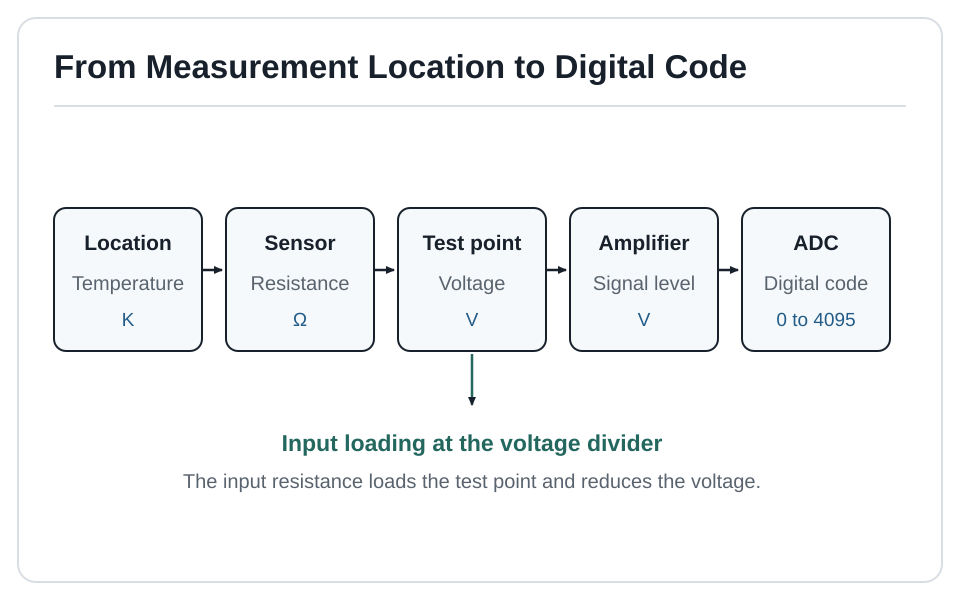

# M6-L1 – Measurement Chains, Sensors and Measurement Points {#L1}

**Course area:** M6 – Bachelor: Measurement and Introduction to Control

**Level:** Bachelor

**Prerequisites:** [Resistors and voltage dividers](M1-L2.md), [Thévenin equivalent circuit](M1-L4.md), units and orders of magnitude from [M2-L1](M2-L1.md).

**Learning objective:** Describe a measurement chain from the sensor to the estimated value, calculate the loading effect of a finite input resistance and assess the resolution of idealised digitisation.

## From the measurement location to a numerical value {#S1}

The **measurand** is the quantity you want to determine. For the temperature of a body, for example, it must be clear at which location and for which time interval the value is to apply. A sensor responds to a local physical quantity and converts it into, for example, a resistance or a voltage. Signal conditioning adapts the signal range and can attenuate unwanted frequency components. The analogue-to-digital converter (ADC) supplies a code sampled in time. Processing converts that code back into the unit of the measurand using a model.

Label each interface in a block diagram with its signal and unit. This helps to isolate the source of a discrepancy. An unexpected temperature reading may arise from the measurement location, loading at the sensor interface, limited ADC resolution or the conversion back to the measurand. A stable reading only demonstrates that the displayed numbers vary little.

## Calculating input loading {#S2}

Replace the sensor output circuit at the measurement point with its open-circuit voltage $U_0$ and series resistance $R_\mathrm{th}$. In the DC model, the measuring instrument has input resistance $R_\mathrm{in}$. This gives

$$
U_\mathrm{in}=U_0\frac{R_\mathrm{in}}{R_\mathrm{th}+R_\mathrm{in}},\qquad
\frac{U_\mathrm{in}-U_0}{U_0}=-\frac{R_\mathrm{th}}{R_\mathrm{th}+R_\mathrm{in}}.
$$

The second expression applies for $U_0\ne0$. The magnitude of the relative error decreases as the ratio $R_\mathrm{in}/R_\mathrm{th}$ increases. For it to be at most one per cent, $R_\mathrm{in}\ge99R_\mathrm{th}$ must hold.

{alt="Measurement chain from temperature through sensor resistance, loaded input voltage and amplification to ADC code. The input resistance draws current and reduces the input voltage."}

## Model calculation from the measurement point to the ADC {#S3}

In the model, a sensor with $10\,\mathrm{k\Omega}$ forms the lower resistor in a voltage divider. The upper resistor is also $10\,\mathrm{k\Omega}$ and the ideal supply is $3.3\,\mathrm V$. The open-circuit voltage is $1.65\,\mathrm V$, and the output resistance of the parallel combination is $5\,\mathrm{k\Omega}$. With $R_\mathrm{in}=100\,\mathrm{k\Omega}$ you obtain $U_\mathrm{in}=1.57143\,\mathrm V$. Loading therefore causes an error of about $-78.6\,\mathrm{mV}$ or $-4.76\,\%$ relative to the open-circuit value. The direct model with $R_\mathrm{Sensor}\parallel R_\mathrm{in}=9.0909\,\mathrm{k\Omega}$ also gives this result.

An idealised amplifier stage with gain $2$ supplies $3.14286\,\mathrm V$. Let the subsequent $12$-bit ADC divide the range from $0$ to $4.096\,\mathrm V$ into $2^{12}=4096$ equally wide intervals. The step size is then

$$
q=\frac{4.096\,\mathrm V}{4096}=1\,\mathrm{mV}.
$$

With coding based on the lower interval boundary as the transition, the code is $3142$. Reconstruction using the interval midpoint gives $3.1425\,\mathrm V$. The difference of around $-0.36\,\mathrm{mV}$ is within half a step. An additional ADC bit would reduce the quantisation step. The input loading that occurred before amplification would still be present.

## Exercises and solutions {#S4}

1. Compare $R_\mathrm{in}=1\,\mathrm{M\Omega}$ and $100\,\mathrm{k\Omega}$ for the same divider.
2. Determine the step size of an ideal $10$-bit ADC with the same input voltage range. State the maximum quantisation error when reconstructing at the interval midpoint within the measurement range.

**Solution 1.** For $1\,\mathrm{M\Omega}$ the loading factor $1000/1005$ relative to $1.65\,\mathrm V$ gives an input voltage of around $1.6418\,\mathrm V$. The magnitude of the error drops from $78.6\,\mathrm{mV}$ to about $8.2\,\mathrm{mV}$.

**Solution 2.** $4.096\,\mathrm V/1024=4\,\mathrm{mV}$. In the chosen model the magnitude of the error is at most $2\,\mathrm{mV}$. An input outside the permissible range causes saturation and falls outside this estimate.

## Model limitations and further learning {#S5}

For time-dependent signals, an input can also have a capacitive effect. The loading effect then depends on the frequency and on the time between two samples. The ADC calculation here assumes ideal, equally wide intervals. Deriving temperature from a resistance or code additionally requires a calibration relationship. [M6-L2](M6-L2.md) shows how to deal with correction and uncertainty.

## Sources {#S6}

- [OpenStax, University Physics Volume 2, § 10.4 – Electrical Measuring Instruments](https://openstax.org/books/university-physics-volume-2/pages/10-4-electrical-measuring-instruments) · Section 10.4 – internal resistances and instrument loading. · Last accessed: 2026-11-25
- [MIT OpenCourseWare, 6.003 – Sampling and Quantization](https://ocw.mit.edu/courses/6-003-signals-and-systems-fall-2011/resources/lecture-22-sampling-and-quantization/) · sampling and quantisation. · Last accessed: 2026-11-25
