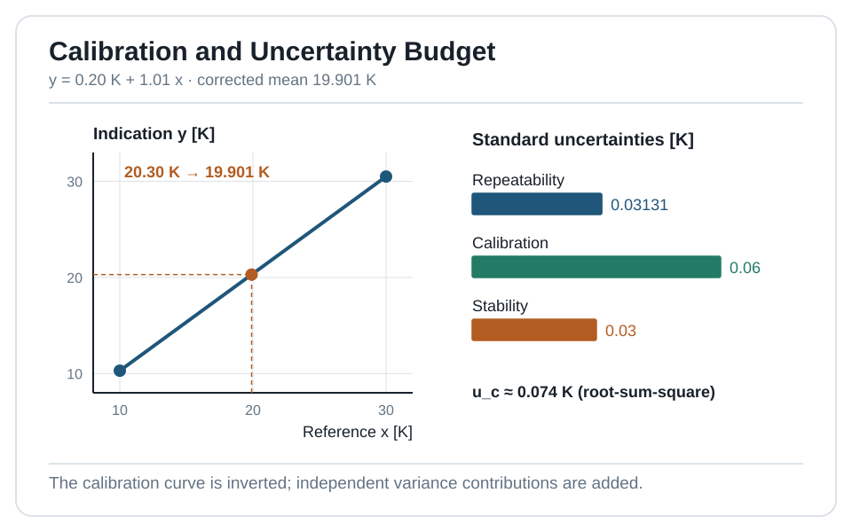

# M6-L2 – Calibration, Error and Measurement Uncertainty {#L2}

**Course area:** M6 – Bachelor: Measurement and Introduction to Control

**Level:** Bachelor

**Prerequisites:** [Measurement chains and resolution](M6-L1.md) and [statistical modelling](M2-L6.md).

**Learning objective:** Determine a linear calibration relationship from two reference points, correct a series of measurements and combine independent uncertainty contributions into a standard uncertainty.

## Calibration and dispersion {#S1}

A temperature sensor displays similar values in repeated measurements. A comparison with a reference under specified conditions reveals whether these values estimate the temperature well. **Calibration** establishes the relationship between the reference values and the corresponding indications, together with their respective uncertainties. Correction subsequently uses this relationship to estimate the measurand. Changing the instrument settings would constitute adjustment.

A systematic error may recur in a similar way under unchanged conditions. Random error varies between repetitions. The mean of repeated observations can reduce some of the random dispersion. A shift shared by all indications remains in the mean.

## Inverting a calibration function {#S2}

The example values denote temperature deviations in kelvin. Let the reference value be $x$ and the indication $y$. Within the operating range we use the model $y=a+bx$. Two reference pairs give

| Reference $x$ in K | Indication $y$ in K |
| ---: | ---: |
| 10.00 | 10.30 |
| 30.00 | 30.50 |

From this follow $b=(30.50-10.30)/(30.00-10.00)=1.01$ and $a=0.20\,\mathrm K$. The corrected estimate for a new indication is $\hat x=(y-a)/b$.

Five repeated readings are $20.2$, $20.3$, $20.4$, $20.3$ and $20.3\,\mathrm K$. The mean is $\bar y=20.30\,\mathrm K$, so $\hat x\approx19.901\,\mathrm K$. The correction lies between the reference points. A third reference measurement in the same range would be useful for checking the assumed linearity. The two reference points themselves already define a unique straight line.

## Uncertainty budget for the mean {#S3}

For $n$ independent repetitions under stable conditions, we use the sample standard deviation $s_y$ and the corresponding standard uncertainty of the mean:

$$
s_y=\sqrt{\frac{\sum_{i=1}^{n}(y_i-\bar y)^2}{n-1}},\qquad
u(\bar y)=\frac{s_y}{\sqrt n}.
$$

In the measurement series, the sum of squared deviations is $0.02\,\mathrm{K^2}$ and $s_y\approx0.07071\,\mathrm K$. The contribution from repeated observations to the corrected temperature is $u(\bar y)/|b|\approx0.03131\,\mathrm K$. For this teaching example, let a separate calibration characterisation supply further standard uncertainties of $0.060\,\mathrm K$ for the transferred reference and calibration influence and $0.030\,\mathrm K$ for an independent stability influence. Both are already expressed on the corrected temperature scale. Each influence occurs only once in the budget.

| Influence | Standard uncertainty in K |
| --- | ---: |
| Repeatability of the mean, corrected scale | 0.03131 |
| Reference and calibration in the teaching model | 0.060 |
| Separate stability influence | 0.030 |

For independent contributions, the variances add. This gives $u_c=\sqrt{0.03131^2+0.060^2+0.030^2}\,\mathrm K\approx0.074\,\mathrm K$. You can report the result as $\hat x=19.901\,\mathrm K$ with a combined standard uncertainty of $0.074\,\mathrm K$. A coverage probability cannot be derived from this statement alone. Classification as Type A or Type B describes how a contribution is evaluated, for example from statistical repetition data or reference information.

{alt="Calibration line through two reference pairs, illustrating inversion of the mean, with bars for the three standard uncertainty contributions."}

The orange guide lines show how the corrected reference value is estimated from the indication. The three bars share a common scale and show standard uncertainties, not variances. Their lengths are therefore not added linearly.

## Exercises and solutions {#S4}

1. What is the corrected estimate for an indication of $25.45\,\mathrm K$?
2. What happens to the repeatability contribution and the calibration contribution if there are 20 independent repetitions instead of five, with the same dispersion?

**Solution 1.** $(25.45-0.20)/1.01=25.00\,\mathrm K$.

**Solution 2.** The repeatability contribution halves because the denominator contains $\sqrt n$. The calibration influence shared by all repetitions remains. Under the same remaining assumptions, $u_c$ drops to around $0.069\,\mathrm K$.

## Model limitations and further learning {#S5}

In a practical uncertainty budget, parameters such as offset and slope may be correlated. Their covariances must then be included in the calculation. Temperature drift over the measurement series may also violate the independence assumption. The static model describes the relationship after settling. [M6-L3](M6-L3.md) adds the temporal response.

## Sources {#S6}

- [BIPM/JCGM 200:2012, International Vocabulary of Metrology](https://www.bipm.org/en/doi/10.59161/jcgm200-2012) · terms 2.16–2.19, 2.26 and 2.39. · Last accessed: 2026-11-25
- [BIPM/JCGM 100:2008, Guide to the Expression of Uncertainty in Measurement](https://www.bipm.org/en/doi/10.59161/jcgm100-2008e) · sections 4 and 5, evaluation and combination of standard uncertainties. · Last accessed: 2026-11-25
