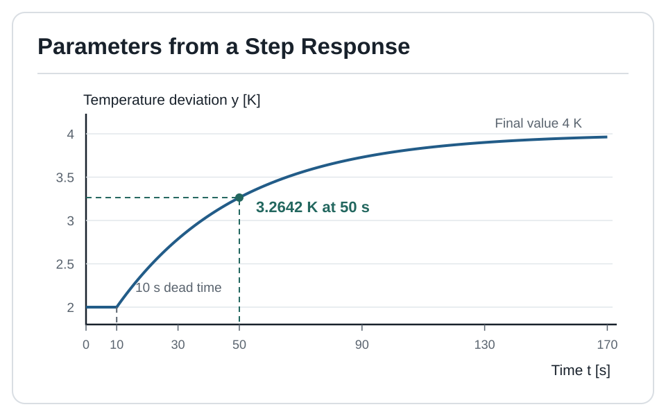

# M6-L3 – Models and Identification from a Step Response {#L3}

**Course area:** M6 – Bachelor: Measurement and Introduction to Control

**Level:** Bachelor

**Prerequisites:** [Differential equations for models](M2-L3.md), [circuit step response](M1-L5.md) and [calibration](M6-L2.md).

**Learning objective:** Determine the static gain, time constant and any detectable dead time from an idealised step response, and distinguish their effects.

## Why the plant needs time {#S1}

The input to a model can change abruptly while its output follows with a delay. A plant with a slow response smooths rapid input changes. Dead time shifts the response additionally, for example due to transport or the temporal assignment of measurement data. As an introduction, we consider a linear first-order plant with delay. The experiment begins in steady state.

With the change in the manipulated variable $\Delta u$, initial value $y_0$, process gain $K$, time constant $\tau>0$ and delay $L\ge0$, the ideal response to an input step at $t=0$ is

$$
y(t)=
\begin{cases}
y_0,&0\le t<L,\\
y_0+K\Delta u\bigl(1-\exp(-(t-L)/\tau)\bigr),&t\ge L.
\end{cases}
$$

The final value is $y_\infty=y_0+K\Delta u$. $K$ has the unit of the output quantity divided by the unit of the input quantity. $\tau$ and $L$ are expressed in units of time.

{alt="Simulated curve with 10 seconds of dead time. At 50 seconds the temperature reaches just under 3.26 kelvin, corresponding to 63.2 per cent of the change from 2 to 4 kelvin."}

## Reading parameters from the data {#S2}

1. Determine the initial value and a stable final value from the time intervals before and long after the step. The estimate is $K=(y_\infty-y_0)/\Delta u$.
2. Estimate $L$ from the time between the input change and the start of the visible output change. With noisy data, this step requires a justified rule.
3. Determine the target value $y_{63}=y_0+(1-\exp(-1))(y_\infty-y_0)$. Obtain the corresponding crossing time $t_{63}$ from the measured points or suitable interpolation. Then $\tau=t_{63}-L$.

The figure of $63.2\,\%$ refers to the **change**. It also applies to a falling output, with $y_\infty-y_0$ retaining its negative sign. The relationship follows from $t=L+\tau$, since the remaining exponential term is then $\exp(-1)$.

## Evaluating a simulated step in the manipulated variable {#S3}

At $t=0$, a dimensionless manipulated variable jumps from $0.25$ to $0.50$. The previously stable output is $2.00\,\mathrm K$, and the simulated long-term plateau is $4.00\,\mathrm K$. A densely sampled curve reveals a delay of $10\,\mathrm s$. Some sample values from the simulation are:

| Time in s | Temperature deviation in K |
| ---: | ---: |
| 0 | 2.0000 |
| 10 | 2.0000 |
| 30 | 2.7869 |
| 50 | 3.2642 |
| 90 | 3.7293 |
| 170 | 3.9634 |

From $\Delta u=0.25$ and the output change of $2\,\mathrm K$ follows $K=8\,\mathrm K$ per unit of the manipulated variable. The target value $y_{63}$ is around $3.2642\,\mathrm K$. The curve reaches this at $50\,\mathrm s$, hence $\tau=40\,\mathrm s$. Check the estimate at a second time. At $90\,\mathrm s$, two time constants have elapsed since the start of the output response. The model gives $2+2(1-\exp(-2))\approx3.7293\,\mathrm K$.

## Exercises and solutions {#S4}

1. For the same model, calculate the time at which the output reaches $3.00\,\mathrm K$.
2. Another plant starts at $10\,\mathrm K$ and, after an input step of $-0.20$, reaches a final value of $9\,\mathrm K$. The response starts after $5\,\mathrm s$ and reaches $9.3679\,\mathrm K$ at $25\,\mathrm s$. What parameters do you estimate?

**Solution 1.** The remaining fraction of the initial difference is $1/2$. Therefore $t=10\,\mathrm s+40\,\mathrm s\ln 2\approx37.7\,\mathrm s$.

**Solution 2.** The quotient of $-1\,\mathrm K$ and $-0.20$ gives $K=5\,\mathrm K$ per unit of the manipulated variable. The dead time is $5\,\mathrm s$ and the time constant is $25\,\mathrm s-5\,\mathrm s=20\,\mathrm s$.

## Model limitations and further learning {#S5}

An unknown final value and a dead time resolved only coarsely make the graphical estimate sensitive. A slowly starting higher-order response can resemble dead time. Therefore, check the fitted model against additional data points or a second step in the manipulated variable. [M6-L4](M6-L4.md) connects the measured and manipulated variables in a feedback loop.

## Sources {#S6}

- [APMonitor – First Order Plus Dead Time](https://apmonitor.com/pdc/index.php/Main/FirstOrderSystems) · FOPDT model equation and parameters: process gain, time constant and dead time; original teaching examples. · Last accessed: 2026-11-25
- [University of Michigan – Control Tutorials, Introduction: System Analysis](https://ctms.engin.umich.edu/CTMS/index.php?example=Introduction&section=ControlPID&section=SystemAnalysis) · First-order systems: time constant, pole and step response; comparison with the teaching model. · Last accessed: 2026-11-25
