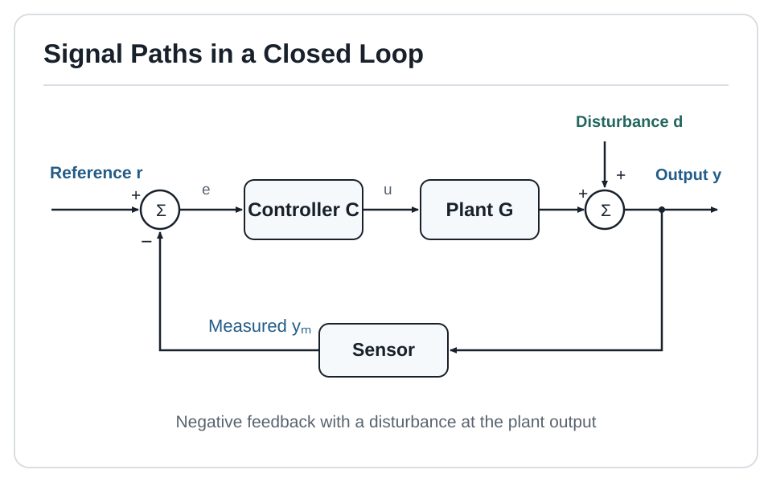

# M6-L4 – Open- and Closed-Loop Control {#L4}

**Course area:** M6 – Bachelor: Measurement and Introduction to Control

**Level:** Bachelor

**Prerequisites:** [Signals and systems](M5-L1.md), [Laplace transform](M5-L4.md) and [plant model from the step response](M6-L3.md).

**Learning objective:** Identify the reference, control error, manipulated variable, disturbance and measured value in a block diagram, and calculate the effect of simple negative feedback.

## Open-loop and closed-loop control of the same process {#S1}

A modelled heating process is intended to achieve a constant temperature deviation. In **open-loop control**, a command determines the manipulated variable. In **closed-loop control**, the measured output feeds back into the manipulated variable. If the temperature falls below the reference, suitable negative feedback increases the manipulated variable.

The model distinguishes five quantities. The reference $r$ determines the desired value. The output $y$ is the temperature deviation to be controlled. The measuring element provides $y_m$, which equals $y$ in the simplest model. The error $e=r-y_m$ is passed to the controller. Its manipulated variable $u$ acts on the plant. A disturbance $d$ represents an additional influence, such as a load change. The point at which the disturbance enters matters for every calculation.

{alt="Control loop with a negative measurement feedback path. The reference and the returned measurement are compared, the controller converts the error into a manipulated variable, and a disturbance is added at the output."}

## Translating feedback into equations {#S2}

We use linear transfer elements for the controller $C(s)$ and plant $G(s)$ with zero initial conditions. The disturbance $D(s)$ is added at the plant output. In this model the measured value equals the disturbed output. Capital letters denote Laplace transforms.

$$
U=C(R-Y),\qquad Y=GU+D.
$$

Substituting and rearranging gives

$$
Y=\frac{GC}{1+GC}R+\frac{1}{1+GC}D.
$$

The first factor describes the reference path, the second the disturbance path. The loop gain $GC$ determines the frequencies at which these factors are large or small. For an additive disturbance at the plant input, however, the disturbance path becomes $G/(1+GC)$. The location in the block diagram therefore determines the numerator. The algebraic formula also provides the characteristic condition for the dynamics. Whether the feedback is stable is examined in [M6-L5](M6-L5.md).

## Example with a load change {#S3}

For the static comparison, let $y=Ku+d$, with $K=2\,\mathrm K$ per dimensionless unit of the manipulated variable and $r=2\,\mathrm K$. Feedforward sets $u_0=r/K=1$. Without feedback, $u=u_0$ remains unchanged. If $d=-0.4\,\mathrm K$ occurs, the output consequently drops to $1.6\,\mathrm K$.

Add proportional feedback $u=u_0+k_p(r-y)$ with $k_p=0.5\,\mathrm K^{-1}$. Then

$$
y=r+\frac{d}{1+Kk_p}=2\,\mathrm K-\frac{0.4\,\mathrm K}{2}=1.8\,\mathrm K.
$$

The static disturbance effect is halved. The control error of $0.2\,\mathrm K$ produces an additional manipulated-variable contribution of $0.1$. With $u=1.1$, the plant again gives $2\cdot1.1\,\mathrm K-0.4\,\mathrm K=1.8\,\mathrm K$. The dimensionless manipulated variable is unbounded in this algebraic exercise.

## Exercises and solutions {#S4}

1. What temperature deviation does the model give with $k_p=1\,\mathrm K^{-1}$ for the same disturbance?
2. The sensor adds an error $n$ to $y$. Otherwise under the same assumptions, derive the transfer factor from $N$ to the actual output $Y$.

**Solution 1.** The DC loop gain is $Kk_p=2$. Thus $y=2\,\mathrm K-0.4\,\mathrm K/3\approx1.867\,\mathrm K$. The residual error is approximately $0.133\,\mathrm K$.

**Solution 2.** From $Y=GC(R-Y-N)+D$ follows the factor $-GC/(1+GC)$. A positive measurement offset can reduce the actual output because the controller interprets the measured value as too high.

## Limitations and further study {#S5}

The static example neglects energy storage, dead times and actuator limits. In time-dependent plants, increased gain may improve disturbance rejection while reducing the stability margin. Measurement errors and output disturbances act through different paths. In [M6-L5](M6-L5.md), you compare the dynamics of P, PI and PID controllers.

## Sources {#S6}

- [MIT OpenCourseWare, 16.30 Feedback Control Systems, Lecture 24 – Closed-Loop System Analysis](https://ocw.mit.edu/courses/16-30-feedback-control-systems-fall-2010/resources/mit16_30f10_lec24/) · feedback and closed-loop analysis. · Last accessed: 2026-11-25
- [Åström/Murray – Feedback Systems v2.10d, Chapter 10 PID Control](https://www.cds.caltech.edu/~murray/books/AM05/pdf/am08-pid_19Jul11.pdf) · § 10.1, pp. 294–297 and § 10.5, p. 308: proportional, integral and derivative action and filtered derivative. · Last accessed: 2026-11-25
