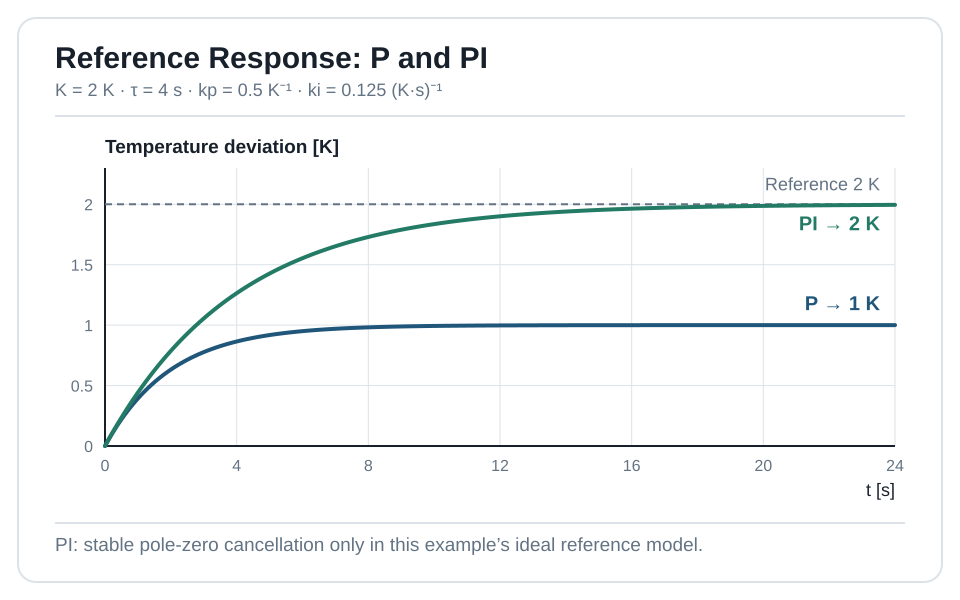

# M6-L5 – Stability and Introduction to Controllers {#L5}

**Course area:** M6 – Bachelor: Measurement and Introduction to Control

**Level:** Bachelor

**Prerequisites:** [Laplace transform and poles](M5-L4.md), [first-order plant](M6-L3.md) and [negative feedback](M6-L4.md).

**Learning objective:** Determine the poles of a simple continuous-time control loop and compare the steady-state error, transient response and noise sensitivity of P, PI and PID controllers.

## Poles and controller types {#S1}

Let a first-order lag plant be $G(s)=K/(\tau s+1)$ with $K>0$ and $\tau>0$. We consider continuous-time linear models with negative unity feedback. A pole $p$ with a negative real part produces a decaying component $\exp(pt)$. For asymptotic internal stability, all dynamically relevant eigenvalues must lie in the open left half-plane. A transfer function after cancellation may conceal an internal mode, so we consider the characteristic polynomial before cancellation.

In the parallel form, a PID controller is written as

$$
C(s)=k_p+\frac{k_i}{s}+k_d s.
$$

The P term responds to the current error. The I term accumulates the error. The D term accounts for its rate of change. For a fixed control objective, the D contribution vanishes when the error is constant. With a dimensionless manipulated variable and a temperature error in kelvin, $k_p$, $k_i$ and $k_d$ have the units $\mathrm K^{-1}$, $(\mathrm{K\,s})^{-1}$ and $\mathrm{s\,K^{-1}}$.

## P and PI on the same plant {#S2}

With $C=k_p$, the reference-to-output transfer function is

$$
\frac{Y}{R}=\frac{Kk_p}{\tau s+1+Kk_p}.
$$

The pole lies at $p=-(1+Kk_p)/\tau$. For a stable loop and a constant reference $r_0$, the remaining error is $r_0/(1+Kk_p)$. A PI controller now adds $k_i/s$. The denominator of the reference-to-output transfer function before cancellation is

$$
\tau s^2+(1+Kk_p)s+Kk_i .
$$

For the real coefficients of this second-order polynomial, positive coefficients are sufficient for stability. With a positive stability margin, an attainable reference and an unlimited ideal integrator, $e=0$ must hold in steady state: a persistently non-zero error would continue to change the integrator contribution to the manipulated variable. This argument assumes that the state under consideration has actually reached steady state.

## Numerical example with the same P term {#S3}

Set $K=2\,\mathrm K$ per unit of the manipulated variable, $\tau=4\,\mathrm s$ and $k_p=0.5\,\mathrm K^{-1}$. For the P controller, the pole lies at $-0.5\,\mathrm{s^{-1}}$. A reference step of $2\,\mathrm K$ leads to a steady-state temperature deviation of $1\,\mathrm K$ and a steady-state error of $1\,\mathrm K$.

For the PI controller, choose $k_i=0.125\,(\mathrm{K\,s})^{-1}$. The numerical coefficients of the denominator give $4s^2+2s+0.25$ when $s$ is expressed in $\mathrm{s^{-1}}$. This gives a double pole at $-0.25\,\mathrm{s^{-1}}$. The steady-state output equals the reference. This choice leads to pole-zero cancellation at $-0.25\,\mathrm{s^{-1}}$ in the ideal reference path. Both poles before cancellation are already stable.

Adding the ideal D term $k_d=0.25\,\mathrm{s\,K^{-1}}$ changes the leading coefficient to $\tau+Kk_d=4.5\,\mathrm s$. From $4.5s^2+2s+0.25$ we obtain $p\approx(-0.2222\pm\mathrm j\,0.0786)\,\mathrm{s^{-1}}$. The poles remain stable. This change does not imply a general improvement for other plants.

{alt="Analytical reference responses to a step of two kelvin: P approaches one kelvin, PI approaches two kelvin."}

In the ideal P model, the response to the reference step is $x(t)=1\,\mathrm K\,(1-\mathrm e^{-t/(2\,\mathrm s)})$. For the PI controller chosen here, the stable cancellation in the reference path gives $x(t)=2\,\mathrm K\,(1-\mathrm e^{-t/(4\,\mathrm s)})$. The figure assumes a zero initial value and includes no actuator limits.

## Exercises and solutions {#S4}

1. Which proportional gain gives a pole at $-1\,\mathrm{s^{-1}}$ for the same plant? What is the resulting steady-state error for $r_0=2\,\mathrm K$?
2. How can you tell from an ideal P or PI model whether the output reaches a constant reference without steady-state error in the stable case?

**Solution 1.** $-(1+2k_p)/4=-1$ gives $k_p=1.5\,\mathrm K^{-1}$. The error is $2\,\mathrm K/(1+2\cdot1.5)=0.5\,\mathrm K$.

**Solution 2.** The reference-to-output transfer function at $s=0$ must equal one. P gives the factor $Kk_p/(1+Kk_p)$ for finite $k_p$. PI with $k_i>0$ has a factor of one in the model described, because the numerator and denominator have the same constant term $Kk_i$.

## Limitations and further study {#S5}

Ideal differentiation amplifies rapidly varying disturbance components. Practical designs often use a filtered D term and differentiate the measured value to avoid demanding an ideal impulse in response to a reference step. Actuator limits can cause integrator windup and subsequently worsen the transient response. [M6-L6](M6-L6.md) examines P and PI with a modelled actuator limit and a load disturbance.

## Sources {#S6}

- [Åström/Murray – Feedback Systems v2.10d, Chapter 10 PID Control](https://www.cds.caltech.edu/~murray/books/AM05/pdf/am08-pid_19Jul11.pdf) · § 10.1, pp. 294–297 and § 10.5, p. 308: proportional, integral and derivative action and filtered derivative. · Last accessed: 2026-11-25
- [MIT OpenCourseWare, 16.30 Feedback Control Systems – Lecture Notes](https://ocw.mit.edu/courses/16-30-feedback-control-systems-fall-2010/pages/lecture-notes/) · Lectures 2, 23 and 24 on poles, integrator limiting and closed loops. · Last accessed: 2026-11-25
