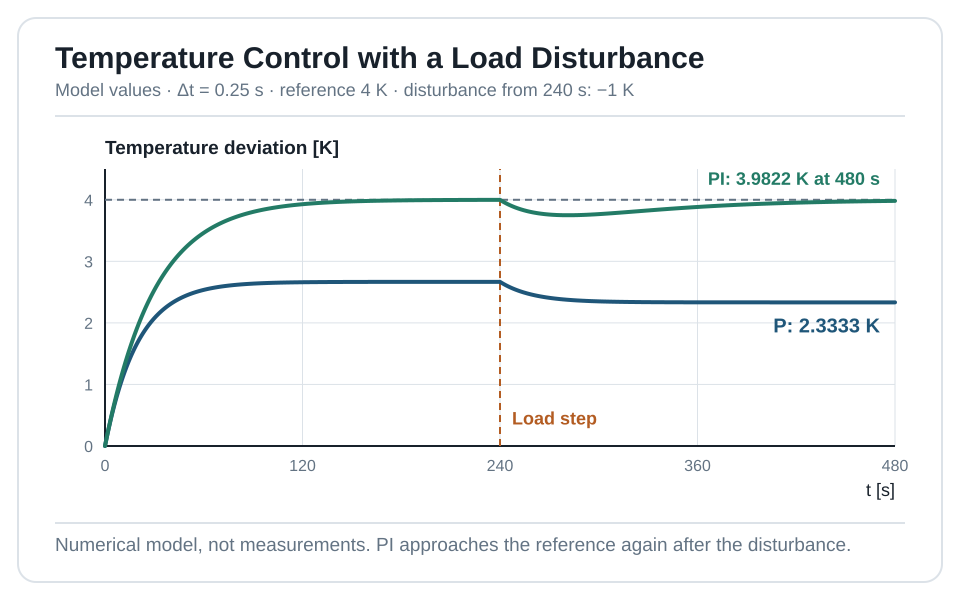

# M6-L6 – Temperature Control Case Study {#L6}

**Course area:** M6 – Bachelor: Measurement and Introduction to Control

**Level:** Bachelor

**Prerequisites:** [Plant model](M6-L3.md), [feedback](M6-L4.md) and [P and PI controllers](M6-L5.md).

**Learning objective:** Reproduce a simulated temperature control system, compare reference and disturbance responses using defined metrics, and document the range of validity of the results.

## A testable temperature model {#S1}

The state $x$ is the temperature deviation relative to an environment assumed to be constant. For the dimensionless manipulated variable $u$ and a disturbance $d$ in kelvin, we use

$$
60\,\mathrm s\,\dot x+x=(10\,\mathrm K)u+d,\qquad 0\le u\le1.
$$

At $t=0$, $x$ starts at $0\,\mathrm K$ and the new reference $r$ is $4\,\mathrm K$. At $t=240\,\mathrm s$, $d$ changes from $0$ to $-1\,\mathrm K$. The modelled sensor supplies $x$ directly. Both variants use $k_p=0.20\,\mathrm K^{-1}$. The PI controller adds $k_i=k_p/(60\,\mathrm s)$. Its integrator contribution $z$ starts at zero. The unconstrained manipulated variable is $u_\mathrm{raw}=k_p(r-x)+z$ and is limited to the range from zero to one.

## Simulation with standard Python {#S2}

The script updates the state and integrator using the explicit Euler method. Both calculations use the error at the beginning of the step. If the manipulated variable reaches a limit, the integrator may continue only when its contribution acts towards the usable range.

```python
def simulate(ki, dt=0.25):
    x = z = 0.0
    rows = []
    for k in range(round(480 / dt) + 1):
        t = k * dt
        d = 0.0 if t < 240 else -1.0
        e = 4.0 - x
        raw = 0.20 * e + z
        u = min(1.0, max(0.0, raw))
        rows.append((t, x, u))
        x += dt * (10.0 * u + d - x) / 60.0
        within = 0.0 < raw < 1.0
        returns = (raw <= 0.0 and e > 0.0) or (raw >= 1.0 and e < 0.0)
        if within or returns:
            z += dt * ki * e
    return rows

for name, ki, plateau in (("P", 0.0, 8.0 / 3), ("PI", 0.20 / 60, 4.0)):
    rows = simulate(ki)
    rise = [next(t for t, x, _ in rows if t < 240 and x >= f * plateau)
            for f in (0.10, 0.90)]
    pre = [x for t, x, _ in rows if t < 240]
    print(name, "Rise time", round(rise[1] - rise[0], 2), "s")
    print("Overshoot", max(0.0, max(pre) - plateau), "K")
    for t, x, _ in rows:
        if t in (240.0, 280.0, 480.0):
            print(f"t={t:.0f} s: x={x:.4f} K")
```

## Metrics and plausibility check {#S3}

Here the rise time measures the interval between $10\,\%$ and $90\,\%$ of the final steady-state value without a disturbance for each controller. Under this definition a P controller may be fast and still miss the actual reference. Overshoot is measured relative to the same steady-state comparison value in the time window before the disturbance.

| Quantity | P | PI |
| --- | ---: | ---: |
| Rise time in s | 43.75 | 65.75 |
| Overshoot before disturbance in K | 0 | 0 |
| $x(240\,\mathrm s)$ in K | 2.6667 | 3.9987 |
| $x(280\,\mathrm s)$ in K | 2.3779 | 3.7491 |
| $x(480\,\mathrm s)$ in K | 2.3333 | 3.9822 |

The steady-state P reference follows from $x=10k_p(4-x)+d$, hence $x=(8+d)/3$ when all temperatures are expressed numerically in kelvin. Before and after the disturbance, the expected values are therefore $2.6667\,\mathrm K$ and $2.3333\,\mathrm K$. The PI controller can eventually return to $4\,\mathrm K$. The required manipulated variable increases from $0.4$ to $0.5$. Both values lie within the permitted range. At $480\,\mathrm s$, the disturbance response is still decaying. In both evaluated trajectories, the manipulated variable remains between zero and one without reaching the limits.

{alt="Simulated temperature trajectories for P and PI from the start to 480 seconds, with a reference of four kelvin and a marked load disturbance at 240 seconds."}

The figure uses the state values calculated by the script. The P controller retains a steady-state error both before and after the load step. The PI controller approaches the reference again after the load step. The values are numerical model results, not measured curves.

## Exercises and solution outlines {#S4}

1. Simulate with half the step size. Compare the values at $280\,\mathrm s$ and document the difference.
2. Under what conditions would a specified reference be unattainable even with integral action if the disturbance remained at $d=-1\,\mathrm K$?

**Solution 1.** Set $dt=0.125$ in the function call. At $280\,\mathrm s$, the results remain close to $2.3779\,\mathrm K$ and $3.7491\,\mathrm K$, respectively. The difference due to halving the step size is less than $0.001\,\mathrm K$ in both cases. The input and output time points must coincide for the comparison.

**Solution 2.** With $u\in[0,1]$, only the steady-state range from $-1$ to $9\,\mathrm K$ can be reached. A reference above $9\,\mathrm K$ or below $-1\,\mathrm K$ remains outside the range of possible steady-state values.

## Model limitations and next steps {#S5}

This case study examines an idealised model with a constant environment and a single time constant. Delay, measurement noise, calibration errors and additional thermal storage can change the results. A follow-up project can add each influence separately and check it against the reference documented here. The [study pathway](pages/study-path.md) leads to subsequent modules.

## Sources {#S6}

- [MIT OpenCourseWare, 16.30 Feedback Control Systems – Lecture Notes](https://ocw.mit.edu/courses/16-30-feedback-control-systems-fall-2010/pages/lecture-notes/) · Lectures 23 and 24 on integrator limiting and closed loops. · Last accessed: 2026-11-25
- [Åström/Murray – Feedback Systems v2.10d, Chapter 10 PID Control](https://www.cds.caltech.edu/~murray/books/AM05/pdf/am08-pid_19Jul11.pdf) · § 10.1, pp. 294–297 and § 10.5, p. 308: proportional, integral and derivative action and filtered derivative. · Last accessed: 2026-11-25
- [APMonitor – First Order Plus Dead Time](https://apmonitor.com/pdc/index.php/Main/FirstOrderSystems) · FOPDT model equation and parameters: process gain, time constant and dead time; original teaching examples. · Last accessed: 2026-11-25
