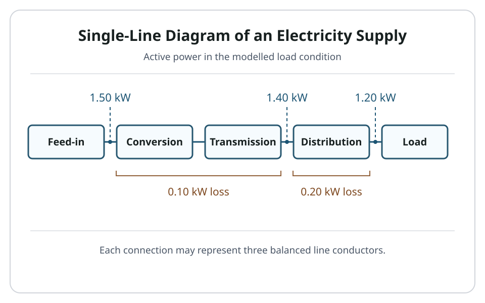

# M7-L1 – Electric Power Supply and Power Balances {#L1}

**Course area:** M7 – Bachelor: Electric Power Engineering

**Level:** Bachelor

**Prerequisites:** [AC power and frequency response](M1-L7.md). You should be familiar with RMS values and complex phasors.

**Learning objective:** Identify generation, transmission, distribution and loads in a single-line diagram, establish a power balance and use it to determine energy transfer and efficiency.

## Power on its way to the load {#S1}

An electricity supply system connects conversion, transport and use. A generator or a converter-coupled system feeds in electrical power. A transformer couples voltage levels. A transmission line connects major supply nodes; the distribution network delivers power to loads. Storage and local generation can temporarily reverse the direction of power flow. Whether a node is consuming or supplying power at a given time follows from the balance at its connection point.

A **single-line diagram** shows electrical connections and the main components, using one line per connection. In a three-phase network the line can represent three conductors. The drawing establishes which elements are directly connected. Phase sequence, individual conductor currents and physical cable routing must be specified separately when necessary.

{alt="Single-line diagram of a modelled supply system. From the feed-in point, a voltage conversion stage, transmission line and distribution network lead to the load. Power quantities suitable for balancing are marked at the interfaces."}

## Balances at nodes and interfaces {#S2}

Active power $P$ in watts is energy transfer per unit time averaged over one period. For sinusoidal quantities in steady state, with RMS phasors $\underline U$ and $\underline I$, the following holds per phase:

$$
\underline S=\underline U\,\underline I^*=P+jQ,
\qquad
|\underline S|=\sqrt{P^2+Q^2}.
$$

Here $\underline I$ points into the load under consideration. Positive active and reactive power represent absorption under this passive sign convention. An inductive load current lags the voltage and gives $Q>0$. $Q$ is specified in var and $|\underline S|$ in VA. Reactive power describes periodic energy exchange in the sinusoidal model. It can increase RMS current and thus line losses.

For our energy balance, we use the **magnitudes of active power** specified in the direction of flow. In a steady-state section without additional feed-in,

$$
P_{\mathrm{in}}=P_{\mathrm{out}}+P_{\mathrm{loss}},
\qquad
\eta=\frac{P_{\mathrm{out}}}{P_{\mathrm{in}}}.
$$

Efficiency is dimensionless and requires $P_{\mathrm{in}}>0$. If stored energy within the boundary also changes, $\mathrm{d}W_{\mathrm{stored}}/\mathrm{d}t$ is added to the right-hand side of the instantaneous energy balance. For constant average active power, $W=P\,\Delta t$. For load profiles, add the energy contributions of the time intervals.

## Worked example with three balance boundaries {#S3}

In a model, a source continuously delivers $1.50\,\mathrm{kW}$ at the electrical grid connection. After conversion and transmission, $1.40\,\mathrm{kW}$ remains, and the user receives $1.20\,\mathrm{kW}$ after distribution.

| Section | Input | Output | Losses | Efficiency |
|---|---:|---:|---:|---:|
| Conversion plus transmission | $1.50\,\mathrm{kW}$ | $1.40\,\mathrm{kW}$ | $0.10\,\mathrm{kW}$ | $93.33\,\%$ |
| Distribution | $1.40\,\mathrm{kW}$ | $1.20\,\mathrm{kW}$ | $0.20\,\mathrm{kW}$ | $85.71\,\%$ |
| Entire electrical path | $1.50\,\mathrm{kW}$ | $1.20\,\mathrm{kW}$ | $0.30\,\mathrm{kW}$ | $80.00\,\%$ |

The product of the two section efficiencies is $0.80$, because the intermediate power cancels when multiplying the ratios. In four hours, the user receives $4.8\,\mathrm{kWh}$, the source supplies $6.0\,\mathrm{kWh}$ and the path dissipates $1.2\,\mathrm{kWh}$ as lost energy. The efficiency calculation starts at the electrical source terminals. Primary energy used for generation belongs within a correspondingly larger balance boundary.

## Model limitations {#S4}

A single-line diagram and an active power balance answer different questions. The diagram shows the connections. The balance determines how much average energy per unit time crosses the boundary. Voltage drop and current limits additionally require voltages, impedances and load behaviour. In unbalanced three-phase systems, examine the phases individually. For highly distorted waveforms, include the relevant harmonics or use a time-domain calculation.

## Exercises with solutions {#S5}

1. A load draws $0.60\,\mathrm{kW}$ for two hours and $1.50\,\mathrm{kW}$ in the following hour. What are the energy and average power?  
   **Solution** $W=2\cdot0.60+1\cdot1.50=2.70\,\mathrm{kWh}$. The average power over three hours is $0.90\,\mathrm{kW}$.
2. A phase has $P=300\,\mathrm W$ and $Q=400\,\mathrm{var}$. What are the apparent power, power factor and current at $100\,\mathrm V$?  
   **Solution** $|\underline S|=500\,\mathrm{VA}$, $P/|\underline S|=0.60$ and $I=5\,\mathrm A$. A resistive phase at the same voltage and active power requires $3\,\mathrm A$.

**Further reading:** [Three-phase systems, star and delta](M7-L2.md)

## Sources {#S6}

- [J. L. Kirtley, MIT 6.061, Review of Network Theory](https://ocw.mit.edu/courses/6-061-introduction-to-electric-power-systems-spring-2011/d79822ef5fbdb21b1c44e1b3b8282453_MIT6_061S11_ch1.pdf) · Chapter 1, pp. 1–2: network topology, nodes and Kirchhoff laws; partial scope. · Last accessed: 2026-11-25
- [U.S. Department of Energy, Electric Transmission and Distribution](https://www.energy.gov/sites/default/files/2023-11/FINAL_CESER%20Electricity%20Grid%20Backgrounder_508.pdf) · P. 1, Exhibit 1 and Substations: generation, transmission and distribution structure using the US example. · Last accessed: 2026-11-25
