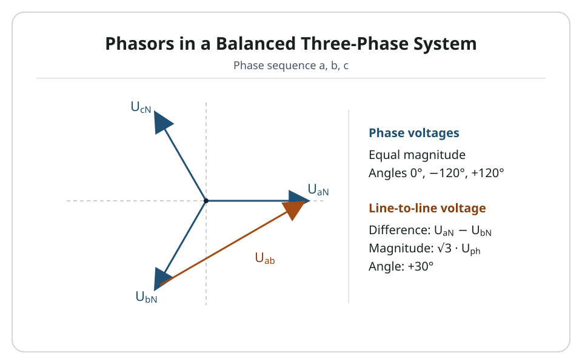

# M7-L2 – Three-Phase Systems, Star and Delta {#L2}

**Course area:** M7 – Bachelor: Electric Power Engineering

**Level:** Bachelor

**Prerequisites:** [Sinusoidal AC and complex impedance](M1-L6.md) and [Power balances](M7-L1.md).

**Learning objective:** Distinguish phase and line quantities in a balanced three-phase model, derive the star and delta relationships and calculate total power.

## Three phases with fixed phase relationships {#S1}

A balanced three-phase system has three voltage phasors of equal magnitude, separated by $120^\circ$. For the sequence $a,b,c$, we use as an example $\underline U_{aN}=U_\mathrm{ph}\angle 0^\circ$, $\underline U_{bN}=U_\mathrm{ph}\angle -120^\circ$ and $\underline U_{cN}=U_\mathrm{ph}\angle 120^\circ$. All magnitudes are RMS values. The phase sequence determines, for example, the rotation direction of a resulting rotating field. The choice of angular reference does not change any voltage magnitude.

{alt="Phasor diagram of a balanced system with three phase voltages separated by 120 degrees. The arrow from the tip of phasor b to the tip of a is the line-to-line voltage Uab."}

In **star (wye)**, each load branch lies between a line conductor and the common star point. The line-to-line voltage is a difference. For $a$ and $b$,

$$
\underline U_{ab}=\underline U_{aN}-\underline U_{bN}
  =\sqrt{3}\,U_\mathrm{ph}\angle 30^\circ,
\qquad I_\mathrm{L}=I_\mathrm{ph}.
$$

The line current flows directly through the branch. With three identical impedances, the currents separated by $120^\circ$ sum to zero. Any neutral conductor present carries no current in this ideally balanced sinusoidal case. With an unbalanced load, neutral current must be determined from the individual currents.

## Delta and the power relationship {#S2}

In **delta**, each branch lies between two line conductors. Therefore $U_\mathrm{ph}=U_\mathrm{LL}$. Defining delta currents around the loop, we obtain, for example, $\underline I_a=\underline I_{ab}-\underline I_{ca}$. Because the two phase currents have equal magnitude and are separated by $120^\circ$, $I_\mathrm L=\sqrt{3}\,I_\mathrm{ph}$. The quantity $U_\mathrm{LL}$ denotes the magnitude of a line-to-line voltage, and $I_\mathrm L$ the magnitude of a line current.

For three identical branches, both connections satisfy

$$
\begin{aligned}
P &= 3 U_\mathrm{ph} I_\mathrm{ph}\cos\varphi
   = \sqrt{3}\, U_\mathrm{LL}I_\mathrm L\cos\varphi,\\
Q &= \sqrt{3}\, U_\mathrm{LL}I_\mathrm L\sin\varphi .
\end{aligned}
$$

The angle $\varphi$ is the angle of the **phase voltage relative to its corresponding phase current**, equal to the argument of the phase impedance under the passive sign convention. When using line quantities to determine the angle, the additional geometrical phase shift must be accounted for.

## Worked example with identical resistors {#S3}

An ideal three-phase connection supplies $U_\mathrm{LL}=120\sqrt{3}\,\mathrm V\approx207.85\,\mathrm V$. Three resistive branches each have $R=24\,\Omega$.

In star, each branch has $120\,\mathrm V$ and $5\,\mathrm A$. Hence $P=3\cdot120\cdot5=1\,800\,\mathrm W$. In delta, each branch has $120\sqrt3\,\mathrm V$ and carries $5\sqrt3\,\mathrm A$. Each line conductor then carries $15\,\mathrm A$ and $P=5\,400\,\mathrm W$. The threefold total power follows from the square of the phase voltage, which is larger by a factor of $\sqrt3$ across the same resistances. If the delta connection is to absorb the same power as the star connection at the same supply, each of its resistances must be $72\,\Omega$.

## Limitations and checks {#S4}

The relationships involving $\sqrt3$ for magnitudes assume balance and a sinusoidal fundamental here. For unbalanced branches, phasor differences and Kirchhoff’s laws still apply. Power is then summed from the individual complex powers at the terminals. If the star point of an unbalanced star load is floating, its potential must also be calculated in the model. If several harmonics are present, currents at the third harmonic and its integer multiples in particular can add in the neutral conductor when they are in phase.

## Exercises with solutions {#S5}

1. A balanced star load has $\underline Z_\mathrm{ph}=(24+j18)\,\Omega$ at $U_\mathrm{ph}=120\,\mathrm V$. Calculate $I_\mathrm L$, $P$ and $Q$.  
   **Solution** $|Z|=30\,\Omega$ and $I_\mathrm L=4\,\mathrm A$. $\cos\varphi=0.8$ and $\sin\varphi=0.6$ give $P=1\,152\,\mathrm W$ and $Q=864\,\mathrm{var}$.
2. The star point of the same load is ideally connected to the source star point. What is its neutral current?  
   **Solution** $0\,\mathrm A$. All phase currents have the same RMS magnitude and are separated pairwise by $120^\circ$. The three phasors sum vectorially to zero.

**Further reading:** [Transformers and voltage conversion](M7-L3.md)

## Sources {#S6}

- [J. L. Kirtley, MIT 6.061, Polyphase Networks](https://ocw.mit.edu/courses/6-061-introduction-to-electric-power-systems-spring-2011/c6393a58319200a5344752de0cf47ec4_MIT6_061S11_ch3.pdf) · Chapter 3, Three Phase Systems and Line-Line Voltages, printed pp. 3–7; 120-degree phases, sqrt(3) ratio and wye/delta. Pages 1 and 7 visually checked. · Last accessed: 2026-11-25
