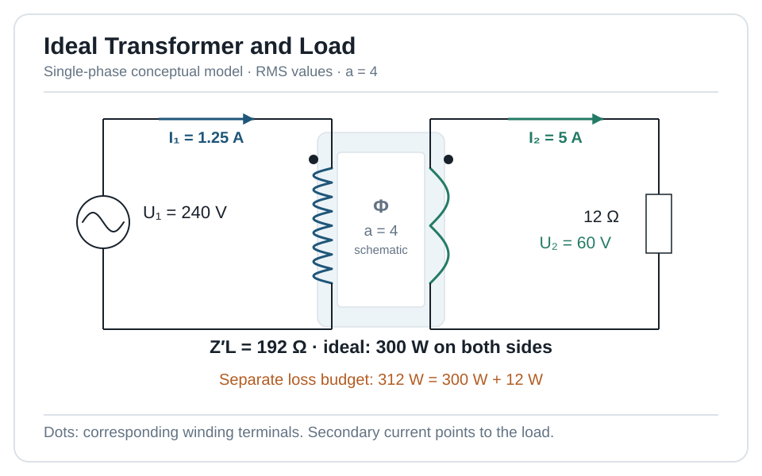

# M7-L3 – Transformers and Voltage Conversion {#L3}

**Course area:** M7 – Bachelor: Electric Power Engineering

**Level:** Bachelor

**Prerequisites:** [Three-phase systems, star and delta](M7-L2.md) and [Induction and electromagnetic energy](M4-L4.md).

**Learning objective:** Calculate a voltage transformation ratio and a referred load impedance, define current directions unambiguously and distinguish ideal transformation from losses and voltage drop.

## Two windings with coupled flux {#S1}

A transformer magnetically couples two windings. In the ideal model, the same time-varying magnetic flux $\Phi$ passes through every turn of both windings. The law of induction relates the induced voltage to the rate of change of flux linkage. With $N_1$ and $N_2$ turns and consistent polarity, the following holds for sinusoidal RMS phasors:

$$
a=\frac{N_1}{N_2},
\qquad
\frac{\underline U_1}{\underline U_2}=a.
$$

The voltages are measured from the correspondingly dotted terminals to the respective other terminals. The primary current $\underline I_1$ points into the primary dotted terminal. The secondary current $\underline I_2$ is defined here as the current delivered to the load, pointing away from the secondary dotted terminal. With this orientation, the ideal model gives

$$
\underline I_1=\frac{\underline I_2}{a},
\qquad
\underline U_1\underline I_1^*
=\underline U_2\underline I_2^*.
$$

If both currents are defined as entering the dotted terminals, the sign of the current relationship changes. Equality of the transferred complex power holds under the respective input and output conventions. For a three-phase transformer, the transformation relationships initially apply to each winding phase. The line voltage ratio and phase shift additionally depend on the connections on both sides.

## Referring impedance to the primary side {#S2}

From $\underline U_2=Z_\mathrm L\underline I_2$, the load as seen from the primary circuit is

$$
Z'_\mathrm L=\frac{\underline U_1}{\underline I_1}
            =a^2Z_\mathrm L .
$$

The relationship also holds for complex loads with linear coupling. It scales both the magnitude and the $R/X$ components together. An impedance referred to the primary side is an electrical equivalent model. Physically, the load remains on the secondary side. In line models, the conversion allows components specified at different voltage levels to be summed on a common side.

## Worked example of output power and losses {#S3}

We use an imagined single-phase source of $240\,\mathrm V$ and an ideal transformer with $a=4$. A resistor of $12\,\Omega$ is connected to the secondary side. This gives $U_2=60\,\mathrm V$, $I_2=5\,\mathrm A$ and $I_1=1.25\,\mathrm A$. The useful power is $300\,\mathrm W$. On the primary side, $Z'_\mathrm L=4^2\cdot12\,\Omega=192\,\Omega$. The independent check $240\,\mathrm V/192\,\Omega=1.25\,\mathrm A$ gives the same input current.

A simplified loss budget adds $12\,\mathrm W$ for the core and winding at the same output operating point. Assuming that appropriate source adjustment keeps the output power at $300\,\mathrm W$, the input power is $312\,\mathrm W$ and the efficiency is approximately $96.15\,\%$. This **power balance** determines efficiency. To calculate voltage drop under load, the components of the equivalent circuit must be known.

{alt="Circuit diagram of an ideal transformer with current directions, dot convention and a twelve-ohm load; referred input impedance of 192 ohms."}

The windings are represented symbolically; the eight and two arcs merely illustrate the 4:1 ratio and not actual numbers of turns. Both voltages are referenced to the dotted winding terminal. Ideal power transfer and the separately assumed loss budget are different models at the same output operating point.

## A more detailed equivalent circuit {#S4}

Winding resistances describe current-dependent copper losses. Leakage reactances represent flux components that couple to only one winding each. A parallel magnetising branch accounts for the establishment of flux. In a simplified sinusoidal model, a parallel loss resistance represents core losses. Voltage deviation under load therefore also depends on the phase of the current. Equivalent circuit parameters may change with frequency and operating conditions.

The ideal model neglects core saturation, frequency dependence and dynamic switching-on transients. Voltage transformation relies on time-varying flux. At constant flux, the induced voltage is zero. In a real system, a constant applied winding voltage can initially cause a flux change up to saturation. A time-dependent model is necessary to describe this process.

## Exercises with solutions {#S5}

1. A load $Z_\mathrm L=(6+j2)\,\Omega$ is connected to an ideal transformer with $a=3$. What does the source see?  
   **Solution** $Z'_\mathrm L=9(6+j2)\,\Omega=(54+j18)\,\Omega$. The impedance angle remains unchanged.
2. A simplified model delivers $450\,\mathrm W$ of useful power with $15\,\mathrm W$ of losses. What is $\eta$?  
   **Solution** $\eta=450/(450+15)\approx0.9677$. To determine the actual voltage ratio, the load current and equivalent circuit parameters are required.

**Further reading:** [Overview of electrical machines](M7-L4.md)

## Sources {#S6}

- [OpenStax, University Physics Volume 2, Transformers](https://openstax.org/books/university-physics-volume-2/pages/15-6-transformers) · Section 15.6: voltage, current and turns ratio, and transmission losses (basic model). · Last accessed: 2026-11-25
- [J. L. Kirtley, MIT 6.061, Polyphase Networks](https://ocw.mit.edu/courses/6-061-introduction-to-electric-power-systems-spring-2011/c6393a58319200a5344752de0cf47ec4_MIT6_061S11_ch3.pdf) · Chapter 3, pp. 12–13: ideal turns ratio and three-phase transformers. · Last accessed: 2026-11-25
