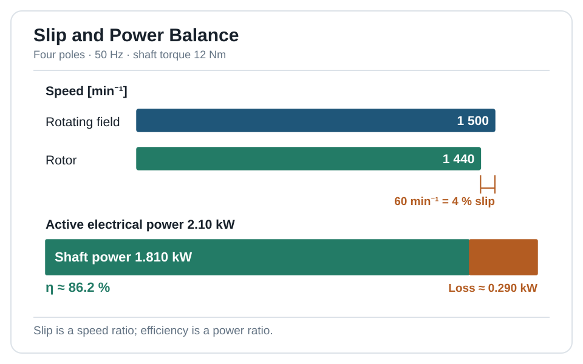

# M7-L4 – Overview of Electrical Machines {#L4}

**Course area:** M7 – Bachelor: Electric Power Engineering

**Level:** Bachelor

**Prerequisites:** [Induction and electromagnetic energy](M4-L4.md) and [Three-phase systems, star and delta](M7-L2.md).

**Learning objective:** Distinguish rotating magnetic fields, synchronous speed and slip, convert torque into mechanical power, and account for the losses at a motor operating point.

## From the electrical to the mechanical side {#S1}

An electrical machine couples electrical quantities and motion through a magnetic field. In **motor operation**, the machine absorbs active electrical power and delivers shaft power. In **generator operation**, it absorbs mechanical shaft power and delivers active electrical power. The same physical principle may allow both directions of conversion. The direction depends on the torques, connection conditions and operating point.

The electromagnetic forces acting around the circumference produce a torque on the rotor. Conversely, the flux linkage of a moving winding or magnetic field changes. The resulting induced voltage influences the current. The simple model of a DC machine expresses this coupling through the back EMF $E=k_\mathrm{e}\omega$ and electromagnetic torque $T_\mathrm{e}=k_\mathrm{t}I$ at constant excitation flux. The back EMF increases with rotational speed. Mechanical losses may cause the torque at the air gap and the usable shaft torque to differ.

## Rotating magnetic fields, pole pairs and slip {#S2}

A stator system that is symmetrical in space and time, with sinusoidal currents, produces a rotating magnetic field in the ideal fundamental-component model. With $p$ pole pairs, one electrical period rotates the field mechanically by $1/p$ revolutions. At frequency $f$ in hertz, therefore,

$$
\frac{n_\mathrm{s}}{1\,\mathrm{min}^{-1}}
=\frac{60}{p}\,\frac{f}{1\,\mathrm{Hz}}.
$$

Four poles give two pole pairs. A synchronous machine rotates at $n=n_\mathrm{s}$ in synchronous steady-state operation. There may be a constant angle between the rotor and stator fields, related to the torque exchanged.

In an ordinary induction machine operating as a motor, the rotating field moves faster than the rotor. The relative motion induces rotor currents whose interaction with the field produces torque. The relative difference in rotational speed is called **slip**:

$$
s=\frac{n_\mathrm{s}-n}{n_\mathrm{s}}.
$$

At the synchronous point, steady-state induction in the short-circuited rotor due to the rotating stator field vanishes in this idealised model. When the machine is driven above synchronous speed, $s<0$. Under suitable electrical conditions, this operating point allows generator operation.

## Worked example: shaft power of an induction machine {#S3}

A model motor with four poles operates at $f=50\,\mathrm{Hz}$ and $n=1\,440\,\mathrm{min}^{-1}$. This gives $n_\mathrm{s}=1\,500\,\mathrm{min}^{-1}$ and $s=4\,\%$. The shaft drives a load with $T_\mathrm{sh}=12\,\mathrm{Nm}$. The angular velocity and shaft power are

$$
\omega=\frac{2\pi\cdot1\,440}{60}\approx150.80\,\mathrm{rad/s},
\qquad
P_\mathrm{sh}=T_\mathrm{sh}\omega\approx1.810\,\mathrm{kW}.
$$

If the active electrical input power is $2.10\,\mathrm{kW}$, the motor efficiency is $\eta=P_\mathrm{sh}/P_\mathrm{el}\approx86.2\,\%$. The total difference is approximately $0.290\,\mathrm{kW}$. Separating this into copper, core, friction and ventilation losses requires further model parameters. Slip and overall efficiency are different dimensionless quantities.

{alt="Two speed bars for the rotating field and rotor, plus a power bar showing shaft power and total loss."}

The two groups of bars use separate scales. The speed difference is four per cent of synchronous speed. The orange portion of the electrical power represents total loss and cannot be determined from slip alone.

## Scope of the model {#S4}

The speed formula is based on the fundamental component of the field. Winding arrangement, harmonics, magnetisation state and supply may influence the torque. The product of angular velocity and shaft torque gives the instantaneous mechanical power at the port considered, even in dynamic operation. A dynamic balance must also account for changes in stored kinetic and magnetic energy. The steady-state difference balance gives only the total loss at the operating point considered.

## Exercises with solutions {#S5}

1. A six-pole machine operates at $50\,\mathrm{Hz}$ and $960\,\mathrm{min}^{-1}$. What are its synchronous speed and slip?  
   **Solution** $p=3$, so $n_\mathrm{s}=1\,000\,\mathrm{min}^{-1}$ and $s=(1\,000-960)/1\,000=4\,\%$.
2. A motor absorbs $1\,250\,\mathrm W$ and has total losses of $150\,\mathrm W$. Find its efficiency and shaft torque at $1\,200\,\mathrm{min}^{-1}$.  
   **Solution** $P_\mathrm{sh}=1\,100\,\mathrm W$, hence $\eta=88\,\%$. With $\omega=40\pi\,\mathrm{rad/s}$, this gives $T_\mathrm{sh}=1\,100/(40\pi)\,\mathrm{Nm}\approx8.75\,\mathrm{Nm}$.

**Further study:** [Lines, loads and simplified network models](M7-L5.md)

## Sources {#S6}

- [MIT OpenCourseWare – 6.061 Introduction to Electric Power Systems, Readings](https://ocw.mit.edu/courses/6-061-introduction-to-electric-power-systems-spring-2011/pages/readings/) · Chapter index 9–12: synchronous, induction, DC and permanent-magnet machines; linked chapters not re-reviewed here. · Last accessed: 2026-11-25
- [OpenStax, Electric Generators and Back Emf](https://openstax.org/books/university-physics-volume-2/pages/13-6-electric-generators-and-back-emf) · University Physics 2 §13.6: generator induction and motor back EMF; partial machine overview only. · Last accessed: 2026-11-25
