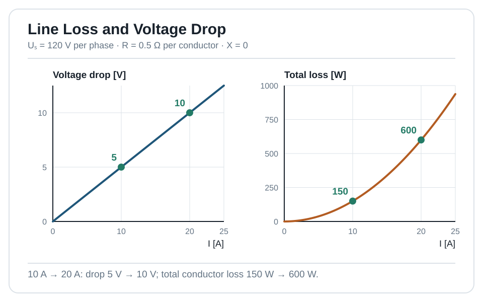

# M7-L5 – Lines, Loads and Simplified Network Models {#L5}

**Course area:** M7 – Bachelor: Electric Power Engineering

**Level:** Bachelor

**Prerequisites:** [Three-phase systems, star and delta](M7-L2.md), [Transformers and voltage conversion](M7-L3.md) and [Impedances in sinusoidal operation](M1-L6.md).

**Learning objective:** Model a radial connection as a per-phase equivalent circuit, calculate voltage drop and line loss, and explain which assumptions distinguish load calculations from fault calculations.

## The radial two-bus case {#S1}

The simplest network diagram containing a line has a sending bus and a load bus. In a balanced three-phase system, all three identical phases can be calculated using a single per-phase equivalent circuit. The source has a fixed phase-voltage phasor $\underline U_\mathrm S$. Each phase of the line has a series impedance $Z_\mathrm{line}=R+jX$, and the load has a phase impedance $Z_\mathrm{load}$. Shunt admittance to earth is neglected in the short-line model. All impedances are at the same voltage level, after conversion using an ideal turns ratio if necessary.

The branch current is positive from the source to the load. The linear system of equations reduces to

$$
\underline I=\frac{\underline U_\mathrm S}{Z_\mathrm{line}+Z_\mathrm{load}},
\qquad
\underline U_\mathrm R=\underline U_\mathrm S-Z_\mathrm{line}\underline I .
$$

The phasor voltage drop across the line is $Z_\mathrm{line}\underline I$. The difference between the voltage magnitudes also depends on the direction of this phasor relative to the receiving-end voltage. For a small relative drop, it can be projected in the direction of $\underline U_\mathrm R$. If the current lags the load voltage by $\varphi$, the following approximation applies:

$$
|\underline U_\mathrm S|-|\underline U_\mathrm R|
 \approx I(R\cos\varphi+X\sin\varphi).
$$

The transverse component of the drop changes the angle. The approximation neglects its contribution to the magnitude at first order. For a large voltage drop, the full phasors must be used.

## Power loss in the three conductors {#S2}

For three identical conductor impedances, $P_\mathrm{loss}=3RI^2$. The factor of three sums the active power losses in the three line conductors. The quantity $R$ is the resistance of one phase in the equivalent model. An ideal inductive reactance consumes no active power averaged over a sinusoidal cycle. It changes the voltage and current, and exchanges reactive power $Q_\mathrm{line}=3XI^2$ with the rest of the network in the model.

## Worked example: increasing loss at higher current {#S3}

A balanced model has $U_\mathrm S=120\,\mathrm V$ per phase, $R=0.5\,\Omega$ and $X=0$. Three load resistors of $11.5\,\Omega$ each are connected in star. This gives $I=10\,\mathrm A$, $U_\mathrm R=115\,\mathrm V$, $P_\mathrm{load}=3\cdot115\cdot10\,\mathrm W=3\,450\,\mathrm W$ and $P_\mathrm{loss}=150\,\mathrm W$. The supplied active power is $3\,600\,\mathrm W$ and satisfies the balance.

With $5.5\,\Omega$ per phase in the second state, $I=20\,\mathrm A$. The voltage drop is then $10\,\mathrm V$ and the conductor loss is $600\,\mathrm W$. The load terminals receive $110\,\mathrm V$ per phase. Doubling the current magnitude quadruples the heat dissipated at constant resistance.

{alt="A linear voltage-drop graph and a quadratic power-loss graph with marked points at ten and twenty amperes."}

The graphs hold the line resistance constant and vary current as a parameter. In the two-bus model, the current in each case is determined by the load impedance. The left axis shows the difference between phase voltages; the right axis shows the sum of the three resistive conductor losses.

## Scope and idealised fault cases {#S4}

During a fault, a new boundary condition may replace the normal load model. An assumed ideal balanced short circuit sets the three terminal potentials equal in the model. The current is then determined by the remaining equivalent impedances, including that of the source. Zero impedance in an ideal source circuit results in a singular calculation. Unbalanced faults require a multiphase model or decomposition into symmetrical components. Arcing, dynamics, earthing, protective-device behaviour and phase imbalance are not accounted for in the equivalent model considered here.

Depending on the analysis, a constant-power model may also be appropriate for regulated loads. The assumption of constant complex power $\underline I=\overline{\underline S/\underline U_\mathrm R}$ makes the current calculation voltage-dependent. The linear branch equation and this load condition give a nonlinear system of equations. The modelling assumption must therefore be documented together with the result.

## Exercises with solutions {#S5}

1. What are the power loss and load voltage in the second state of the example, with the same source and twice the line resistance?  
   **Solution** $R=1\,\Omega$ and $I=120/(1+5.5)\,\mathrm A\approx18.46\,\mathrm A$. These give $U_\mathrm R\approx101.54\,\mathrm V$ and $P_\mathrm{loss}\approx1\,022.49\,\mathrm W$.
2. Does the loss double if the resistance is doubled at the same load impedance?  
   **Solution** In general, the current changes as well. Here, simply doubling the old loss would give $1\,200\,\mathrm W$. Recalculating the current gives approximately $1\,022.49\,\mathrm W$.

**Further study:** [Power supply system case study](M7-L6.md)

## Sources {#S6}

- [J. L. Kirtley, MIT 6.061, AC Power Flow in Linear Networks](https://ocw.mit.edu/courses/6-061-introduction-to-electric-power-systems-spring-2011/9cf8de165233601f547b284cee5c2131_MIT6_061S11_ch2.pdf) · Chapter 2, pp. 14–15: complex power and RMS values; partial scope. · Last accessed: 2026-11-25
- [J. L. Kirtley, MIT 6.061, Introduction to Symmetrical Components](https://ocw.mit.edu/courses/6-061-introduction-to-electric-power-systems-spring-2011/7603169f5d8514b769a46fa900b79a57_MIT6_061S11_ch4.pdf) · Chapter 4, p. 2: symmetrical components for unbalanced networks; partial scope. · Last accessed: 2026-11-25
