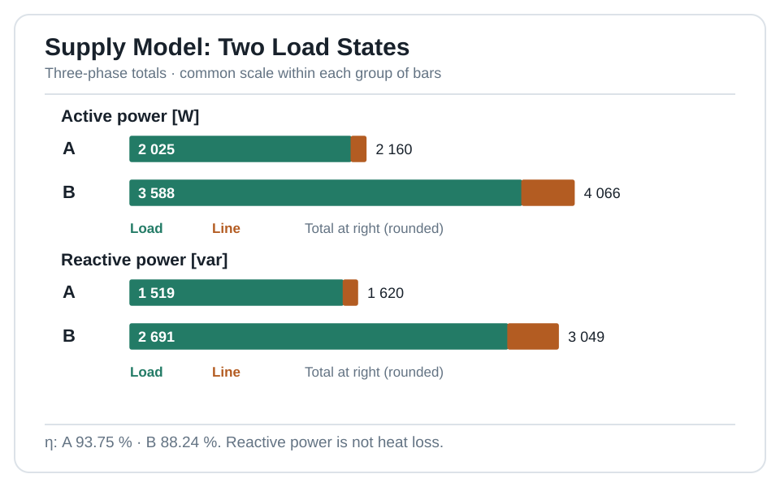

# M7-L6 – Power Supply System Case Study {#L6}

**Course area:** M7 – Bachelor: Electric Power Engineering

**Level:** Bachelor

**Prerequisites:** [Electrical power balances](M7-L1.md), [Voltage conversion](M7-L3.md) and [the radial two-bus case](M7-L5.md).

**Learning objective:** Reproducibly compare two load states of a balanced supply model, account for active and reactive power flows, and explain changes in voltage, losses and efficiency.

## Model and comparison question {#S1}

The conceptual model connects an ideal three-phase supply to a balanced load. An ideal transformer provides a secondary phase voltage of $120\,\mathrm V$. All subsequent impedances are referred to the secondary side. The series impedance $Z_\mathrm{line}=(0.8+j0.6)\,\Omega$ per phase combines the line and passive series components. The ideal transformer itself absorbs no active power.

In state A, the load impedance is $Z_A=(12+j9)\,\Omega$ per phase. In state B, it becomes $Z_B=(6+j4.5)\,\Omega$. Lower impedance means higher current in this comparison. The voltage directly at the load and the active power it absorbs are obtained from the same current. The comparison covers two separate steady states.

## Power balance using phasors {#S2}

The constant reference is $\underline U_\mathrm S=120+j0$ in volts. With $Z=Z_\mathrm{line}+Z_\mathrm{load}$, the relationships are

$$
\begin{aligned}
\underline I &= \underline U_\mathrm S/Z,\\
\underline U_\mathrm R &= Z_\mathrm{load}\underline I,\\
\underline S_\mathrm{in} &= 3\,\underline U_\mathrm S\underline I^*,\\
\underline S_\mathrm{load} &= 3\,\underline U_\mathrm R\underline I^*,\\
\underline S_\mathrm{line} &= 3\,|\underline I|^2 Z_\mathrm{line}.
\end{aligned}
$$

The quantities are RMS phasors. The supplied power is positive from the source terminals into the network. Since $\underline U_\mathrm S=\underline U_\mathrm R+Z_\mathrm{line}\underline I$, the identity $\underline S_\mathrm{in}=\underline S_\mathrm{load}+\underline S_\mathrm{line}$ holds. This provides a check for both active and reactive power. For efficiency $\eta=P_\mathrm{load}/P_\mathrm{in}$, we use only the real parts.

## Reproducible model calculation {#S3}

This Python program uses built-in complex arithmetic. The complex power identity is checked directly for both cases.

```python
u_source = 120 + 0j
z_line = 0.8 + 0.6j

cases = [("A", 12 + 9j), ("B", 6 + 4.5j)]
for label, z_load in cases:
    current = u_source / (z_line + z_load)
    u_load = z_load * current
    s_source = 3 * u_source * current.conjugate()
    s_load = 3 * u_load * current.conjugate()
    s_line = 3 * abs(current)**2 * z_line
    assert abs(s_source - s_load - s_line) < 1e-9
    efficiency = s_load.real / s_source.real
    print(
        f"{label}: I={abs(current):.2f} A, U={abs(u_load):.2f} V, "
        f"Pin={s_source.real:.2f} W, Pload={s_load.real:.2f} W, "
        f"Ploss={s_line.real:.2f} W, Qin={s_source.imag:.2f} var, "
        f"eta={efficiency:.2%}"
    )
```

| State | Current magnitude | Load voltage per phase | Supplied active power $P_\mathrm{in}$ | Load power | Line loss | Efficiency |
|---|---:|---:|---:|---:|---:|---:|
| A | $7.50\,\mathrm A$ | $112.50\,\mathrm V$ | $2\,160.00\,\mathrm W$ | $2\,025.00\,\mathrm W$ | $135.00\,\mathrm W$ | $93.75\,\%$ |
| B | $14.12\,\mathrm A$ | $105.88\,\mathrm V$ | $4\,065.88\,\mathrm W$ | $3\,587.54\,\mathrm W$ | $478.34\,\mathrm W$ | $88.24\,\%$ |

The source delivers approximately $1\,620.00\,\mathrm{var}$ in A and $3\,049.41\,\mathrm{var}$ in B. In this particular comparison, the load and line impedances have the same angle, so the power factor at the supply is $0.8$ in both cases. Efficiency nevertheless falls because the line resistance accounts for a greater share of the total resistance as load impedance decreases. Absolute load power increases because the higher load current more than offsets the decrease in load voltage in this model.

{alt="Stacked bars for the active and reactive power of the load and line in two states, with supply totals on the right."}

The bar lengths correspond to the unrounded calculated values; the figures in the diagram are rounded to whole watts or var, respectively. The active and reactive power scales are separate. The orange reactive power portion represents the reactive power exchanged by the line, not additional heat dissipation.

## Limitations and further exercise {#S4}

The calculation fixes source voltage, frequency and impedances. Load characteristics of electrical machines and regulated constant-power loads require their own load models. A detailed load-flow analysis may include multiple buses, modelled generator conditions, parallel paths and voltage-dependent loads. The example calculation can be used to derive voltage deviations and proportions of losses within this equivalent model.

**Exercise 1** Recalculate state B with $Z_\mathrm{line}=(1.2+j0.9)\,\Omega$.  
**Solution** The magnitude of the total impedance is $9\,\Omega$. This gives $I=13.33\,\mathrm A$, $U_\mathrm R=100\,\mathrm V$, $P_\mathrm{load}=3\,200\,\mathrm W$ and $P_\mathrm{loss}=640\,\mathrm W$. The balance gives $P_\mathrm{in}=3\,840\,\mathrm W$ and $\eta=83.33\,\%$.

**Exercise 2** Why is the current magnitude used in the loss formula for the line?  
**Solution** $\underline I\underline I^*=|\underline I|^2$ is real and independent of the phase reference. The real part of the line impedance gives the positive resistive loss, and its imaginary part gives the line's reactive power.

**Further study:** [Study pathway with the next applied project](pages/study-path.md)

## Sources {#S5}

- [J. L. Kirtley, MIT 6.061, AC Power Flow in Linear Networks](https://ocw.mit.edu/courses/6-061-introduction-to-electric-power-systems-spring-2011/9cf8de165233601f547b284cee5c2131_MIT6_061S11_ch2.pdf) · Chapter 2, pp. 14–15: real, reactive and apparent power; partial scope. · Last accessed: 2026-11-25
- [J. L. Kirtley, MIT 6.061, Introduction to Load Flow](https://www.ocw.mit.edu/courses/6-061-introduction-to-electric-power-systems-spring-2011/2f9042dd664b5bd07e4b5d4cb4930062_MIT6_061S11_ch5.pdf) · Chapter 5, § 2, p. 1: bus voltages and complex power balance; partial scope. · Last accessed: 2026-11-25
