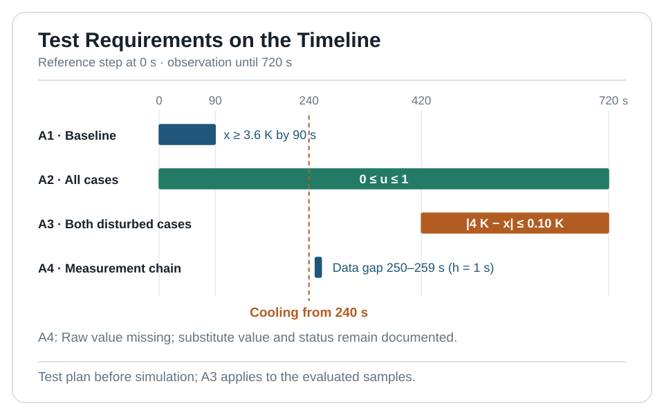

# M8-L1 – Requirements, Sources and the Project Question {#L1}

**Course area:** M8 – Bachelor: Engineering Practice and Bachelor’s Project

**Level:** Bachelor

**Prerequisites:** [Measurement chains](M6-L1.md), [Feedback](M6-L4.md) and [Temperature control](M6-L6.md).

**Learning objective:** Break a technical question down into verifiable requirements and specify suitable evidence for each objective.

## The project question {#S1}

A temperature controller is intended to maintain a constant temperature rise above ambient in a simulated test room. A temporary environmental influence lowers the temperature. The sensor reading has a small periodic deviation and temporarily fails. The project question is: **Which of the requirements specified in advance does the modelled controller meet in these three test cases?**

The test concerns the temperature rise $x=T-T_\mathrm{amb}$ in kelvin. At $T_\mathrm{amb}=20\,^\circ\mathrm C$, $x=4\,\mathrm K$ corresponds to an absolute temperature reading of $24\,^\circ\mathrm C$. The reference remains at $4\,\mathrm K$. The plant, measurement chain and control input are computational models. What matters in the project is whether a claim can be traced to a requirement, a file and a verifiable result.

## Specify requirements before calculating {#S2}

The frequency, duration and magnitude of a disturbance affect what a test can demonstrate. We therefore define three explicit scenarios:

- **Baseline:** Reference step at $t=0$, idealised calibrated measurement, without an external disturbance.
- **Disturbance:** From $t=240\,\mathrm s$, constant modelled cooling acts, represented in the plant equation by $d=-1\,\mathrm K$.
- **Measurement chain:** The same cooling, periodic measurement deviation and a measurement gap over $250\,\mathrm s\le t<260\,\mathrm s$.

| ID | Test object | Evidence in the computational experiment |
| --- | --- | --- |
| A1 | Approach in the baseline case | The simulated state $x$ first reaches at least $3.6\,\mathrm K$ by $t=90\,\mathrm s$. |
| A2 | Control input in all cases | Every recorded control input satisfies $0\le u\le1$. |
| A3 | Deviation after the disturbance begins | In both disturbed cases, $|4\,\mathrm K-x|\le0.10\,\mathrm K$ at every tested time from 420 to 720 s. |
| A4 | Documentation of the measurement outage | The raw values are missing during the specified interval; the substitute value and associated status can be identified separately. |

A3 applies at the times investigated. A further test with a smaller time step assesses the dependence on computational resolution. A4 establishes whether the data gap is correctly handled in the log. A3 tests whether the room also maintains its temperature under these conditions.

{alt="Timeline from zero to 720 seconds showing requirements A1 to A4, onset of the disturbance at 240 seconds and the measurement gap from 250 seconds."}

The coloured regions indicate the intended test times or time windows, not the outcome of the test. A1 requires at least one qualifying sample by 90 seconds; A3, by contrast, requires the limit to be satisfied at every tested time in the specified interval. For A4, the endpoint at 260 seconds is excluded.

## Example: Deriving a precise criterion from an observation {#S3}

“Stable at the end” can mean different things in everyday language. Suppose a test shows two rows with $x(400\,\mathrm s)=3.86\,\mathrm K$ and $x(720\,\mathrm s)=4.01\,\mathrm K$. The final value is only $0.01\,\mathrm K$ away from the reference. This is insufficient to decide A3, because A3 requires the **maximum absolute error over an interval**. A third row with $x(480\,\mathrm s)=3.88\,\mathrm K$ would immediately disprove A3.

We also distinguish between the purpose of a test and the applicable standard of evidence. The log field for a substitute value can be tested directly. Evidence of actual temperature quality would require, among other things, a suitable thermometer, consideration of the spatial temperature distribution and an independent experiment. A positive simulation result is a statement about this configuration and these disturbances.

## Self-check {#S4}

1. For an additional case, formulate a concrete limit on a single overshoot of at most $0.20\,\mathrm K$. Which value must you determine from the data?
2. The sample interval is half a second. How many raw values are missing if the interval $[250,260)$ is sampled exactly?
3. Why can a rejected data field in the log violate A4 even though the curve satisfies A3?

### Solutions

1. In this case, $\max x\le4.20\,\mathrm K$ must hold throughout the observation period specified in advance. During evaluation, the maximum simulated state value and its time are recorded.
2. There are $10/0.5=20$ missing raw values. The first missing value is at $250\,\mathrm s$, the last at $259.5\,\mathrm s$.
3. A4 tests the traceability of the measurement information. A plausible curve does not prove that the log makes the difference in origin between measured and substitute values visible.

## Project limitations and further study {#S5}

The comparison demonstrates suitability for the specified scenarios with a scalar state model. Statements about the operational safety of a heating system require other evidence and qualified professionals with appropriate responsibility. In [M8-L2](M8-L2.md), the component models and their interfaces are developed.

## Sources {#S6}

- [KIT, B.Sc. Electrical Engineering and Information Technology, module handbook, winter semester 2026/27](https://s.kit.edu/mhb-etit-bsc23) · project work module M-ETIT-106629, § 13.56. · Last accessed: 2026-11-25
- [TUM, Electrical Engineering and Information Technology study guide](https://www.cit.tum.de/fileadmin/w00byx/cit/Studium/Studiengaenge/Bachelor_Elektrotechnik_Informationstechnik/Studienfuehrer_Bachelor_EI.pdf) · §§ 5.6–5.7 on engineering practice and the bachelor’s thesis. · Last accessed: 2026-11-25
- [NASA Systems Engineering Handbook, Appendix D](https://www.nasa.gov/reference/appendix-d-requirements-verification-matrix/) · unambiguous linking of requirements and evidence · Last accessed: 2026-11-25
