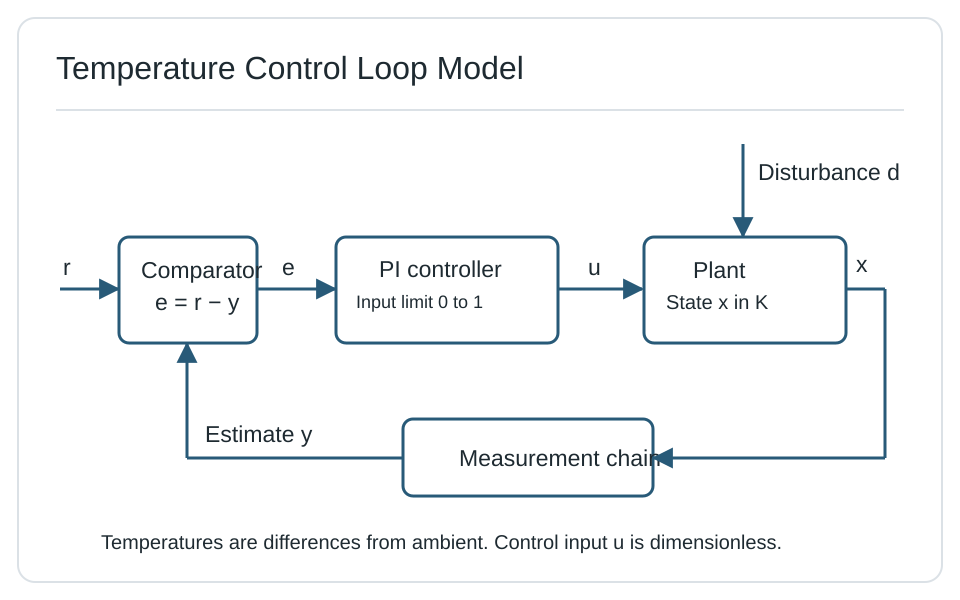

# M8-L2 – Design of the Measurement Chain and Control Plant {#L2}

**Course area:** M8 – Bachelor: Engineering Practice and Bachelor’s Project

**Level:** Bachelor

**Prerequisites:** [Project requirements](M8-L1.md), [Step response](M6-L3.md) and [Stability and introduction to controllers](M6-L5.md).

**Learning objective:** Formulate plant, measurement and controller models using consistent quantities. Calculate the most important expected values before simulation.

## From the problem statement to the interface {#S1}

The plant supplies the temperature rise $x$ in kelvin. The measurement chain converts $x$ into a raw signal $m$ and estimates the calibrated measurement value $y$ from it. The controller uses $y$ to form the error $e=r-y$. It supplies the dimensionless control input $u$, limited to the interval $[0,1]$. The reference $r$ and disturbance $d$ are modelled in kelvin. $d$ is an equivalent input to the plant that shifts its equilibrium value.

{alt="Block diagram of a feedback-controlled plant. The numerical temperature state is captured by the measurement chain and fed back to the controller."}

## Plant model and units {#S2}

The state dynamics are

$$
\tau\dot x+x=K_u u+d,\qquad \tau=60\,\mathrm s,\quad K_u=10\,\mathrm{K}.
$$

Since $u$ is dimensionless, $K_u$ can be specified in kelvin. $\tau\dot x$ has units of kelvin. A constant control input $\bar u$ and a constant disturbance $\bar d$ yield the steady-state value $\bar x=K_u\bar u+\bar d$. For $r=4\,\mathrm K$, the disturbance-free equilibrium would require $u=0.4$. With $d=-1\,\mathrm K$, it requires $u=0.5$.

The controller calculation uses the integrator state $z$ in control-input units. The proportional gain is $K_p=0.20\,\mathrm K^{-1}$ and the integral gain is $K_i=K_p/\tau$. In the linear model, $\dot z=K_i e$. The unconstrained control input is $K_p e+z$. When limiting the input, integration in the direction of a control-input limit that has already been reached is suspended. When the unconstrained control input falls back, the integrator can resume normal operation. This conditional integration is the anti-windup rule used here.

## Measurement model and calibration {#S3}

For the raw signal in volts, we assume:

$$
m=b+g x+n,\qquad
b=0.30\,\mathrm V,\quad
g=1.02\,\mathrm{V/K}.
$$

The calibrated estimate is $y=(m-b)/g$. For the **measurement chain** case, the simulation uses a prescribed deviation $n=0.05\,\mathrm V\sin(2\pi t/(20\,\mathrm s))$. The resulting measurement error has a peak value of $0.05\,\mathrm V/g\approx0.0490\,\mathrm K$. The sinusoidal disturbance is used to reproduce the same deviation exactly in every run.

During the ten-second measurement gap, $y$ remains at the last valid value. Integration of the state $x$ continues. Each substitute value receives a status flag. This behaviour models a limited test case. A longer gap would require a separate fault-handling requirement.

## Example: Initial values and plausibility {#S4}

Initially, $x(0)=z(0)=0$. Without measurement deviation, calibration gives $y(0)=0$. The initial control input is $u(0)=0.20\cdot4=0.8$. With $d=0$, the state rate is

$$
\dot x(0)=\frac{10\,\mathrm K\cdot0.8}{60\,\mathrm s}
=0.1333\ldots\,\mathrm{K/s}.
$$

An explicit Euler step of one second therefore gives $x(1\,\mathrm s)=0.1333\ldots\,\mathrm K$. It starts with the values at $t=0$. If the code updated $z$ before this calculation and immediately used the newly calculated control input, it would implement a different discrete method. The first hand-calculated value is therefore a useful test of the update order.

## Self-check {#S5}

1. A raw value is $m=3.36\,\mathrm V$. Determine $y$ using the specified calibration.
2. What disturbance $d$ is present at equilibrium when $u=0.65$ and $x=4\,\mathrm K$?
3. At $e=1\,\mathrm K$ and $z=0.9$, the controller proposes $u=1.1$. What does the limiter return, and how does the integrator behave?

### Solutions

1. $(3.36-0.30)/1.02=3\,\mathrm K$.
2. $d=x-K_u u=4\,\mathrm K-6.5\,\mathrm K=-2.5\,\mathrm K$.
3. The valid control input is $u=1$. Since $e>0$ would further increase the unconstrained control input, $z$ remains unchanged during this step.

## Limitations and further study {#S6}

Heat loss, room size and heating power are represented here by the steady-state gain $K_u$ and by $\tau$. The measurement chain uses known calibration values. The uncertainty of these parameters would need to be determined in a real measurement project. [M8-L3](M8-L3.md) combines the models into a reproducible computational experiment.

## Sources {#S7}

- [Åström/Murray – Feedback Systems, Second Edition](https://fbswiki.org/wiki/index.php/Feedback_Systems%3A_An_Introduction_for_Scientists_and_Engineers) · Chapter index 3, 5, 6, 9 and 11: modeling, dynamics, linear systems, transfer functions and PID; linked chapters not re-reviewed. · Last accessed: 2026-11-25
- [JCGM 100:2008, Guide to the Expression of Uncertainty in Measurement](https://www.bipm.org/en/doi/10.59161/jcgm100-2008e) · measurement model, input quantities and uncertainty · Last accessed: 2026-11-25
