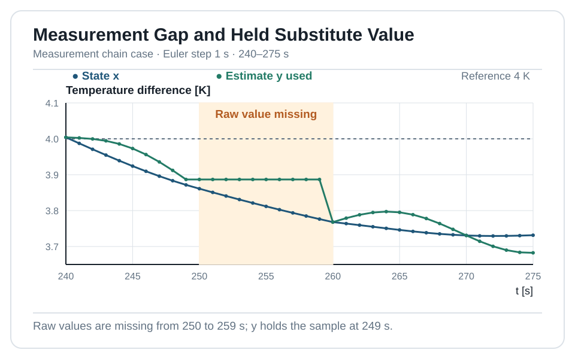

# M8-L3 – Simulation, Reference Values and Measurement Data {#L3}

**Course area:** M8 – Bachelor: Engineering Practice and Bachelor’s Project

**Level:** Bachelor

**Prerequisites:** [Project requirements](M8-L1.md), [Plant and measurement model](M8-L2.md) and [Computational experiments](M2-L7.md).

**Learning objective:** Produce a reproducible simulation run with documented inputs, raw values, state variables and test metrics calculated from them.

## Data flow and timeline {#S1}

The model consistently uses seconds, kelvin for temperature differences and volts for the raw sensor value. At each time, the current state $x_k$ is measured first, the control input $u_k$ is then calculated, and integration subsequently uses the values at that time. For the Euler method with step size $h$,

$$
x_{k+1}=x_k+\frac{h}{\tau}\left(K_u u_k+d_k-x_k\right).
$$

The log contains both the simulated state $x_k$ and the measurement estimate $y_k$. The simulated state serves here as the reference for the test metrics. In a real installation, the controller generally knows this state only through measurements or an estimate. During the measurement gap, the field for $m_k$ is empty. The substitute value used remains visible in $y_k$.

## Reproducible computational experiment {#S2}

The program requires the Python standard library. With a step size of one second, it calculates 721 rows per case, including the time 720 s. The control input specified there is recorded. For the reported time interval, only inputs before that final time contribute to the evolution of the state. When saving the data, rows are distinguished by the name of each test case.

```python
import csv
import math

TAU, GAIN, REF = 60.0, 10.0, 4.0
KP, KI = 0.2, 0.2 / TAU
OFFSET, SCALE = 0.30, 1.02
CASES = ("basis", "stoerung", "messkette")

def simulate(case, dt=1.0):
    if case not in CASES or dt not in (1.0, 0.5):
        raise ValueError("Unbekannter Fall oder Zeitschritt")
    x, z, y = 0.0, 0.0, 0.0
    samples = []
    for k in range(int(720 / dt) + 1):
        t = k * dt
        missing = case == "messkette" and 250 <= t < 260
        n = 0.05 * math.sin(2 * math.pi * t / 20) if case == "messkette" else 0.0
        raw = None if missing else OFFSET + SCALE * x + n
        if raw is not None:
            y = (raw - OFFSET) / SCALE
        d = -1.0 if case != "basis" and t >= 240 else 0.0

        e = REF - y
        proposal = KP * e + z
        u = min(1.0, max(0.0, proposal))
        deeper = (proposal >= 1 and e > 0) or (proposal <= 0 and e < 0)
        samples.append((t, x, raw, y, u, d, int(missing)))
        if not deeper:
            z += dt * KI * e
        x += dt * (GAIN * u + d - x) / TAU
    return samples

def metrics(rows):
    arrival = next(t for t, x, *_ in rows if x >= 3.6)
    max_after = max(abs(x - REF) for t, x, *_ in rows if t >= 420)
    return arrival, max_after, sum(row[-1] for row in rows)

with open("temperaturprojekt.csv", "w", encoding="utf-8", newline="") as file:
    writer = csv.writer(file)
    writer.writerow(("fall", "t_s", "x_K", "roh_V", "y_K", "u", "d_K", "luecke"))
    for case in CASES:
        rows = simulate(case)
        assert all(0 <= row[4] <= 1 for row in rows)
        writer.writerows((case, *row) for row in rows)
        print(case, metrics(rows))
```

The file *temperaturprojekt.csv* is created in the working directory. The three columns for the raw value, the calibrated value used and the gap status help test the data handling separately. The original code retains its German CSV labels and case names (`basis` = baseline, `stoerung` = disturbance, `messkette` = measurement chain; `fall` = case, `roh_V` = raw value in volts, `luecke` = gap). To compare a different step size, run the same function with $h=0.5\,\mathrm s$ and record the results separately.

## Expected test values {#S3}

| Case at $h=1\,\mathrm s$ | First sample with $x\ge3.6\,\mathrm K$ | Maximum absolute reference error from 420 s | Missing raw values |
| --- | ---: | ---: | ---: |
| Baseline | 68 s | approximately $0.000003\,\mathrm K$ | 0 |
| Disturbance | 68 s | $0.046309\,\mathrm K$ | 0 |
| Measurement chain | 69 s | $0.045113\,\mathrm K$ | 10 |

In the **measurement chain** case, the estimate at the start of the outage at 250 s is approximately $3.886769\,\mathrm K$. It stays constant up to and including 259 s. The actual simulated state falls during that period from approximately $3.861068\,\mathrm K$ to $3.776376\,\mathrm K$. The difference illustrates why a held signal must be flagged in the file.

{alt="Time histories of the simulated state and the measurement estimate used from 240 to 275 seconds; ten seconds without raw values are shaded."}

The points come from the program in this lesson. The lines connect the discrete samples as a visual guide; they do not represent additional measurement resolution. During the shaded period, no raw values are available. The green curve does not describe new sensor measurements, but the held substitute value.

## Self-check {#S4}

1. How many data rows are generated for three cases and a time step of one second? Count the header row separately.
2. In the measurement chain case, the true state at 250 s is approximately $3.861068\,\mathrm K$, and the substitute value is $3.886769\,\mathrm K$. How large is the difference $y-x$?
3. Why can the climate-control reference in a log’s raw-value column neither be directly compared with $4\,\mathrm K$ nor be read from an empty cell?

### Solutions

1. Each case has 721 rows, giving a total of 2163 data rows plus one header row.
2. The difference is approximately $+0.025701\,\mathrm K$. In this row, the value that continues to be used overestimates the simulated state.
3. The raw value is a voltage and requires calibration. An empty cell signifies a measurement gap. Separate columns are provided for the substitute value used and the status.

## Limitations and further study {#S5}

The comparison is deterministic. Other sensor deviations, longer outages and changed model parameters are separate test cases. A reproducible file initially demonstrates that the same calculation can be repeated with the same inputs. [M8-L4](M8-L4.md) additionally tests whether the model satisfies the selected references and assumptions.

## Sources {#S6}

- [National Academies, Reproducibility and Replicability in Science](https://www.nationalacademies.org/read/25303/chapter/3) · summary on computational reproducibility with the same inputs, computational steps and conditions · Last accessed: 2026-11-25
- [Åström/Murray – Feedback Systems, Second Edition](https://fbswiki.org/wiki/index.php/Feedback_Systems%3A_An_Introduction_for_Scientists_and_Engineers) · Chapter index 3, 5, 6, 9 and 11: modeling, dynamics, linear systems, transfer functions and PID; linked chapters not re-reviewed. · Last accessed: 2026-11-25
