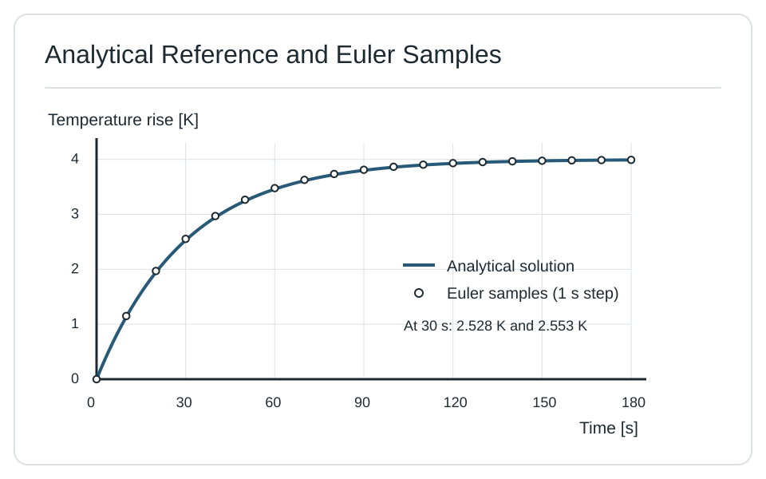

# M8-L4 – Model Validation and Troubleshooting {#L4}

**Course area:** M8 – Bachelor: Engineering Practice and Bachelor’s Project

**Level:** Bachelor

**Prerequisites:** [Computational experiment and data sets](M8-L3.md), [Linear differential equations](M2-L3.md) and [Stability](M6-L5.md).

**Learning objective:** Distinguish computational errors, model discrepancies and measurement problems using different types of comparative data.

## Different questions require different evidence {#S1}

The implementation is consistent if the code solves the specified equations correctly. Model suitability is a separate question. A computational result may match an incomplete model precisely. We therefore examine an analytically solvable reference case, sensitivity to the numerical time step and the deviation from a separately defined test plant.

| Question | Suitable comparison |
| --- | --- |
| Is the state update correct? | Hand calculation of the first time step and analytical baseline case. |
| Do the verification results depend strongly on the time step? | Repeat with 1 s and 0.5 s. |
| Does the model explain a test plant with different parameters? | Compare the model trajectory with independent reference values and document the residual. |
| Can missing raw data be identified? | Directly test the time boundaries, empty field and status flag. |

## Analytical check and time-step comparison {#S2}

In the baseline case with ideal measurement, the control input remains within its limits. With the plant $10/(60s+1)$ and PI controller $0.20+0.20/(60s)$, the closed-loop reference-to-output transfer function is $1/(30s+1)$. The exact continuous solution for the reference step is

$$
x(t)=4\,\mathrm K\left(1-\mathrm e^{-t/(30\,\mathrm s)}\right).
$$

At $t=30\,\mathrm s$ it gives approximately $2.5285\,\mathrm K$. The Euler run with a one-second step gives $2.5534\,\mathrm K$ at that time. The difference of approximately $0.0249\,\mathrm K$ can be attributed to discretisation. It occurs in the deterministic baseline case before any measurement gap. The first sample reaching $3.6\,\mathrm K$ occurs at 68 s in the coarser run and at 69 s in the run with half the step size. The continuous equation reaches the threshold at $30\,\mathrm s\ln 10\approx69.08\,\mathrm s$.

In the disturbed case, the largest error after 420 s rises from $0.046309\,\mathrm K$ to $0.046812\,\mathrm K$ when the time step is halved. Both results are below $0.10\,\mathrm K$. In the measurement chain case, 10 and 20 rows respectively are flagged within the gap. Its duration remains unchanged.

{alt="Temperature rise curve in the baseline case. The analytical reference and the Euler samples are compared using the value at 30 seconds."}

## Cross-check: the test plant responds more slowly {#S3}

In an additional synthetic experiment, a constant control input $u=0.4$ replaces the PI controller. The test plant has $\tau=72\,\mathrm s$. It gives approximately $2.262\,\mathrm K$ at 60 s. The original model with $\tau=60\,\mathrm s$ gives $2.528\,\mathrm K$. The residual $x_\mathrm{Test}-x_\mathrm{Modell}$ is therefore approximately $-0.267\,\mathrm K$ (the subscripts denote the test plant and the model).

The sign is consistent with the slower test plant. If deviations at several times follow a similar pattern, the time constant may offer an explanation. A single value also allows for a different steady-state gain, measurement calibration errors or an incorrectly aligned time axis. Several samples, the final value and a second run should therefore be examined. The synthetic counterexample tests the troubleshooting procedure. Demonstrating validity for an actual room requires real comparative data.

## Self-assessment {#S4}

1. For $x(0)=0$ and $x_\infty=4\,\mathrm K$, an open-loop test gives $x=2.5285\,\mathrm K$ at 60 s. Estimate the time constant using the first-order model.
2. In a log with $h=1\,\mathrm s$, raw values are missing from 250 s through 260 s inclusive. How does this differ from the requirement?
3. Why is a comparison of two Euler step sizes alone weaker than a comparison with the analytical solution?

### Solutions

1. The normalised deviation from the final value is approximately $1-2.5285/4=0.3679$. Thus $\tau=-60\,\mathrm s/\ln(0.3679)\approx60\,\mathrm s$.
2. The upper boundary of the interval is exclusive. At 260 s there must already be a valid raw value. Eleven flagged rows would indicate a boundary error in the implementation.
3. Both Euler runs may share an implementation error. The independently derived solution provides a reference for the model calculation in the simplified case.

## Limitations and further learning {#S5}

The thresholds are checked at discrete samples. Rare deviations between two samples would require a finer simulation or an analytical bound. [M8-L5](M8-L5.md) incorporates the findings into the report and verification matrix.

## Sources {#S6}

- [Åström/Murray – Feedback Systems, Second Edition](https://fbswiki.org/wiki/index.php/Feedback_Systems%3A_An_Introduction_for_Scientists_and_Engineers) · Chapter index 3, 5, 6, 9 and 11: modeling, dynamics, linear systems, transfer functions and PID; linked chapters not re-reviewed. · Last accessed: 2026-11-25
- [NASA Systems Engineering Handbook, Appendix D](https://www.nasa.gov/reference/appendix-d-requirements-verification-matrix/) · traceability to evidence and verification methods · Last accessed: 2026-11-25
