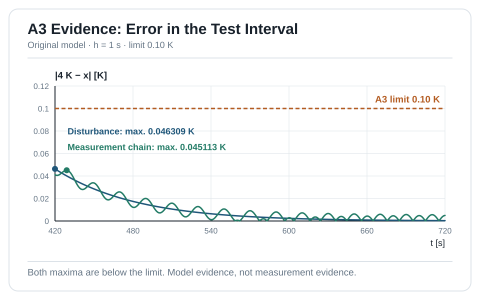

# M8-L5 – Technical Reporting and Reproducibility {#L5}

**Course area:** M8 – Bachelor: Engineering Practice and Bachelor’s Project

**Level:** Bachelor

**Prerequisites:** [Requirements matrix](M8-L1.md), [Data log](M8-L3.md) and [Reference tests](M8-L4.md).

**Learning objective:** Write a verifiable technical project report that clearly identifies decisions, results, uncertainties and limitations.

## Report and verification evidence {#S1}

Begin the report with the project question and the most important result. Describe the temperature difference as the target quantity, the cases tested, the model assumptions and the underlying data. Details of the simulation loop belong in the methods section or an appendix. A single figure in the main text is sufficient if it supports the verification decision and identifies the time axis, units, reference value and onset of the disturbance. Each row of the verification matrix shows which test supports the corresponding statement.

| ID | Finding for $h=1\,\mathrm s$ | Evidence |
| --- | --- | --- |
| A1 | Met. The first sample reaching $3.6\,\mathrm K$ in the baseline case occurs at 68 s. | Column $x$ of the baseline data. |
| A2 | Met. All logged control inputs lie in $[0,1]$. | Range check of the control input column for all three test cases. |
| A3 | Met. Largest verified reference tracking error: $0.046309\,\mathrm K$ in the disturbed case and $0.045113\,\mathrm K$ in the measurement chain case. | Maximum absolute error across the rows from 420 s onwards. |
| A4 | Met. Exactly ten raw values are missing. The status and held estimate are visible. | Time comparison for the rows from 250 to 259 s. |

The statement “A2 met” is narrower than a statement about the feasibility of the heating power. A2 checks a dimensionless model input whose limit is part of the program. Whether an implemented system can safely and accurately realise a corresponding control input requires additional requirements and evidence.

{alt="Absolute reference tracking error of the two disturbed cases during the verification interval from 420 to 720 seconds, with a requirement limit of 0.10 kelvin."}

The plotted interval contains all 301 verification samples for each case. The largest absolute error is determined from these values, not from the final value. The figure thus provides direct evidence for A3 in the numerical model; other requirements and the actual system require separate evidence.

## Report numerical values with appropriate precision {#S2}

The verification matrix allows the exact value recorded by the program to be located. In the results summary, “approximately $0.05\,\mathrm K$ maximum error after 420 s” is sufficient. In the disturbed case, halving the time step changes this verification value by approximately $0.0005\,\mathrm K$. This describes numerical sensitivity in this comparison. It is not an established measurement uncertainty for an actual device.

Separate the assumptions behind uncertainties according to their origin. Time resolution comes from the computational method. Sensor gain, offset and possible drift originate in the measurement chain. An unmodelled spatial temperature distribution concerns the choice of model. Use a quantitative uncertainty budget only for quantities with traceable input data.

## Reproduction instructions and final review {#S3}

Another person needs the program text from the lesson, the Python version used, the inputs for all three cases and a description of the generated file. They should be able to reproduce the same threshold decision. Brief reproduction instructions specify the directory where the run generates its CSV and which columns and time intervals to evaluate. When comparing two versions later, it should be clear whether the model, data processing or only the presentation was changed.

A concise final report may have the following structure:

1. Question, scope, verification criteria.
2. Plant, measurement and controller models with units.
3. Test cases, program version and data provenance.
4. Results, verification matrix and comparison runs.
5. Limitations, open questions and reproduction instructions.

Good scientific practice begins when experiments are recorded. Retain a run that failed a requirement if it provides technical insight. Explain corrections to the model or calculation and their effects on the conclusion.

## Self-assessment {#S4}

1. Write a defensible one-sentence summary of A3. It should include the outcome, scenarios and time interval.
2. A report contains two rounded figures for A3. How can you verify the claim without running the program again?
3. Propose an additional test for a substantially longer measurement gap. What information should be specified in the requirement before the test is performed?

### Solutions

1. “In the two simulated cases with a cooling disturbance, the absolute reference tracking error was below $0.10\,\mathrm K$ at all verified time points from 420 to 720 s.”
2. Use the saved CSV, filter by the two test cases and $420\le t\le720$, calculate $|4\,\mathrm K-x|$ for each row and compare the respective maxima with the threshold.
3. Specify the start and duration of the gap, substitute-value strategy, observation interval and permissible deviation. Specify separately when the failure status must be visible. The assessment depends on the purpose of the test.

## Completion and further learning {#S5}

This project enables the reader to trace the engineering process from requirements and models through data to the report. The [study pathway](pages/study-path.md) identifies the subsequent elective modules to which the same verification structure can be applied.

## Sources {#S6}

- [KIT, B.Sc. Electrical Engineering and Information Technology, module handbook, winter semester 2026/27](https://s.kit.edu/mhb-etit-bsc23) · § 13.56, project work following good scientific practice. · Last accessed: 2026-11-25
- [National Academies, Reproducibility and Replicability in Science](https://www.nationalacademies.org/read/25303/chapter/3) · summary on reproducible computational studies · Last accessed: 2026-11-25
- [JCGM 100:2008, Guide to the Expression of Uncertainty in Measurement](https://www.bipm.org/en/doi/10.59161/jcgm100-2008e) · scope and documentation of measurement uncertainty · Last accessed: 2026-11-25
