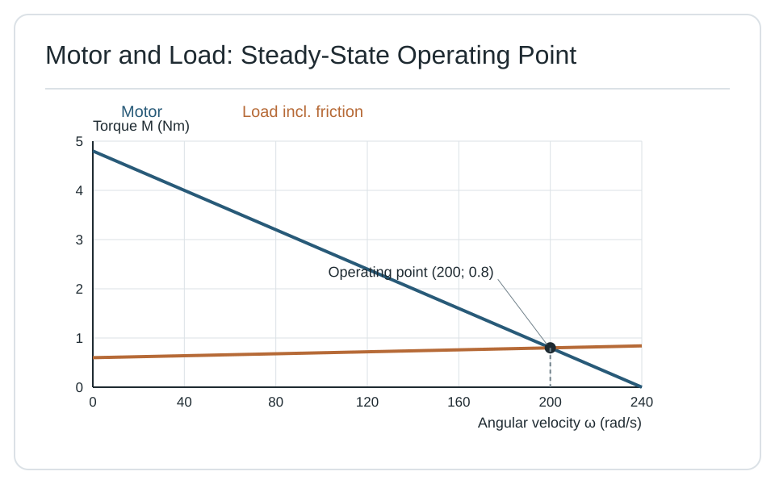

# M9-L1 – Motor, Load and Mechanical Operating Point {#L1}

**Course area:** M9 – Bachelor: Electrical Drives and Power Electronics

**Level:** Bachelor · Elective area

**Prerequisites:** [Overview of electrical machines](M7-L4.md), [Power balance](M1-L1.md).

**Learning objective:** Determine torque, speed, the mechanical load characteristic and efficiency using a DC machine model; distinguish steady-state and dynamic operation.

## From the Electrical to the Mechanical Port {#S1}

A drive consists of an energy source, a power converter, a machine and a mechanical load. When lifting a load, the machine must transfer energy against gravity; when lowering it, the load can transfer energy to the machine. The direction of motion alone therefore does not determine whether the machine operates as a motor or a generator.

We take the armature current $i$ as positive into the positive voltage terminal and the electromagnetic torque $M$ in the direction of positive angular velocity $\omega$. For a DC machine with constant excitation flux and idealised commutation,

$$
u=Ri+L\frac{di}{dt}+k_e\omega,\qquad M=k_t i.
$$

The final voltage term is the back EMF (electromotive force). In consistent SI units, $k_e$ in $\mathrm{V\,s/rad}$ and $k_t$ in $\mathrm{N\,m/A}$ have the same numerical value $k$, provided the conversion model is lossless: $k_e\omega i=M\omega$. Mechanical power is $P_\mathrm{mech}=M\omega$; rotational speed $n$ in revolutions per minute is converted using $\omega=2\pi n/60$. At standstill, a motor can produce torque but cannot deliver mechanical power.

## Load Characteristic and Steady-State Operating Point {#S2}

For a rigid shaft with moment of inertia $J$, viscous friction coefficient $B$ and external load torque $M_L$ opposing rotation in the positive direction,

$$
J\dot\omega=M-B\omega-M_L.
$$

With constant voltage and steady-state current, $M=k(u-k\omega)/R$. The motor characteristic decreases linearly with $\omega$. The required load characteristic $M_\mathrm{erf}=M_L+B\omega$ (subscript erf denotes required torque) increases for $B>0$. Their intersection is the steady-state operating point. If the shaft slows slightly at constant $u$, the motor torque increases in the steady-state electrical model, counteracting the slowdown. Dynamic stability with finite $L$ must be investigated separately.

{alt="Decreasing motor characteristic and increasing load characteristic intersecting at 200 rad/s and 0.8 Nm."}

A fan may have an opposing torque that increases approximately with $\omega^2$ (for positive rotation), whereas a conveyor belt often requires approximately constant load torque. The ideal no-load speed $u/k$ also assumes $B=0$. The stall current $u/R$ is merely a model value and may be thermally unacceptable in practice.

## Worked Example: Operating Point and Power {#S3}

Let $u=24\,\mathrm V$, $R=0.5\,\Omega$, $k=0.1$ in the SI units above, $B=0.001\,\mathrm{N\,m\,s/rad}$ and $M_L=0.6\,\mathrm{N\,m}$. From $k(u-k\omega)/R=B\omega+M_L$,

$$
\omega=\frac{ku/R-M_L}{B+k^2/R}=200\,\mathrm{rad/s},\qquad i=8\,\mathrm A.
$$

This is approximately 1910 revolutions per minute. The electromagnetic torque is $0.8\,\mathrm{N\,m}$. The power delivered to the external load is $P_L=M_L\omega=120\,\mathrm W$. The electrical input power is $192\,\mathrm W$. In the steady-state model, $32\,\mathrm W$ is lost through $Ri^2$ and $40\,\mathrm W$ through $B\omega^2$. The balance $192=120+32+40$ is satisfied. Efficiency with respect to the external load is $62.5\,\%$. The internal conversion power of 160 W must not be confused with useful output power.

## Operating Quadrants and Model Limitations {#S4}

| Angular velocity | Electromagnetic torque | Power conversion |
| --- | --- | --- |
| positive | positive | Motoring |
| positive | negative | Generating braking |
| negative | negative | Reverse motoring |
| negative | positive | Reverse generating braking |

The table describes internal power conversion. Useful electrical regeneration requires the converted power to exceed the losses and both the source and converter to be capable of absorbing energy. The DC machine model cannot be transferred directly to induction machines or field-oriented controlled synchronous machines. Saturation, brush voltage drop and temperature-dependent resistance are not included here.

## Exercises with Solutions {#S5}

1. How does the operating point in the example change for $M_L=0.81\,\mathrm{N\,m}$?  
   **Solution** $\omega=(4.8-0.81)/0.021=190\,\mathrm{rad/s}$; $i=10\,\mathrm A$ and $M=1\,\mathrm{N\,m}$.
2. A motor produces a positive torque of $2\,\mathrm{N\,m}$ at $\omega=-50\,\mathrm{rad/s}$. What power is converted internally?  
   **Solution** $M\omega=-100\,\mathrm W$. The machine absorbs mechanical energy; the net electrical output depends on the losses and converter.
3. Why is the efficiency in the example zero when the shaft is locked, provided positive input power is supplied?  
   **Solution** $P_L=M_L\omega=0$; without motion, no external mechanical work is performed.

**Further study:** [Power semiconductors and switching states](M9-L2.md)

## Sources {#S6}

- [KIT – Electrical drives and power electronics](https://www.eti.kit.edu/studium_ems.php) · Bachelor EAL, WS 25/26, course 2306660, description: drives and conversion; not a mathematical torque-speed model. · Last accessed: 2026-11-25
- [TU Delft OpenCourseWare, Electrical machines and drives, Lecture 4](https://ocw.tudelft.nl/course-lectures/4-dc-machines-and-drives/) · Lecture 04, topic list: armature voltage, torque, speed control; slides not reviewed. · Last accessed: 2026-11-25
- [MIT OpenCourseWare, 6.685 Electric Machines, course notes](https://ocw.mit.edu/courses/6-685-electric-machines-fall-2013/pages/course-notes/) · (Chapter 6) · Last accessed: 2026-11-25
