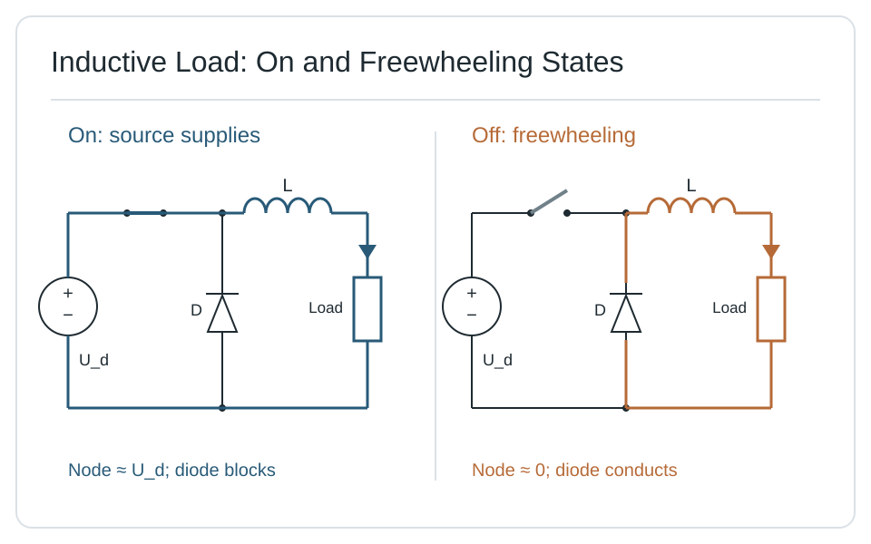

# M9-L2 – Power Semiconductors and Switching States {#L2}

**Course area:** M9 – Bachelor: Electrical Drives and Power Electronics

**Level:** Bachelor · Elective area

**Prerequisites:** [Diodes and rectification](M3-L2.md), [Transistors](M3-L3.md), [Energy storage components](M1-L5.md).

**Learning objective:** Analyse the switching states of an inductive load and estimate conduction, switching and thermal losses using a simplified model.

## Switching Rather than Linear Voltage Regulation {#S1}

A linear control element can sustain a substantial voltage and carry a substantial current at the same time. By contrast, an ideal power switch has two states: in the conducting state the voltage drop is zero, and in the blocking state the current is zero. Thus $p=ui$ is zero in both states. Energy flow can be controlled by varying the duration of the states. The switching frequency $f_s=1/T_s$ denotes the repetition rate of a complete switching cycle.

In the model, a diode conducts only in the forward direction; a controlled MOSFET can conduct current in both directions when its channel is on. Its body diode can provide a current path even when the gate is off. An IGBT is often combined with an antiparallel diode. The suitability of a device depends on blocking voltage, current, losses, temperature and switching behaviour, not solely on the type of device.

## Inductive Load and Freewheeling {#S2}

For an inductor, $u_L=L\,di/dt$. If the inductor current is positive, it cannot change abruptly at finite voltage. When the upper switch of a buck converter is turned off, the freewheeling diode initially carries the current. In the on state, the source supplies energy to the load and, where applicable, to the inductor; during freewheeling, the inductor releases stored energy.

{alt="Two switching states of the buck converter: source and inductor on the left, freewheeling path through the diode on the right."}

| State | Upper switch | Freewheeling diode at positive current | Node potential relative to ground (ideal) |
| --- | --- | --- | --- |
| On | conducting | blocking | $U_d$ |
| Off | blocking | conducting | $0$ |

When the inductor current ceases, freewheeling ends. A third state with zero inductor current is then required. In a synchronous half-bridge, an actively controlled switch replaces the freewheeling path. Both switches must not be turned on simultaneously (shoot-through); dead time separates their drive signals. During dead time, the node voltage depends on the current direction and diode path. Real inductive switching circuits also require protection against parasitic overvoltages. This module uses hypothetical circuits and simulations only; it is not a construction guide.

## Loss Models {#S3}

For a MOSFET with assumed constant on-resistance $R_\mathrm{DS,on}$, average conduction loss is obtained from the mean square current over the entire cycle. For approximately constant current $I$ and duty cycle $D$, $P_\mathrm{leit}\approx D R_\mathrm{DS,on}I^2$ (the subscript leit denotes conduction). For a diode with constant forward voltage drop $U_F$, the approximate loss is instead $P_D=(1-D)U_F I$.

Current and voltage overlap during real switching transitions. A simple model with linear overlap gives

$$
E_\mathrm{sw}\approx\frac12 U I(t_r+t_f),\qquad P_\mathrm{sw}=f_s E_\mathrm{sw}.
$$

Here, $t_r$ and $t_f$ represent the effective overlap durations. The equation assumes suitable current and voltage waveforms; actual switching energies in data sheets may differ. Gate drive, output capacitance and diode reverse recovery contribute additional losses unless already included in the switching energies used.

## Worked Example: Loss and Temperature {#S4}

A hypothetical buck converter operates with $U=48\,\mathrm V$, $I=10\,\mathrm A$, $D=0.5$, $f_s=20\,\mathrm{kHz}$, $R_\mathrm{DS,on}=20\,\mathrm{m}\Omega$, $U_F=0.8\,\mathrm V$ and $t_r+t_f=100\,\mathrm{ns}$. This gives $P_\mathrm{leit}=1\,\mathrm W$, $P_D=4\,\mathrm W$, $E_\mathrm{sw}=24\,\mathrm{\mu J}$ and $P_\mathrm{sw}=0.48\,\mathrm W$. Their sum is $5.48\,\mathrm W$.

Assuming useful output power of 240 W and only these losses, $\eta=240/(240+5.48)\approx97.77\,\%$. This separate power balance assumes a correspondingly adjusted input current. For the MOSFET alone, assuming total thermal resistance $R_\theta=25\,\mathrm{K/W}$ to a constant ambient temperature of $T_a=40\,^\circ\mathrm C$,

$$
T_j\approx T_a+R_\theta(P_\mathrm{leit}+P_\mathrm{sw})=77\,^\circ\mathrm C.
$$

The diode requires its own thermal balance. Mutual heating is not included in the model. Demonstrating compliance with temperature limits requires real data, cooling conditions and temperature dependencies. Under constant assumptions, doubling the switching frequency doubles switching losses, not conduction losses.

## Exercises with Solutions {#S5}

1. What is the sum of the three losses at 40 kHz with all other data unchanged?  
   **Solution** $1+4+0.96=5.96\,\mathrm W$.
2. Why can an open switching device be exposed to high voltage when there is no freewheeling path?  
   **Solution** A forced rapid change in current produces a high induced voltage according to $u_L=L\,di/dt$.
3. How does doubling the current affect conduction loss at constant $D$ and $R_\mathrm{DS,on}$?  
   **Solution** MOSFET conduction loss increases by a factor of four. Diode loss doubles in the constant voltage drop model.

**Further study:** [DC/DC converters and pulse-width modulation](M9-L3.md)

## Sources {#S6}

- [MIT OpenCourseWare, 6.334 Power Electronics, lecture notes](https://ocw.mit.edu/courses/6-334-power-electronics-spring-2007/pages/lecture-notes/) · (Chapters 1, 5, 11 and 13) · Last accessed: 2026-11-25
