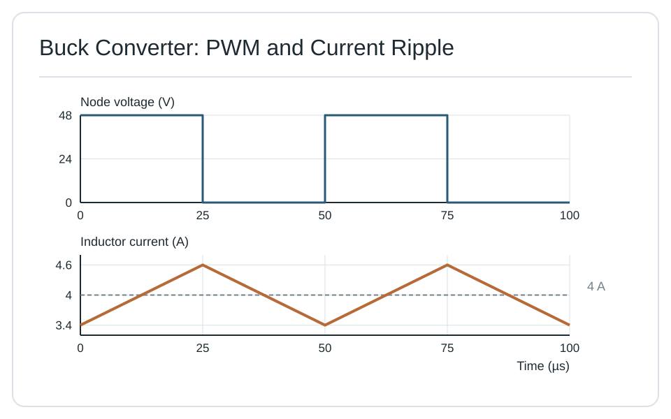

# M9-L3 – DC/DC Converters and Pulse-Width Modulation {#L3}

**Course area:** M9 – Bachelor: Electrical Drives and Power Electronics

**Level:** Bachelor · Elective area

**Prerequisites:** [Switching states](M9-L2.md), [Capacitors and inductors](M1-L5.md).

**Learning objective:** Derive voltage conversion ratios from periodic energy-storage balances and check current ripple and the validity of continuous conduction.

## Average Value and Periodic State {#S1}

Pulse-width modulation (PWM) changes the duration $DT_s$ of the on state, with $T_s$ fixed here. In periodic steady-state operation, the states of the storage elements are identical at the beginning and end of each period. This yields the volt-second and charge balances

$$
\int_0^{T_s}u_L(t)\,dt=0,\qquad \int_0^{T_s}i_C(t)\,dt=0.
$$

The first relation follows from $L\Delta i_L$, the second from $C\Delta u_C$. They also apply to non-sinusoidal signals. We consider idealised non-isolated converters in continuous conduction mode (CCM) and assume small output-voltage ripple. The output voltage can then be regarded as approximately constant during one period.

## Step-Down Converter (Buck) {#S2}

The switching states from [M9-L2](M9-L2.md) give $u_L=U_d-U_o$ during the on state and $u_L=-U_o$ during freewheeling. The volt-second balance gives

$$
D(U_d-U_o)+(1-D)(-U_o)=0,\qquad U_o=D U_d.
$$

In the idealised model, the inductor current rises and falls linearly. The peak-to-peak ripple is

$$
\Delta i_{L,pp}=\frac{(U_d-U_o)D}{Lf_s}.
$$

{alt="PWM node voltage of 48/0 V and triangular inductor current from 3.4 to 4.6 A at D = 0.5."}

Example: $U_d=48\,\mathrm V$, $D=0.5$, $L=500\,\mathrm{\mu H}$, $f_s=20\,\mathrm{kHz}$ and $R_L=6\,\Omega$. This gives $U_o=24\,\mathrm V$, $I_o=4\,\mathrm A$ and $\Delta i_{L,pp}=1.2\,\mathrm A$. The minimum inductor current is $3.4\,\mathrm A$; CCM is thus consistent with the assumptions. An ideal converter delivers $P_o=96\,\mathrm W$ and draws an average of $2\,\mathrm A$ at 48 V. The average input current is not identical to the average inductor current.

With $C=100\,\mathrm{\mu F}$ and an ideal capacitor, approximately $\Delta u_{o,pp}=\Delta i_{L,pp}/(8Cf_s)=75\,\mathrm{mV}$. The formula follows from the positive triangular area of the capacitor current $i_C=i_L-I_o$ over half a period. Equivalent series resistance (ESR) of the capacitor produces an additional ripple contribution.

## Step-Up Converter (Boost) {#S3}

When the lower switch is turned on, $U_d$ is applied across the inductor; the diode to the output blocks and the capacitor supplies the load. When the switch is turned off, the induced voltage adds to the source voltage; the diode carries inductor current to the output. In CCM, $u_L=U_d-U_o$ during the off state. Hence

$$
D U_d+(1-D)(U_d-U_o)=0,\qquad U_o=\frac{U_d}{1-D}.
$$

The ripple is $\Delta i_{L,pp}=U_dD/(Lf_s)$. For $U_d=24\,\mathrm V$, $D=0.5$, $L=500\,\mathrm{\mu H}$ and $f_s=20\,\mathrm{kHz}$, this gives $U_o=48\,\mathrm V$ and $\Delta i_{L,pp}=1.2\,\mathrm A$. For a load of 24 Ω, $I_o=2\,\mathrm A$ and, in the lossless model, $I_d=4\,\mathrm A$. Here the inductor current is also the input current. CCM is satisfied. The apparent increase in output voltage towards infinity as $D\to1$ is a limitation of the model: without an off state, periodic energy delivery through the diode cannot occur.

## Model Selection at the CCM Boundary {#S4}

For a buck converter with a freewheeling diode and resistive load, the CCM boundary occurs at $I_o=\Delta i_{L,pp}/2$. In the first example, this is $0.6\,\mathrm A$. The corresponding load resistance is $R_\mathrm{krit}=24/0.6=40\,\Omega$ (subscript krit denotes the critical value). With a higher load resistance, the CCM model would predict negative current. The diode prevents this; a load-dependent model with a zero-current interval (DCM) then applies. An actively bidirectional synchronous converter, by contrast, can allow negative current.

Switching ripple is not the same as the slower control error. An averaged converter model is often appropriate for control design; current peaks, losses and electromagnetic interference require closer examination of the switching waveforms.

## Exercises with Solutions {#S5}

1. What is $D$ for an ideal buck converter with 36 V input and 12 V output?  
   **Solution** $D=1/3$.
2. At a constant operating point, how do current ripple and the ideal average output voltage change if the inductance is doubled?  
   **Solution** Ripple is halved; the average remains unchanged as long as the CCM model applies.
3. An ideal boost converter delivers 36 V from a 12 V input. Determine $D$ and the average input current for $I_o=1\,\mathrm A$.  
   **Solution** $D=2/3$, $I_d=3\,\mathrm A$ from the power balance. Whether CCM applies must still be checked using $L$ and $f_s$.

**Further study:** [Inverters and machine power supply](M9-L4.md)

## Sources {#S6}

- [MIT OpenCourseWare, 6.334 Power Electronics, lecture notes](https://ocw.mit.edu/courses/6-334-power-electronics-spring-2007/pages/lecture-notes/) · (Chapters 5 and 8) · Last accessed: 2026-11-25
