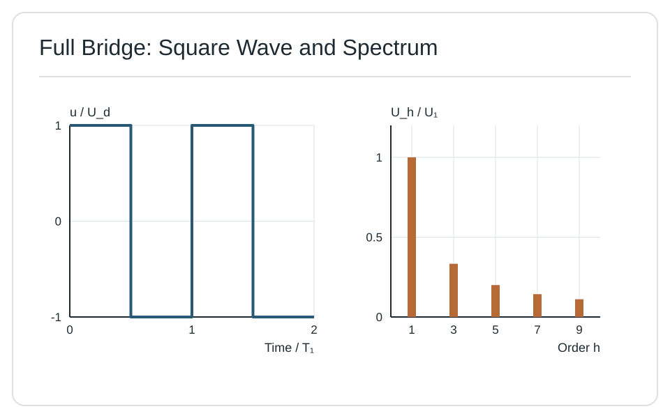

# M9-L4 – Inverters and Machine Supplies {#L4}

**Course area:** M9 – Bachelor: Electrical Drives and Power Electronics

**Level:** Bachelor · Elective

**Prerequisites:** [Three-phase systems](M7-L2.md), [Fourier analysis](M5-L3.md), [PWM](M9-L3.md).

**Learning objective:** Explain the output states of a full bridge, calculate the fundamental and harmonics, and assess the interaction between the converter and the machine.

## Single-phase voltage-source full bridge {#S1}

Two half bridges A and B are connected between the poles of an ideal DC link $U_d$. The load is connected between the midpoints. With $s_A,s_B\in\{0,1\}$, 1 denotes the upper switch being on and 0 the lower switch being on in the respective leg. Dead times are initially neglected. The load voltage is the difference between the two node potentials:

$$
u_{AB}=U_d(s_A-s_B).
$$

| $s_A$ | $s_B$ | $u_{AB}$ |
| --- | --- | --- |
| 1 | 0 | $+U_d$ |
| 0 | 1 | $-U_d$ |
| 0 | 0 | 0 |
| 1 | 1 | 0 |

The zero states do not mean that no load current flows. An inductive load can continue to carry current during these states. In either half bridge, simultaneous conduction of both switches is prohibited. Depending on the circuit, the antiparallel diodes or conducting channels allow current in both directions.

## Square-wave operation and harmonics {#S2}

In symmetrical square-wave operation, $u_{AB}$ alternates between $+U_d$ and $-U_d$ after each half of the fundamental period. For a waveform starting at $t=0$ with a positive value, the Fourier series is (except at discontinuities)

$$
u_{AB}(t)=\frac{4U_d}{\pi}\sum_{h=1,3,5,\ldots}\frac{\sin(h\omega_1t)}{h}.
$$

The fundamental has an RMS value of $U_1=4U_d/(\pi\sqrt{2})$, while the entire square wave has an RMS value of $U_d$. The total harmonic distortion of the voltage is $\mathrm{THD}=\sqrt{U_d^2-U_1^2}/U_1\approx48.34\,\%$. A higher total RMS value does not imply a higher usable fundamental component.

{alt="Square-wave load voltage of the full bridge and its normalised spectrum of odd harmonics."}

For an ideal RL load, $I_h=U_h/\sqrt{R^2+(h\omega_1 L)^2}$ applies to each harmonic. The inductance attenuates higher-order harmonic currents. Example: $U_d=48\,\mathrm V$, $f_1=50\,\mathrm{Hz}$, $R=4\,\Omega$, $L=20\,\mathrm{mH}$. The results are $U_1\approx43.22\,\mathrm V$, $I_1\approx5.80\,\mathrm A$, $U_3\approx14.41\,\mathrm V$ and $I_3\approx0.75\,\mathrm A$ (all RMS values). This is a passive model load, not yet a complete electrical machine with back EMF.

## Sinusoidal PWM and three-phase operation {#S3}

In bipolar sinusoidal PWM of a full bridge, a sinusoidal reference $m\sin(\omega_1t)$ is compared with a normalised triangular carrier. In the linear range $0\le m\le1$ and at a high carrier frequency, the local average of the load voltage is approximately $mU_d\sin(\omega_1t)$. The fundamental amplitude is approximately $mU_d$. Harmonic components occur, among other places, in groups around the carrier frequency and its multiples. The switching voltage itself remains pulsed.

A two-level three-phase inverter has three half bridges. With sinusoidal references displaced by 120 degrees, the same carrier-based modulation in its linear range yields a fundamental line-to-line voltage with an RMS value of

$$
U_{LL,1}\approx\frac{\sqrt{3}mU_d}{2\sqrt{2}}.
$$

With $U_d=300\,\mathrm V$ and $m=0.8$, the model gives approximately 147 V line-to-line RMS. The factor 1/2 arises here from the individual half bridge. It must not be erroneously introduced into the single-phase full-bridge formula. The fundamental limit depends on the modulation method; space-vector modulation can utilise the DC link differently.

## Effects on the machine {#S4}

In an AC machine, frequency and fundamental voltage affect flux, torque and rotational speed. For $p$ pole pairs, a synchronous rotating field has a speed of $n_s=60f_1/p$ in revolutions per minute. In an induction machine, the mechanical speed is slightly lower in normal motoring operation. The difference is described by slip. Simple V/f control keeps the fundamental voltage approximately proportional to frequency in the intermediate frequency range to maintain an approximately constant magnetic flux. At low frequencies, the resistive voltage drop becomes important. Once the voltage limit is reached, field weakening is often necessary. This is not a complete torque control method.

Pulsed voltages can cause additional copper and iron losses, torque ripple and insulation stress. In generating operation, the DC link must be able to absorb the returning energy or dissipate it in a controlled manner. A constant DC-link voltage in the model explicitly assumes that this energy can be absorbed.

## Exercises with solutions {#S5}

1. An ideal full bridge with $U_d=60\,\mathrm V$ operates with bipolar sinusoidal modulation at $m=0.7$. What is the approximate RMS value of the fundamental?  
   **Solution** $42/\sqrt{2}\approx29.7\,\mathrm V$.
2. A rotating field is produced at 50 Hz in a machine with two pole pairs. What is the synchronous speed?  
   **Solution** $1500\,\mathrm{min^{-1}}$.
3. Why is the current in an inductive load often less distorted than the switching voltage?  
   **Solution** The inductive reactance increases with frequency and thus limits higher-order harmonic currents.

**Further reading:** [Simulation of a drive system](M9-L5.md)

## Sources {#S6}

- [MIT OpenCourseWare, 6.334 Power Electronics, lecture notes](https://ocw.mit.edu/courses/6-334-power-electronics-spring-2007/pages/lecture-notes/) · (Chapters 3, 9 and 15) · Last accessed: 2026-11-25
- [MIT OpenCourseWare, 6.685 Electric Machines, course notes](https://ocw.mit.edu/courses/6-685-electric-machines-fall-2013/pages/course-notes/) · (Chapters 4, 8 and 10) · Last accessed: 2026-11-25
