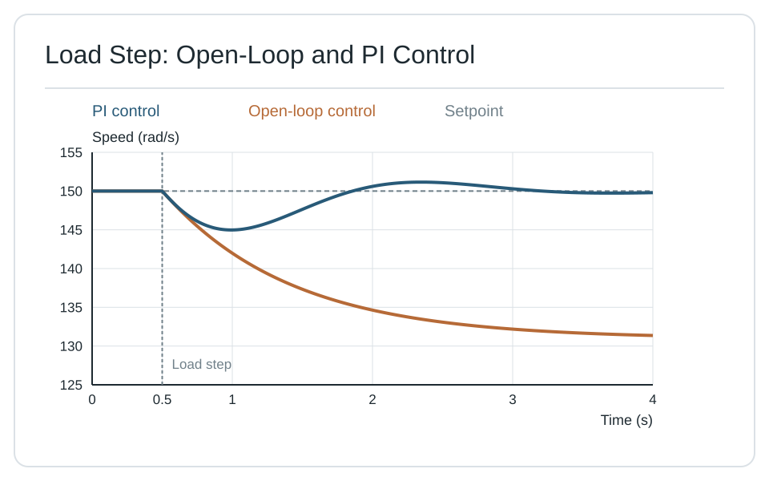

# M9-L5 – Simulation of a Drive System {#L5}

**Course area:** M9 – Bachelor: Electrical Drives and Power Electronics

**Level:** Bachelor · Elective

**Prerequisites:** [Motor operating point](M9-L1.md), [PWM](M9-L3.md), [M6 – Measurement and Introduction to Control](pages/study-path.md#S9), [Model validation](M8-L4.md).

**Learning objective:** Simulate a coupled electrical and mechanical model with a load step, compare open-loop control with PI feedback control, and check the energy balance and dependence on step size.

## Averaged model and experimental question {#S1}

The switching period of a converter can be much shorter than the mechanical response time. In the specified positive-current range, we replace an ideal synchronous buck converter with the average motor voltage $u=D U_d$, where $0\le D\le1$. The DC motor from M9-L1 is described by the coupled differential equations

$$
L\dot i=u-Ri-k\omega,\qquad J\dot\omega=ki-B\omega-M_L
$$

In this approximation, the converter has no losses of its own or additional energy storage elements. Current and speed dynamics are retained, but PWM ripple is not. We investigate a step in the external load torque, starting from a known steady state. The parameters are fictitious and do not describe a particular commercial product.

| Parameter | Value | Parameter | Value |
| --- | --- | --- | --- |
| $U_d$ | 24 V | $R$ | 0.5 Ω |
| $L$ | 20 mH | $J$ | 0.02 kg m² |
| $k$ | 0.1 Nm/A or Vs/rad | $B$ | 0.001 Nms/rad |
| $M_L$ before/after 0.5 s | 0.4 / 0.8 Nm | $\omega_\mathrm{soll}$ | 150 rad/s |

In the initial state, $i=(0.4+B\cdot150)/k=5.5\,\mathrm A$ and $u=Ri+k\omega=17.75\,\mathrm V$. Without feedback control, this manipulated variable remains constant. After the load step, the steady-state calculation predicts $\omega_\infty=(ku/R-0.8)/(B+k^2/R)\approx131.36\,\mathrm{rad/s}$. With ideal speed control at 150 rad/s, however, $i=9.5\,\mathrm A$ and $u=19.75\,\mathrm V$ are required. Both voltages lie within the model limit.

## PI control and saturation {#S2}

We compare open-loop voltage control with proportional-integral speed control. For the error $e=\omega_\mathrm{soll}-\omega$ (soll denotes the setpoint) and the integrator state $z$, we have

$$
u^*=K_Pe+z,\qquad \dot z=K_Ie,\qquad u=\operatorname{clip}(u^*,0,U_d).
$$

$K_P=0.12\,\mathrm{V\,s/rad}$ and $K_I=0.6\,\mathrm{V/rad}$ are model parameters; the integrator is initialised at 17.75 V. The simulation thus starts without an artificial voltage step. During saturation, integration continues only if the error drives the unconstrained manipulated variable back into the permitted range (conditional integration to prevent windup). The controller assumes ideal speed measurement. A current limit and an inner current control loop would be typical additional requirements for real drives.

## Reproducible Python experiment {#S3}

The states are advanced simultaneously from the values at the respective time step using the explicit Euler method. All energy terms use the same old state values and the same step size; the residual balance serves as a numerical check.

```python

def simulate(h, regulated):
    R, L, k, J, B = 0.5, 0.02, 0.1, 0.02, 0.001
    i, w, z = 5.5, 150.0, 17.75
    energy_in = energy_out = 0.0
    storage0 = L*i*i/2 + J*w*w/2
    min_w, max_i = w, i
    for n in range(round(4/h)):
        t = n*h
        load = 0.4 if t < 0.5 else 0.8
        error = 150.0 - w
        raw = z + 0.12*error if regulated else 17.75
        u = max(0.0, min(24.0, raw))
        if regulated and (0 < raw < 24 or
                          raw >= 24 and error < 0 or
                          raw <= 0 and error > 0):
            z += h*0.6*error
        di = (u - R*i - k*w)/L
        dw = (k*i - B*w - load)/J
        energy_in += h*u*i
        energy_out += h*(R*i*i + B*w*w + load*w)
        i += h*di
        w += h*dw
        min_w, max_i = min(min_w, w), max(max_i, i)
    storage1 = L*i*i/2 + J*w*w/2
    residual = energy_in - energy_out - (storage1-storage0)
    return w, i, min_w, max_i, residual


for h in (0.001, 0.0005, 0.00025):
    for regulated in (False, True):
        values = simulate(h, regulated)
        print(h, regulated, *(round(x, 6) for x in values))
```

| Case, $h=0.0005\,\mathrm s$ | $\omega(4\,\mathrm s)$ in rad/s | $i(4\,\mathrm s)$ in A | Minimum speed in rad/s | Maximum current in A |
| --- | ---: | ---: | ---: | ---: |
| Open-loop | 131.364 | 9.223 | 131.364 | 9.223 |
| PI | 149.795 | 9.567 | 144.980 | 10.989 |

{alt="Speed response after the load step at 0.5 s: open-loop control and PI control compared with the setpoint of 150 rad/s."}

The PI controller limits the drop in speed and approaches the setpoint. It can require a higher peak current than open-loop control. After four seconds, the current in the PI case is still slightly above its steady-state target. A snapshot does not establish that all states have already reached steady state.

## Energy balance, convergence and acceptance {#S4}

Multiplying the electrical equation by $i$ and the mechanical equation by $\omega$, the conversion terms $ki\omega$ cancel in the sum:

$$
ui=Ri^2+B\omega^2+M_L\omega+
\frac{d}{dt}\left(\frac12Li^2+\frac12J\omega^2\right).
$$

After integration, this means that input energy minus losses minus load work minus the change in stored energy should equal zero. With explicit Euler integration, a small numerical balance residual arises. The following table gives its magnitude for the model.

| Step size in ms | Open-loop: residual magnitude in J | PI: residual magnitude in J | PI: speed at 4 s in rad/s |
| ---: | ---: | ---: | ---: |
| 1 | 0.002057 | 0.001518 | 149.794389 |
| 0.5 | 0.001028 | 0.000757 | 149.794906 |
| 0.25 | 0.000514 | 0.000378 | 149.795165 |

The approximately halved residual magnitudes are consistent with the first-order method used. The final speeds converge towards one another. A small balance residual checks the discrete calculation, but does not prove that the machine model is realistic.

We choose the following reproducible acceptance criteria for this modelling task: final speed error in the PI case no greater than 0.3 rad/s; maximum current in the PI case below 12 A; magnitude of the energy residual below 0.01 J; final speed difference between the two finer step sizes below 0.01 rad/s. All four criteria are met for the stated test cases. The 12 A value is a fictitious test threshold, not an implemented current limit or a permissible component load. Even a passed test does not justify immediate hardware construction. Switching losses, temperature, sensor delay, current limiting and the real mechanical load must be modelled and checked separately.

## Exercises with solutions {#S5}

1. Determine the steady-state manipulated voltage at 150 rad/s and $M_L=1.6\,\mathrm{N\,m}$. Is it achievable in the model?  
   **Solution** $i=(1.6+0.15)/0.1=17.5\,\mathrm A$, $u=0.5\cdot17.5+15=23.75\,\mathrm V$. The voltage is sufficient in the model, but the fictitious 12 A threshold is exceeded in steady state.
2. How much mechanical energy is stored at 150 rad/s?  
   **Solution** $J\omega^2/2=225\,\mathrm J$.
3. Extend the experiment to include a load step to 2 Nm. Can the controller achieve 150 rad/s in steady state?  
   **Solution** $i=21.5\,\mathrm A$, $u=25.75\,\mathrm V$ would be required. This exceeds 24 V. At saturation, the modelled steady-state speed is $(4.8-2)/0.021\approx133.33\,\mathrm{rad/s}$. The integrator must not grow without bound.

**Completion:** Record the operating point, converter assumptions, load step, numerical balance and at least one model limitation in a brief model description. [Study pathway](pages/study-path.md)

## Sources {#S6}

- [MIT OpenCourseWare, 6.685 Electric Machines, course notes](https://ocw.mit.edu/courses/6-685-electric-machines-fall-2013/pages/course-notes/) · (Chapter 6) · Last accessed: 2026-11-25
- [MIT OpenCourseWare, 6.334 Power Electronics, lecture notes](https://ocw.mit.edu/courses/6-334-power-electronics-spring-2007/pages/lecture-notes/) · (Chapter 8) · Last accessed: 2026-11-25
- [Åström/Murray – Feedback Systems, Second Edition](https://fbswiki.org/wiki/index.php/Feedback_Systems%3A_An_Introduction_for_Scientists_and_Engineers) · Chapter index 3, 5, 6, 9 and 11: modeling, dynamics, linear systems, transfer functions and PID; linked chapters not re-reviewed. · Last accessed: 2026-11-25
